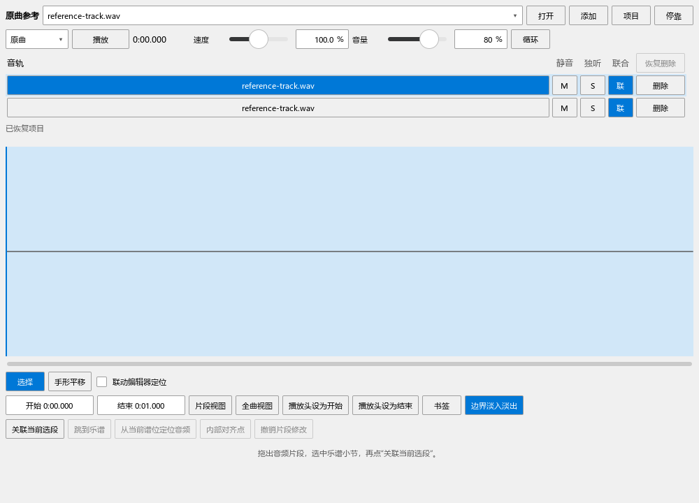
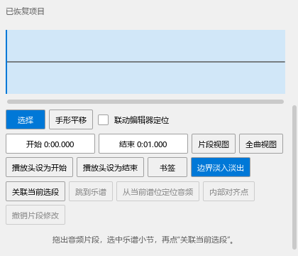
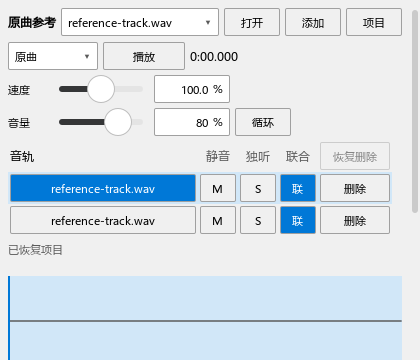
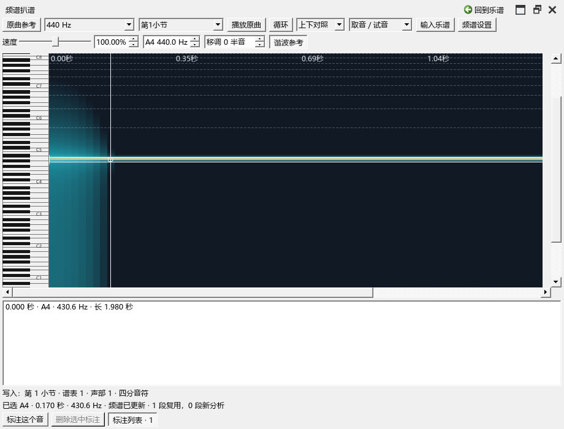

# 原曲播放与频谱空间检查

日期：2026-10-20。

## 当前程序与上一批

0.73.0 已更新到原安装目录，主程序 SHA256 为 `425cd26b2713d82e3319755f9f4956112fb6e745b25f5062902c1ca239b7bc09`。VST 辅助程序、界面资源和图文说明同步更新，个人配置保留。源码为本体 `ec901d355`、插件 `3cb4496`。

本批主程序已编译为 0.74.0，并更新到相同安装目录。SHA256 为 `28f1a06fbfa20723c6cefe192d06002f8786140a0b63dba84f61cb1684b59319`。界面与说明随最后一轮检查同步。

## 本批的操作过程

使用项目自带钢琴谱和生成的四秒 WAV，从原曲面板打开、关联，再点击“播放／停止”。检查三种跟随方式的反复操作、准备时取消、自然结束后再开始。记录乐谱位置、音频输出位置与按钮状态。

三种跟随方式各进行三次开始／停止，随后检查准备时取消、自然结束、再次播放。按钮文字、乐谱与音频状态、播放位置均对应；结束时按正常顺序释放面板，检查程序正常退出。使用原生演奏器及受控输出驱动，核对生成的 MIDI 起音与音频输出位置。日志：`P2/out/usability-074f-reference-panel-performanceeditor-run.txt`，3 项通过（含初始化与结束）。

频谱原标注列表固定在 28–76 像素，不能独立调高。现增加开关及分隔条，空列表收起。实际拖动分隔条后，列表增高；收起后频谱获得更多空间，重新展开后列表可见，设置写入个人配置。标注、输入 A4、快捷键撤销重做、保存 MSCZ 并重新读取的内容核对通过。

## 截图中发现并处理的问题

- 音轨勾选框高于 32 像素的行，被上下裁切；列头与按钮错位。改为紧凑的 M／S／联按钮，统一列宽和行内间距。
- 速度、音量数值框高于其它按钮。改用相同主题控件，高度统一为 28 像素。
- 音轨开关替换列表后，旧按钮继续引用失效的行。改为由面板统一修改音轨，检查静音、独听及参加播放的连续切换。
- 原曲面板高度不足时，上方操作会挤压下面内容。面板增加整体滚动，按钮按作用分组换行；窄窗口检查关联按钮可到达。
- 最后复查发现自定义滚动条未沿右边展开。恢复 Qt 自带滚动条的位置处理，并直接检查其尺寸、屏幕位置及鼠标点击后的滚动。

频谱、音轨、首次打开、控件换行和多面板全屏共五项操作，连同初始化与结束共 7 项通过；检查日志保存在 `P2/out/usability-074h-panels-pluginhost.txt`。滚动条尺寸、屏幕位置与实际点击另外通过，含初始化与结束共 3 项，日志为 `P2/out/usability-074i-tracks-pluginhost.txt`。最终截图中的频谱、列表、开关、数值框与窄窗操作已逐张查看。

这些检查使用独立测试谱、生成的音频和隔离设置。多轨真实素材、声卡听感与实时键盘的长时间使用，继续列在完整返工记录中。

完整操作见[频谱与标注列表](REFERENCE_SPECTRUM_074_GUIDE.md)。
