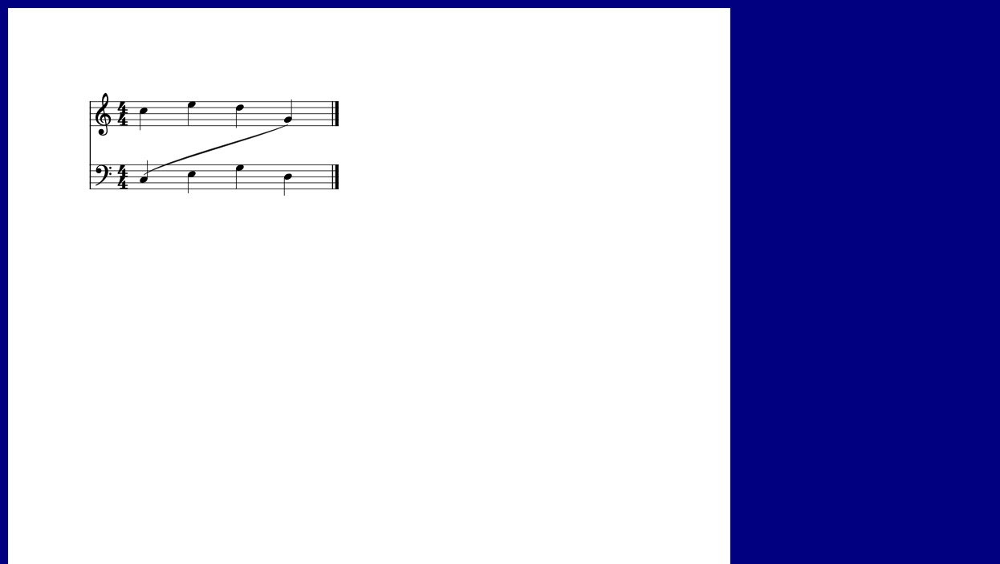
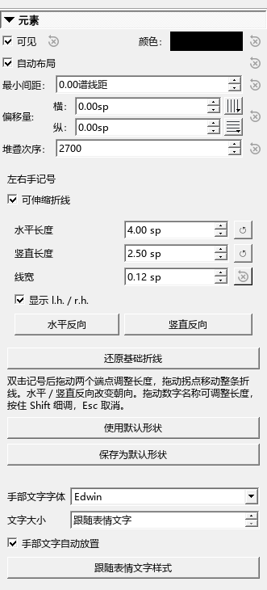

# 圆滑线、渐慢线与分手记号

## 让圆滑线从两边绕过音符

选中圆滑线，在检视器勾选“自由曲线”，然后打开“自动避让音符”。“起点位置”和“终点位置”各有“自动、音符上方、音符下方”三个选项。

例如，前半从上方绕行、后半从下方绕行：在中间添加一个点，分别设置前后区段的经过方向，再把起点设为“音符上方”、终点设为“音符下方”。中间点和切线手柄可以继续拖动。“整理这一段”会重新调整附近的曲线。跨谱表时，避让同时考虑两个谱表的实际音符和符杠。

一次调整可以用 Ctrl+Z 撤销。端点选择和中间点随乐谱保存；重新打开后继续调整。

## 添加跨行的 rit.

在谱面选中要渐慢的范围，从速度面板加入“渐慢 rit.（可播放）”。结束位置选到下一小节开头时，线的末端落在上一小节末尾；跨行的部分按各自谱行显示。检视器仍可修改文字、线条和最后速度。

载入工作区时会合并本项目重复生成的 rit. 与 a tempo 入口。自己制作并命名的其它记号继续保留。

## 添加和调整分手记号

选中实际要指向的音，从指法面板添加对应方向。开始记号放在音前，结束记号放在音后。新形状的短横默认 0.6 谱间，竖段默认 2.5 谱间。

选中记号后，拖端点改变线长，拖拐角移动折线。开启手部文字后，还会出现文字自己的拖动点；拖它可移动 r.h. 或 l.h.。检视器可分别设置文字字体、字号和自动放置。字号为“跟随表情文字”时，采用本谱的表情文字样式。

“保存为默认形状”会同步四种方向的长度，开始与结束互为镜像。原谱中已经保存的形状继续使用原来的设置；选中后可使用新默认形状。

## 检查记录

14 组布局和操作检查通过，覆盖端点位置、跨谱表、跨行、拖点、保存重开、四种分手方向、旧面板读取与渐慢线。补充检查实际拖动文字控制点：文字移动、折线位置保持、一次撤销恢复。rit. 恰好结束在谱行末尾时，线段数量和终点位置均正确。

跨谱表曲线：

手部文字设置：

