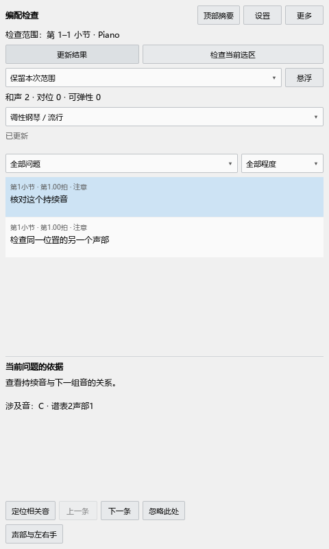

# 和弦显示与编配检查

## 调整谱面上的和弦

停止播放，双击要修改的和弦记号，右侧会打开这一段的修改区。范围两端的手柄用于改变起止位置；拖动记号主体可以移动文字。

一次拖动对应一次撤销。按 Ctrl+Z 恢复，按重做快捷键再次采用修改；谱面与面板同时更新。人工指定的和弦、范围和文字位置随 MSCZ 保存。原有分析文件仍可导入导出。

结束位置是下一小节第一拍时，结束手柄画在上一小节末尾。记号的横向位置继续对应和弦开始处。

和弦根音、斜杠和低音使用同一条文字底线。级数与和弦主体对齐，转位数字显示为上下标。手动选择低音后，和弦名称、级数和转位说明一起更新。“实际音高”可以折叠，折叠状态会记住。

## 重新检查全谱或选段

打开编配检查，在范围下拉框选择：

- “当前选区／小节”：采用当前选区，没有范围选择时采用当前小节。
- “钢琴全谱”：检查所在钢琴声部组的完整乐谱。
- “保留本次范围”：继续检查刚才那一段，方便边改边看。

点“更新结果”开始。“检查当前选区”可直接改查当前选中的范围。分析后，点其它音或空白处继续编辑，列表保留。选择“全部问题、和声、对位、可弹性”及严重程度，可以筛选已有结果。

点列表中的问题定位；双击可在谱旁查看依据。浮动说明优先放到目标小节外侧。相关音仍可选中和编辑。“定位相关音”再次显示位置，“忽略此处”记住这一处提示，“声部与左右手”用于校正分手与声部角色。

## 怎样理解低音排列提示

“低音排列可能较浑浊”会写明具体两音、音程和参考音区。例如，大二度的参考低端音为 E♭3，五度的参考低端音为 B♭1。音越低，紧密排列的声音越容易混在一起。

检查区分同时按下、先后起音和踏板留下的声音。先试听提示的两音；觉得声音不够清晰时，可以拉开排列或改变其中一音的八度。“设置 → 低音程参考表…”可以按自己的听感调整各音程的参考低端音。

参考表来自[好和弦的低音程限制说明及音程图](https://nicechord.com/post/low-interval-limit/)。同音和八度单独处理，九度、十度按实际距离检查。

大跨度会先检查明确属于同一只手的新音，再考虑旧音是否需要继续按住，以及踏板能否帮助松手。详情指出具体音和跨度。遇到左右手分配需要调整时，选中这些音，在“声部与左右手”中校正后更新结果。

## 本轮界面与操作检查

使用真实窗口完成范围拖动、位置拖动、撤销、重做、分类、谱旁提示和保存重开。插件面板 14 项及 P1 操作 49 项通过。速度面板保留当前对象，重复整理后仍可添加渐慢。
