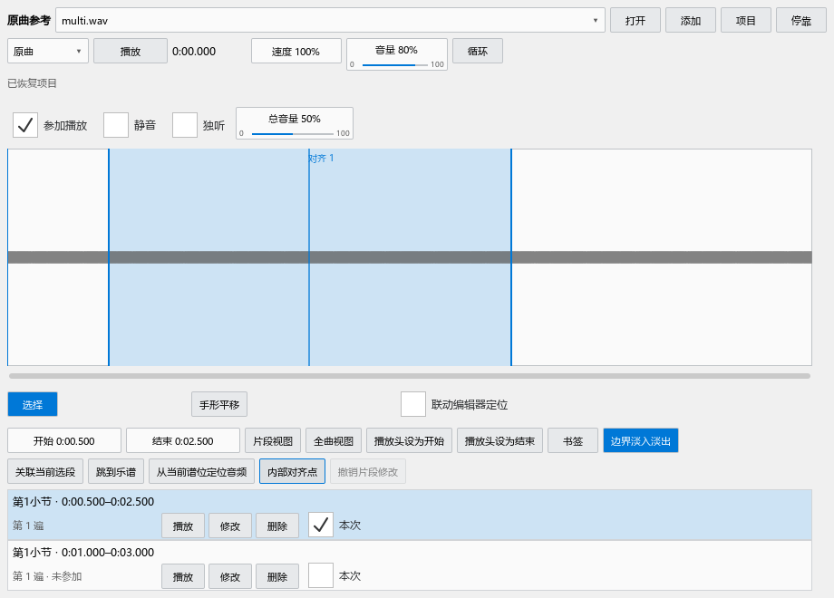

# 原曲参考：打开、关联和一起播放

## 打开播放器

从“视图 → 原曲参考”打开。0.63 起，安装包统一使用这个内置入口。可以拖到下方、侧边或悬浮；再次点击菜单可以隐藏，再次打开会回到原位置。

把 WAV、MP3、FLAC 拖到波形区。多个文件分别成为音轨；也可以点“打开”选择文件。轨道左侧的名称用于切换当前查看的音频。音量、静音、独听及参加播放设置分别作用于各轨。

## 选一个片段

1. 单击波形，把播放位置移到那里。
2. 在波形上直接拖动，选出片段。两端手柄用于微调；时间数字也可以直接输入。
3. 在播放对象选择“原曲”，点“播放”试听；开启循环后反复播放这一段。
4. 底部时间滚动条可以左右浏览。选择“手形平移”后拖动波形，或按鼠标中键拖动。
5. 在鼠标所在位置滚轮缩放。“全曲视图”看完整录音，“片段视图”放大当前范围。

播放器获得焦点后，空格播放或暂停。谱面获得焦点后，空格播放乐谱。波形上按住空格拖动也可以平移时间轴。

## 把片段与乐谱对应

例如，把录音 35–43 秒与第 9–12 小节对应：

1. 在乐谱选第 9–12 小节。
2. 在波形选出 35–43 秒。
3. 点“关联当前选段”。关联列表会显示录音时间和乐谱范围。
4. 点击关联，可分别“跳到乐谱”“跳到音频”或播放该片段。跳到乐谱后，短时位置提示会标出目标。

同一音频片段可以对应多个谱段；同一谱段也可以使用人声、伴奏等多条音频。每条关联可以选择是否“本次使用”。

“内部对齐点”表示录音中的这一刻对应谱子的这一拍。当片段中间逐渐错开时，先选择谱面的一个音，再把录音定位到相应时刻，点“添加内部对齐点”。列表可查看和删除这些对应。

## 一起播放

选中关联，选择本次参加播放的轨道，把播放对象切为“一起播放”，再点“播放”。播放方式包括：

- “开头对齐后各自播放”：一起开始，音频和乐谱分别保持原速度。
- “跟随乐谱”：音频按谱内速度和内部对齐点调整。
- “跟随选定音频”：以所选音频为节奏依据，乐谱与其它音频跟随。

停止后可直接再次播放。“原曲”只播放参加的音轨；“乐谱”播放对应谱段。声音输出设备在软件音频设置中选择。

“联动编辑器定位”默认关闭。开启后，选中的关联负责把谱面选音与录音位置互相对应，适合边听原曲边修改这一段。

## 保存和移动文件

音轨路径、片段、关联、内部对齐点和音轨设置随 MSCZ 保存。保存乐谱后再打开，面板恢复这份乐谱的参考材料。音频文件放在乐谱旁边时，两者一起移动后会优先按相对路径寻找。

找不到音频时，原关联保留，轨道显示“重新定位文件”。点击后选择新路径。原有 JSON 项目仍可导入和另存。

普通 MuseScore 可打开完整乐谱。参考信息保存在标准元数据中；音频文件仍单独存放。

## 实际界面

本轮通过 50 项 P1 操作与 14 项插件窗口检查，包含菜单显隐、同一面板入口、标准元数据保存重开、文件重新寻找、多轨恢复、波形拖选和空格播放。
