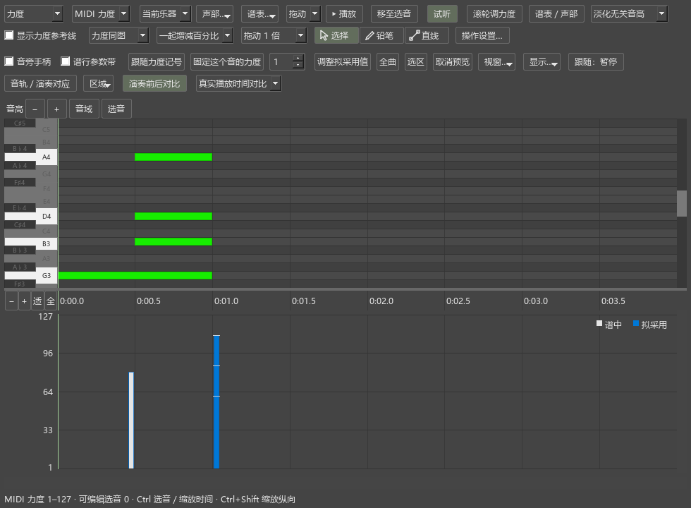

# 演奏力度：对比、试听和使用

## 力度参考线是什么

这条虚线表示谱上的 p、mf、渐强渐弱在这一拍给出的力度。例如右手 mf 为 80、左手 p 为 48，两条线分别显示在 80 和 48。按相对方式保存的音，还会结合重音等演奏处理计算播放力度；指向对比柱可以一起查看。

“MIDI力度”显示 1–127 的实际数值；“相对%”显示各音相对自身演奏基础力度的增减。两个谱表都是 0% 时，分别沿用各自力度。想同时观察高低谱表的差别，选择“MIDI力度”，勾选“显示力度参考线”。“力度同图／按谱表分区”可以切换排列。

## 从 MIDI 采用一段演奏力度

1. 在谱面选中要调整的一段，打开“演奏表达”。
2. 点“导入MIDI”，选择演奏文件。全曲 MIDI 会先寻找所选谱段，再显示对应结果。实时演奏可用“录制／停止”。
3. 对应完成后，在演奏编辑器查看“演奏前后对比”。默认“同音对比”：中性色柱是谱中力度，强调色柱是拟采用力度；同一个音的两根柱排在一起。
4. 新导入默认“采用演奏力度的比例”为 100%。例如原值 80、导入值 100，100%采用 100，50%采用约 90。
5. 选择“逐音固定力度”或“继续跟随力度记号”。
6. 选择应用范围：“选中音／当前选段／全部已对应范围”，点击“使用力度”。一次应用可以用 Ctrl+Z 撤销。

已经使用的音退出待处理对比，普通编辑器显示保存后的结果。项目中剩余的匹配仍可继续使用。

## 两种保存方式

**逐音固定力度**是新材料的默认方式。例如导入值为 100，这个音保存为 MIDI 力度 100。谱上的 p、mf 仍然显示，其它音继续采用各自设置。

**继续跟随力度记号**把目标值换算成这个音的相对增减。例如当前位置给出的基础力度为 80，目标为 100，保存约 +25%。以后修改这一处的力度记号或渐强渐弱，这个音会跟着变化。相对百分比按整数保存，界面会显示取整后的结果。

已有项目恢复自己的比例和保存设置。“保留各音原保存方式”可继续使用先前的相对或固定方式。

## 查看速度变化

“同音对比”把原、新力度对齐到同一谱位，方便判断每个音变了多少。

选择“真实播放时间对比”后，时间尺显示秒数，两种效果按各自速度排列。慢下来的候选会展开到更后面。鼠标缩放、水平浏览和选音沿用编辑器的操作。对应轨中保留导入 MIDI 的原始演奏时间。

点击中性色柱选择谱中音；拖动强调色柱调整拟采用力度。有选音时，铅笔和直线只调整所选音。声部与谱表筛选共同作用于两边。

## 参考线、试听和恢复

对比时默认收起力度参考线，方便看清两根柱；可勾选“显示力度参考线”。普通编辑和对比各自记住这个开关。

点“谱中效果”或“拟采用效果”试听，界面显示当前播放对象。切换时保持当前小节、拍位和反复次数。试听、绘图和“使用力度”采用同一份候选。

首次使用力度前，原值随音符保存。通过“恢复应用前力度”按选音、选段或全曲恢复；保存 MSCZ 后重新打开仍可恢复。人工对应、原始 MIDI 和比例等项目设置可在演奏表达项目中保存。

## 对比界面

图中同一和弦各音的顶部有细标记，便于查看同时音的不同力度。点击原值选音，拖动蓝色柱修改候选。

## 本轮检查

演奏编辑器 64 项、P1 操作 50 项、插件窗口 14 项通过。后续的光标、旧速度模板和项目设置修正，另通过 8 项编辑操作、5 项面板操作以及三份界面脚本检查。传统匹配、分范围应用、方案和编配规则脚本均通过；力度设置检查覆盖新项目、旧比例及两种保存方式。
