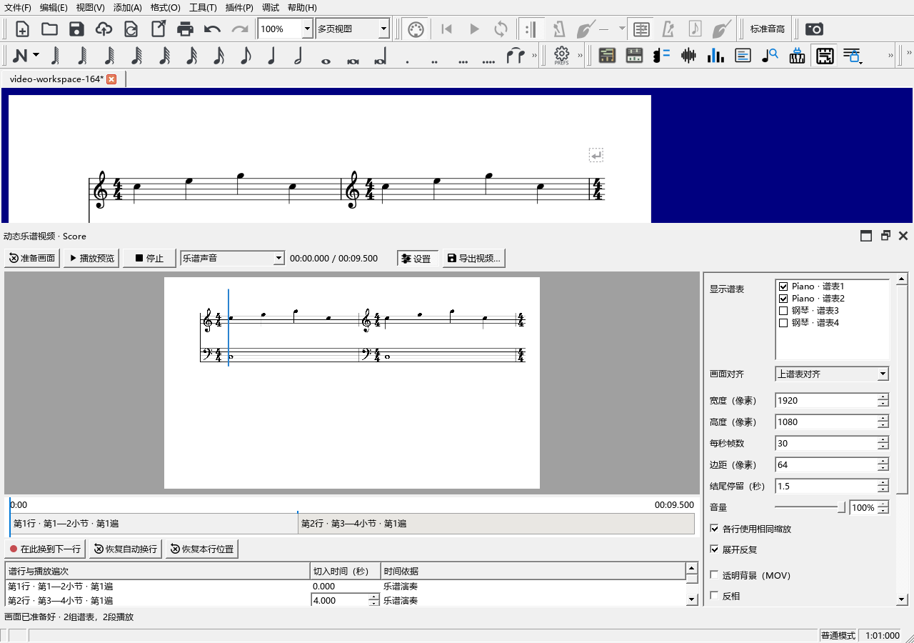

# 本轮功能重新审视与0.165修复

这次重新检查0.159—0.164涉及的操作、混响、多轨MIDI、演奏起止、频谱、原曲控件、动态乐谱和AI说明。先从用户要完成的事情检查入口、当前对象、播放、修改和保存，沿用已经核对过的演奏事件与文件结果。

## 动态乐谱为什么找不到

用户在0.164发布程序中打开“工具”，确实没有动态乐谱。问题发生在软件启动和旧工作区恢复：

- 动作创建时，全局主窗口尚未赋值，创建出的入口没有归入实际主窗口。后续查找又创建了另一个动作。
- 旧工作区恢复自己的菜单，动态乐谱缺少工作区登记和恢复后的补入。
- 编曲工具栏建立得更早，查找不到动作便跳过了胶片按钮。

0.165把动作明确交给正在建立的主窗口。菜单与工具栏使用同一动作；恢复旧菜单后补回“动态乐谱视频…”，多次恢复保持一项。

上轮检查直接建立了一个菜单和面板，绕过了这些步骤。本次将这一检查改为读取完整启动产生的菜单与工具栏，再载入缺少视频入口的旧菜单，最后打开制作面板、切换视图和关闭。

修复后，启动菜单与工具栏指向同一动作；恢复旧菜单及连续更新后保持一项。已从该动作打开面板，自动准备谱行，切到编曲再返回后处理，面板恢复原高度，关闭后鼠标正常释放。查看了这次完整窗口的实际截图：

## 从哪里开始使用

打开乐谱 → **工具 → 动态乐谱视频…** → 右侧选择谱表 → 顶部选择声音 → **播放预览** → **导出视频…**。

首次打开会准备画面。钢琴通常勾选同一件乐器的两个谱表；三、四谱表也可以组合。普通背景导出MP4，透明背景导出MOV。换行时间、画面位置和外观随乐谱保存，可撤销。完整步骤见[制作动态乐谱](SCORE_VIDEO_164_GUIDE.md)。

## 本轮其它功能的审视

| 编号 | 使用过程与本次核对 | 操作说明与已有具体结果 |
|---|---|---|
| N1 | Alt+Q的按下、自动重复与真实松开分别处理；Home根据普通播放、试听、循环选择起点；倚音额外间距进入原生保存和撤销。保留当前快捷键和默认间距。 | [操作](PLAYBACK_159_GUIDE.md)、[按键与倚音](PLAYBACK_159_CHECKS.md) |
| N2 | 混音器CC91控制发送，合成器Zita1产生混响；普通SF2和独立乐器效果路径读取同一发送量。默认“无效果”解释了新谱滑块无尾音的情况。 | [开启混响](PLAYBACK_159_GUIDE.md#让kawai等sf2的混响滑块起作用)、[Kawai输出](PLAYBACK_159_CHECKS.md#kawai-sf2混响) |
| N3 | 批准的五项上游修复与57项提交报告对应；后续改动仍按报告区分。 | [上游报告](UPSTREAM_159_REPORT.md) |
| N4 | 音轨入口会在旧工作区恢复后补回。导入读取完成后加入发起操作的乐谱；当前轨、删除恢复和异步任务分别记录。临时轨可编辑、试听、生成写谱草稿；原始MIDI、修改和对齐随MSCZ保存。说明删除三份重复截图。 | [完整操作](MIDI_TRACKS_160_GUIDE.md)、[连续编辑与保存](MIDI_TRACKS_160_CHECKS.md) |
| N5 | “演奏调整”首次关闭；开启后修改真实起音和松键。手势固定目标，试听和MIDI导出读取同一份演奏结果。关掉工具恢复普通选音，原时值继续保留。 | [拖动与恢复](PERFORMANCE_TIMING_161_GUIDE.md)、[实际事件及重开](PERFORMANCE_TIMING_161_CHECKS.md) |
| N6 | 当前录音、分析任务和显示结果按音轨身份更新。固定时间块保存全音域分析；缩放、调律、换色复用结果。设置页限制内容宽度，时间轴、键盘、倍频和MIDI对照共用位置换算。 | [听辨与写谱](SPECTRUM_162_GUIDE.md)、[缓存与显示](SPECTRUM_162_CHECKS.md) |
| N7 | 谱面控件直接播放／停止，箭头选择片段。显示位置与实际范围分别保存；多轨、重复播放、显隐和撤销共用原曲会话。 | [谱面播放](REFERENCE_CONTROLS_163_GUIDE.md)、[范围及连续停止](REFERENCE_CONTROLS_163_CHECKS.md) |
| N8 | 本次修复完整启动、菜单恢复和工具栏。谱行准备、声音、时间、MP4和透明MOV沿用原有实现与已生成文件；逐项具体结果保留，旧记录补记入口遗漏。 | [操作](SCORE_VIDEO_164_GUIDE.md)、[谱行与视频](SCORE_VIDEO_164_CHECKS.md) |
| N9 | 当前可调用的44项MCP工具与报告清单相符。报告分别说明内存谱数据、MuseScore原图和简化图的用途；本轮新增MIDI轨道和视频的专用AI操作列入后续数据接口工作。 | [工具与数据流程](AI_CONNECTION_IMPLEMENTATION_159.md) |

本次查看已有MIDI、频谱与视频界面截图，核对操作分组、控件宽度、对齐和画布空间；没有重设原来好用的布局与颜色。针对入口错误补查完整启动和旧菜单恢复，已有算法、声音及保存检查按实际适用范围引用。

## 接下来按什么顺序推进

1. 接上实体MIDI键盘后核对录制、停止、对应和采用；结合Mi Monitor听代表性钢琴片段的踏板、混响及多轨效果。
2. 按现有AI报告继续讨论数据组织、任务范围与原生谱图；补充外部MIDI、音频关联和视频的查询及操作。
3. 后续构想包括自动音符候选、音频和弦、自由演奏转谱和更完整的雕版、视频后处理。淡化非旋律音量继续保留待讨论。

本次发布定位：`personal-v0.165.0`。安装与提交信息在发布后补入更新日志。
