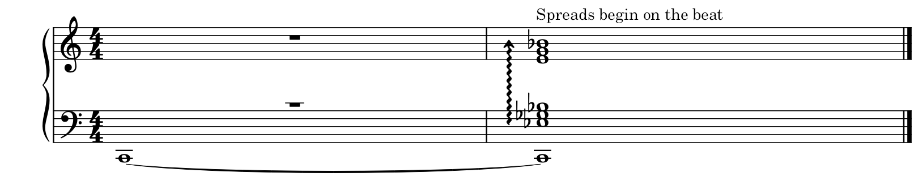

# 0.169 雕版、视频和真机播放复查

## 雕版

在编曲视图用连续谱，切到雕版后直接在页面上选择、拖动。四类操作共用同一份谱，使用原生排版属性，松手后重排相关部分。切回编曲时恢复原先的工作视图。

用有双谱表和力度记号的钢琴谱核对了共同拍位、谱表间距、符号移动及一次撤销。拖动时只显示目标位置和数值，小节宽度拖动一半按 Esc 会放回。谱面手柄可从雕版工具随时关闭。[使用步骤](WORKFLOW_168_GUIDE.md#整理一页谱再输出-pdf-或视频)

拖过一个共同拍位后，导出页面 PDF 和动态乐谱谱行图。两份成品中，该拍位相对于小节起点的位置以及这一行的最后小节一致。

0.169.1 补上琶音线的位置和所跨的谱表。用净书资料中的公开双谱表例子，将跨谱表琶音线左移，同时给共用拍位留白，下谱表的降号露出，延续低音仍在波线之外。前后原生图可比较，另存副本保留了原音高和跨两个谱表的展开。采用后一次撤销恢复前一版。

另外用公开例子检查带力度文字的发夹、谱行入口留白和跨行圆滑线续段。建议能定位各自的谱行，显示原生前后图并撤销。跨行弧保留原来的起止拍位。

## 动态乐谱

手动换行时间跟随该片段的起始拍位和反复位置。换了其它小节的分行，重新准备画面时会恢复仍有相同起点的标记。测试先定一个换行时间，再往下游加换行、重新准备画面，原来的时间保持。

## 原曲文件搬家

把谱保存到录音下一级目录，再把这组文件复制到含中文的新目录。原来位置的录音仍在，打开新位置的谱时优先读取新目录里的录音。用同一个关联开始循环，播放线继续移动。动态乐谱读取同一录音，按正式排版生成谱行画面。

## 频谱听辨

在 WaveTone 2.66 和 MuseScore 打开同一份钢琴录音。WaveTone 图上的 A4、E5 短音分别从约 4.50、5.50 秒开始，MuseScore 的“起音更清楚”读得 4.505、5.515 秒。两边都显示出低音明亮的倍频。最低的 A0 基音在录音中约为 −73 dBFS，明显弱于它的第三、第四倍频。保留现有音高显示，补充低音试音和选择预设的用法。

## Codex 连接

随包 MCP 更新至 2.7.4。连接窗口分别显示已装力度技能和本地研究资料，核对固定版 0.3.3 的版本及文件校验值。现有技能可以保留，版本不同会显示在窗口里。

用固定版研究包的原始 MIDI 还原 48 个起音。两个指定的内声音都由 67 变为 64，锁定的内声音保持 67，其余音的力度和起音位置一致。另用一段 15 音的跨手旋律设置句峰，句峰由 78 变为 84，背景、声部与起音保持原样。采用后撤销恢复原值。

原生谱图用 D 大调转 F 大调的双谱表例子核对。原生整行保留行首两升，转调位置两谱表的降号和括号还原号清楚可见。截取行中的小节时，附带该处仍有效的 F 大调信息。

净书和力度结果已分别同步到「乐谱净书研究」和「制定钢琴 MIDI 力度学习计划」。净书资料里的实施交接记录了雕版、原生候选和动态乐谱的入口。

## CFX

CFX 在独立进程准备时，音源就绪前使用 SF2。切谱时让厂商窗口在后台关闭，读取的音色交还给切走的那份谱，避免界面等待。音源回复使用 Windows 命名管道的事件通知，解决 Qt 5 读取切换线程后回复迟到的问题。[Qt 5 的读取实现](https://github.com/qt/qtbase/blob/5.15/src/corelib/io/qwindowspipereader.cpp) · [Windows 读取回调说明](https://learn.microsoft.com/en-us/windows/win32/api/fileapi/nf-fileapi-readfileex)

用分别保存 Default 和 Soft Player 的两份测试谱，按 A→B→A 切换。Mi Monitor 以 44.1 kHz 输出，两份谱都收到音频信号。播放中保存后继续播放，切回原谱约 104 毫秒，可以直接再播。共用钢琴检查确认两架已载入的实例继续使用，乐谱自己导入的预设也保留。

窗口开着时，Ctrl+S 保存谱面和已完成的演奏编辑。CFX 打开的窗口可能返回上一次的音色数据。程序内用实际插件修改参数，关闭 CFX 窗口后边播边保存，重开读得 0.748；再修改、带着窗口切谱并保存，重开读得 0.252。它们分别是 0.75 和 0.25 在 CFX 的档位。
