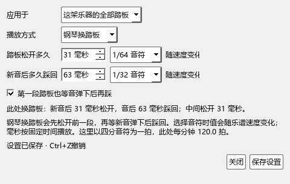
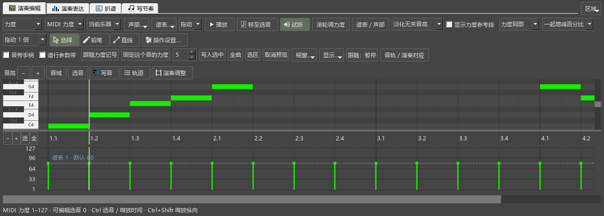

# 0.170：踏板设置、停播操作和工作区恢复

## 这一轮改了什么

| 反馈 | 改动与使用方法 |
|---|---|
| 踏板时间难理解 | 改为“踏板松开多久”“新音后多久踩回”。每行可选毫秒或音符时值，下方举例说明相对新音的动作。入口仍在演奏编辑器的延音踏板参数中。 |
| 停播后符号面板点不动、列表空白 | 修复打开下方工具后，符号面板内容被压到十几像素的问题。面板向主布局报告标题和列表入口需要的高度，停播后可以在当前窗口继续操作。 |
| 第一拍太靠左 | 卷帘和力度区在时间轴起点留出 20 像素。音符、力度柱、刻度、播放线和鼠标定位共同使用这个起点。 |
| 切后处理后两侧面板挤到中央 | 尺寸恢复完再允许保存布局；快速连续切换时，旧恢复任务结束，只有最后所选视图继续恢复。各视图已经保存的侧栏宽度继续使用。 |

## 踏板设置例子

1. 打开“视图 → 演奏编辑器”，参数选“延音踏板”。
2. 点“踏板：SF2…”或“踏板：钢琴…”，播放方式选“钢琴换踏板”。
3. “踏板松开多久”选“1/64 音符”，“新音后多久踩回”选“1/32 音符”。
4. 四分音符每分钟 120 拍时，窗口分别显示约 31、63 毫秒。下方例子说明这次会在新音后约 31 毫秒松开，音后约 63 毫秒踩回。
5. 点“保存设置”，从同一处播放。Ctrl+Z 撤销这次设置，保存 MSCZ 后重开仍使用选定方式。

按音符时值输入会跟随速度。改为每分钟 60 拍时，上述两段时间约为 63、125 毫秒。按毫秒输入则保留固定时间。旧谱沿用原来的数值，默认仍是松开 40 毫秒、音后 60 毫秒踩回。[完整说明](PEDAL_106_GUIDE.md)

## 查到的原因和实际检查

停播问题使用独立测试谱复现：先播放，再打开演奏编辑器，停播后立即点符号组。之前的检查先切过一次 DAW 再切回，已经改变了布局。这次在首次点击前记录到符号面板的内容窗口仅高 14 像素，列表从第 97 像素开始，列表可用高度成为负数。当时主窗口、谱窗和符号面板已恢复启用，鼠标占用为空。

修正后，按手动停止、播放结束、打开原曲／表达页、打断卷帘拖动及多选音滚轮调力度五种操作，停播后直接展开符号组；原曲参考的循环按钮继续可点击。还检查了实际应用符号、撤销及重做。点击检查使用独立离屏进程，窗口尺寸和踏板设置截图使用独立 Windows 测试桌面。

视图恢复存在另一个时序问题：主布局已经切换，内部尺寸仍在排队恢复，此时再次切换会把中间尺寸保存下来；同名旧任务也可能在返回该视图时继续执行。现在保存和恢复共享同一次切换状态。连续切换编曲、DAW、雕版、后处理以及新开视频面板后返回，检查侧栏宽度及编辑器高度。

踏板检查包含保存重开、一次撤销、原毫秒设置和改速后的实际 CC64；第一拍检查包含点击、横向滚动和鼠标位置缩放。截图中的第一组音和力度柱位于键盘右侧留白之后。

## 更新位置与下一步

版本 **0.170.0** 已在现有 E 盘构建目录编译。使用中的安装目录保持原样；更新包包含程序和本次说明，等用户结束使用后安装。源码提交由 `personal-v0.170.0` 定位。

本轮聚焦上述四项。原有完整功能清单继续保留，后续按[当前进度](REWORK_PROGRESS.md)推进实体 MIDI 键盘、代表性音乐听感及已讨论的 AI 和扒谱工作。
