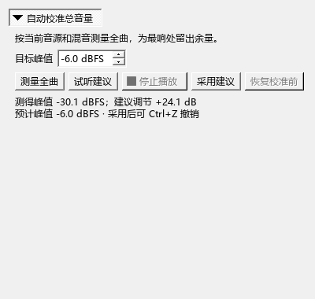
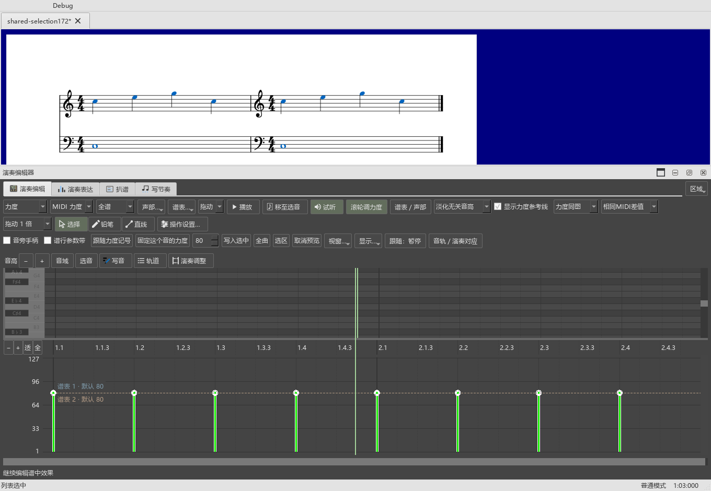

# 0.172：框选、每谱混音与音量校准

## 选一组音再调整

1. 打开“视图 → 演奏编辑器”，显示卷帘与力度区。
2. 在力度柱之间按住右键拖出方框，经过的音会同时在卷帘和谱面选中。
3. 按 Ctrl 或 Shift 再框一组可加选；按 Alt 框选可减选。按 Esc 取消正在进行的框选。
4. 用原来的拖动、写入选中或画线操作调整。松键后可以直接选其它音、点按钮或切页。

演奏对比沿用这套选音，原值和拟采用值都可以作为框选对象。外部 MIDI 的力度区同样支持右键框选。单击右键保留对应菜单；频谱叠加中的右键点按继续试音。

切到“演奏表达”或“扒谱”后，可从“区域”显示力度区。各区共用时间尺和缩放。扒谱的播放线在暂停后仍保留；Home 回到当前关联片段开头，整条录音回到开头。

## 每份谱记住自己的混音

在混音器调好乐器音量、声像、混响、合唱、静音和独听，在合成器或音源面板调好总增益与主效果，然后按 Ctrl+S。切换或重新打开乐谱会恢复本谱的设置。

总谱与分谱使用总谱保存的音源和总输出。两份谱即使共用同一架钢琴，也可以分别保留音量平衡和总增益。

## 自动校准总音量

这是让当前乐谱最响处达到所选峰值的工具。默认 −6 dBFS，给重音和后续调整留出余量。0 dBFS 是数字满幅，可按需要选择目标。

1. 先选好音源和音色，调好旋律、伴奏及其它乐器的平衡。
2. 打开“视图 → 音源与效果”，展开“自动校准总音量”。
3. 点“测量全曲”。后台按当前音源、混音、反复、踏板和效果尾音测量，进度条旁可取消。
4. 看“测得峰值、建议调节、预计峰值”。点“试听建议”从当前位置听；“切回原音量”在同一播放位置切回。
5. 点“采用建议”使用建议总增益。原来的逐音力度与各乐器平衡保留。
6. 按 Ctrl+S 保存。点“停止播放”结束播放后，可用 Ctrl+Z 撤销采用；“恢复校准前”回到首次采用前的总增益。

试听期间保存会保留已确认的增益。更换音色、改变混音或继续改谱后，可再次测量。目标、结果、恢复记录及校准区展开状态随谱保存。

测量使用独立进程，输出为峰值与进度，不保存整曲声音文件。临时材料在本机 E 盘的 `MuseScoreCache/calibration` 下；可用 `KUMO_CACHE_DIR` 指定缓存位置。没有 E 盘时使用系统缓存目录。

## 实现与资料

框选集中在 `selectiongestures.cpp`；混音的收集、恢复和增益撤销集中在 `scoremixstate.cpp`；校准界面和后台测量集中在 `audiocalibration.cpp`。试听使用独立的输出增益，正常保存读取已确认的增益。原生音频渲染与导出共用，频谱继续使用现有分析和缓存。

测量值为音频采样峰值，单位 dBFS。声音输出与显示依据可参阅 [FFmpeg 的音频统计说明](https://ffmpeg.org/ffmpeg-filters.html#astats-1)；VST 继续沿用原生导出的[离线处理方式](https://steinbergmedia.github.io/vst3_dev_portal/pages/FAQ/Processing.html)。

## 实际操作与本轮程序

力度区在普通编辑、演奏表达和扒谱页完成框选、加选、减选与时间尺定位；演奏候选保留原值，外部 MIDI 框选后可一起改力度。松键后继续选音、播放停止和保存的操作也已回查。

两份谱分别设置不同总增益。保存、切换及重开后，音量、声像、混响、合唱、独听、主效果和总增益恢复为各自的数值。

校准使用实际 SF2 输出测量。测试谱最响处为 **−30.1 dBFS**，采用建议后重新渲染测得 **−6.0 dBFS**。试听期间保存保留已确认的增益，采用可撤销、重做；重新打开后可恢复首次校准前的音量。VST 使用相同的原生渲染入口；本轮声音测量采用 SF2。

独立程序：`E:/programming/funcodes/muse3_dev/MuseScore/msvc.install_ui_0_172_x64/bin/MuseScore3Evo.exe`。保留原安装目录，使用时从新目录打开；说明在“帮助 → 个人功能说明”。

提交定位：两仓库标签 `personal-v0.172.0`。源码索引列出了共用框选、混音和校准的独立实现位置。
