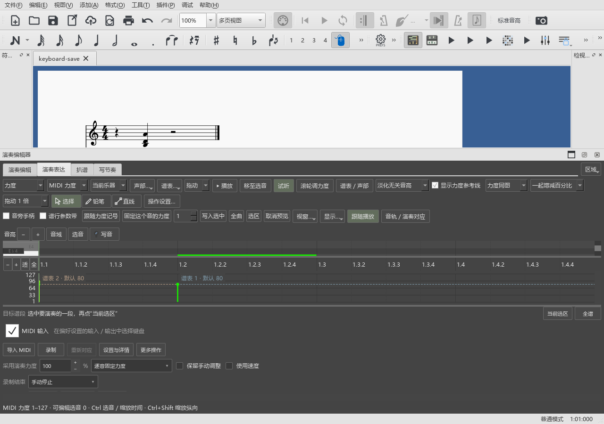
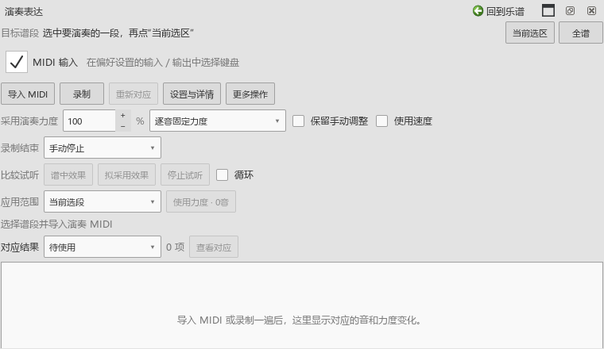

# 保存与频谱范围的补充检查

对应0.80.1。频谱的显示范围修复自0.78.0提供，这次补充使用说明与正常主窗口中的保存检查。

## 查看整首和关联片段

用户补充的现象是：原曲参考里选了一段，扒谱只显示那一段，并且跟不上编辑器缩放。原问题在0.78.0复现并修复。本次在现有程序重新运行`spectrumInitialSourceAndChoice`、`spectrumLinkedZoomAndScroll`两项操作：整条录音与片段切换、逐音轨记忆、实际滚轮缩放、时间滚动条、内部对齐点取音及返回整首均通过。包括准备和结束共4项通过，记录为`P2/out/usability-080-source-range-recheck-pluginhost.txt`。

实际操作见[完整录音与按谱对齐](SPECTRUM_078_GUIDE.md)。

## 在表达面板里保存

编辑乐谱后按Ctrl+S即可保存。内嵌和悬浮的表达面板都使用当前乐谱的保存操作。

这次新增的`nativeui`检查采用正常主窗口初始化，加载原菜单、工作区和快捷键。它在E盘建立独立设置和钢琴谱，给音符设置不同力度，分别将焦点放到内嵌、悬浮表达面板，再发送Ctrl+S。检查同时记录保存动作是否触发，以及文件中实际保存的力度。音符原先处于休止符后的情况也使用正确的音符对象。

截图由窗口自身和其中QML画面组成；控件、字号和占位按实际窗口尺寸查看。系统声卡在这组保存检查中保持空闲。

## 八音轨的关联时间

同一测试检查八条参加播放的音轨，范围从音符所在拍位开始，到另一拍位结束。每条音轨包含两个录音片段，分别核对三种播放方式生成的起止拍位、录音秒数及输出时间。这项检查覆盖时间安排，实际八轨发声与连续播放另在原曲参考操作中检查。

## 本次结果

- 正常主窗口3项操作、初始化与结束共5项通过。记录为`P2/out/usability-0801-bound-nativeui-run.txt`。
- 分别按Ctrl+S保存91、102的逐音固定力度；独立读取最后保存文件，6个音中1个保存为102，其他音保持原值。八条音轨的两段录音、三种播放方式及拍位端点一致。
- 已查看内嵌与悬浮窗口截图，QML内容按真实窗口位置一并记录；频谱整首、片段和放大截图也已查看。
- 检查程序初次读取选到了起始休止符，及浮动后从旧父窗口寻找内容，两处已改为实际音符和原界面对象；范围读取明确绑定测试谱，正常启动补齐字体资源。相关早期失败日志保留。
- 新建工作区读取时仍输出Qt绘图警告；本组保存与时间安排检查通过。后续工作区与符号面板检查继续跟进这些输出。

本次补充检查与说明，频谱、播放和编辑默认值沿用0.80.0。完整返工继续按[总检查表](USABILITY_REWORK_20261019.md)逐项进行。
