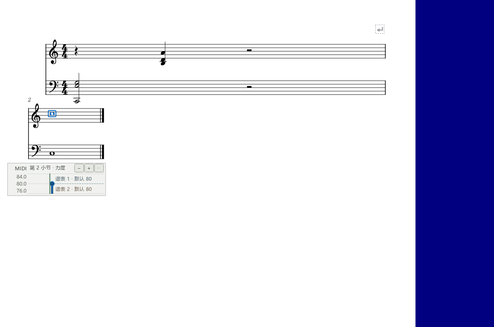
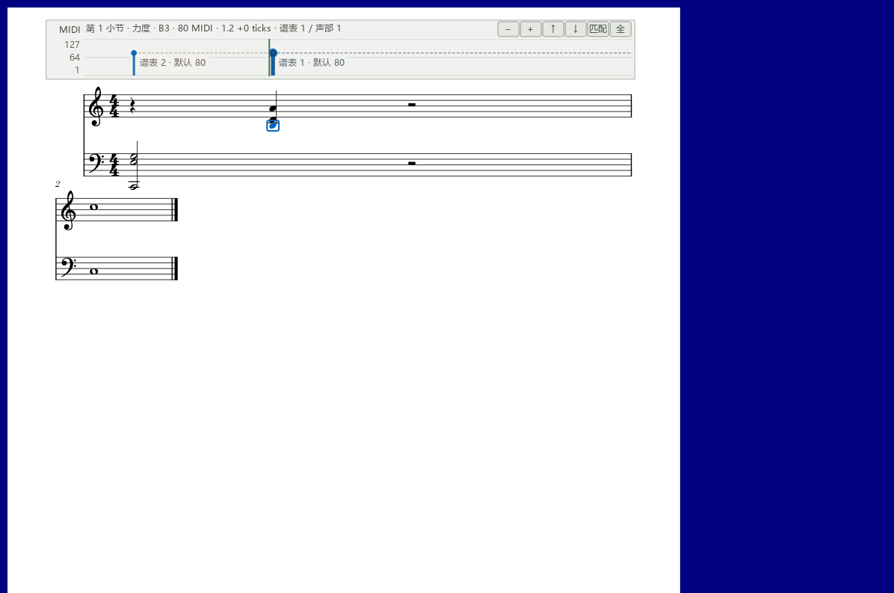
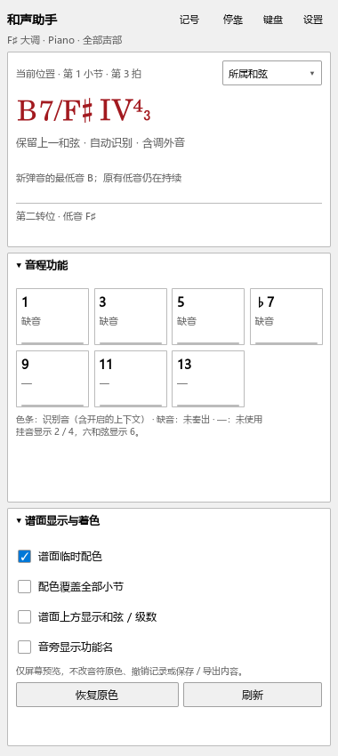

# 谱面调节与和弦显示检查

日期：2026-10-20；个人版本 0.75.0。

已更新原安装目录。主程序SHA256：`0993cd3237a656c151e34b44f1b12ba93f43dc7b6ceeb04c666c07c2c411a8dd`。`kumo.ini`保持原设置。

## 复现与修复

- 关闭编辑器，单独显示谱行带，鼠标放在其数字轴上按 Alt+Shift 滚动。修复前没有改变音符，事件被数字轴缩放接走；修复后改变最近音，保持谱面位置，一轮滚动形成一次撤销。
- 在上下两行间距较小的谱上选择第一行。修复前参数带落在约460像素外的视口底部；修复后选择附近的可见空白。切到第二行、Ctrl缩放及短行菜单均完成检查。选中行完全离开视口时采用固定底部位置。
- 拖动和弦文字。修复前范围手柄随文字纵向移动约60像素；修复后文字移动，起止手柄保持原坐标。末端对应小节右边界。
- 在 F♯ 大调测试 B7/F♯，摘要和详情均显示 IV⁴₃。切到休止，打开保留上一和弦后延续显示；关闭后恢复空拍显示。实际低音为延伸音或外音时，级数标出音名。

四项操作加连续插件重载共7项通过（含初始化与结束）。日志：`P2/out/usability-075g-score-harmony-pluginhost.txt`。修复前的独立失败记录分别保存在075a、075b、075f-range-before日志中。

## 继续使用已有功能

- 演奏编辑器原有的点选、重叠音拖动、滚轮、输入状态、撤销与真实演奏器播放检查共8项通过。原检查脚本保持原样；修复了选中谱行离开视口时的回落位置。日志：`P2/out/usability-075f-editor-regression-performanceeditor-run.txt`。
- 内置分段写法的修改、切换、删除恢复、跨界连线、分谱、个人演奏属性和保存重开共9项通过。日志：`P2/out/usability-075-variants-p1native-run.txt`。旧完整谱副本插件的自动保存继续单独处理。
- 扩展关闭时启动、保存和重开共3项通过。日志：`P2/out/usability-075-gate-off-pluginhost.txt`。
- 使用随包 MCP 程序配置并检查连接，读取6个音，提交与采用力度建议，再撤销，读回与原值一致。子进程的PATH只保留系统目录。记录：`P2/out/usability-075-native-ai/report.json`。
- 和声规则、上下文、时间段、设置、交换文件及新显示规则通过现有JavaScript检查。

Ctrl缩放四次事件处理约3.9–9.5毫秒，采用小型独立测试谱；完整绘制与大谱耗时另行测量。

## 画面

操作步骤见[谱面调节与和弦显示](SCORE_HARMONY_075_GUIDE.md)。完整返工按[使用检查](USABILITY_REWORK_20261019.md)继续。
