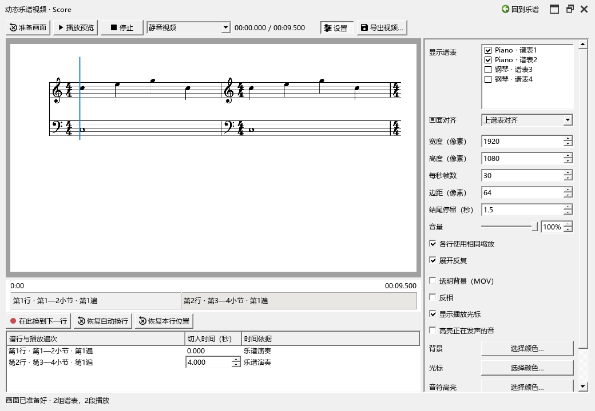
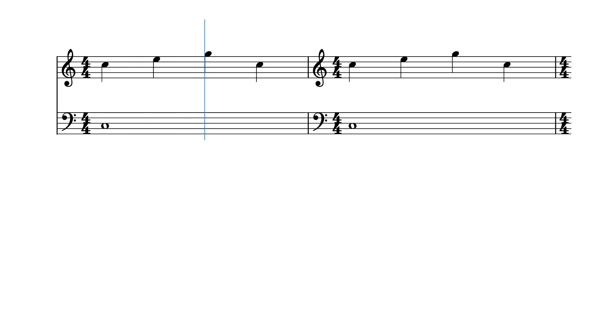

# 制作动态乐谱视频

这项功能把当前乐谱按谱行播放成视频。画面采用 MuseScore 的排版，可以配乐谱声音或一条原曲录音，也可以输出透明背景，放入视频编辑软件。

## 画面与原谱的关系

视频直接使用 MuseScore 已排好的谱面。音符、文字、字号、线条、人工位置和分行都沿用原谱，整行一起放大或缩小。0.166 修复了文字比例及各行大小不一致的问题。升级后点一次“准备画面”更新预览。

要改变一行的音乐内容或净谱，先回到乐谱修改，再准备画面；视频里的边距、位置、背景及换行时间在本面板调整。

## 从哪里打开

打开乐谱，点击“工具 → 动态乐谱视频…”，或编曲工具栏中的胶片图标。软件进入“后处理”视图，显示预览面板。面板标题写着当前谱名。

0.165.0 修复了旧工作区恢复后入口消失的问题，直接打开原来的工作区即可使用。个人工具统一由程序目录的 `kumo.ini` 中 `enable_exp_feature=true` 开启；修改后重启生效。

右上角可以悬浮、单独全屏、回到乐谱或关闭。菜单和工具栏可再次打开同一个面板。中央画面、下方时间区和右侧设置之间的分隔条都能拖动。“设置”按钮可以收起右侧区域。

下面是0.166实际导出的1080p视频画面，使用独立示例谱：

## 第一次：把钢琴谱做成有声音的视频

1. 在右侧“显示谱表”勾选钢琴的两个谱表。三、四谱表的曲子可以多选；各行显示这组谱表的实际排版。
2. 顶部声音选择“乐谱声音”，点击“准备画面”。首次打开会自动准备一次。
3. 点“播放预览”。第一次播放先准备声音，随后画面与声音从同一位置开始。点同一按钮暂停，再点继续；“停止”保留当前位置。点时间轴可跳转，Home 回视频开头，左右键每次移动 0.1 秒。面板内空格也可播放、暂停。
4. 右侧保持宽 1920、高 1080、每秒 30 帧，即常用的 1080p 视频。可选择光标、音符高亮、背景与反相。
5. 点击“导出视频…”，选择文件位置。普通背景输出 MP4。进度显示在底部，点“取消”可以结束本次准备或编码。
6. 按 Ctrl+S 保存乐谱；谱表选择、外观、换行时间及各行位置会随 MSCZ 保存。修改视频设置和拖动位置都可撤销、重做。

“乐谱声音”使用当前声音设置和乐谱的实际演奏结果，包含力度、踏板、实际起音和松键，以及展开后的反复。分谱窗口制作时使用当前分谱。声音的首次准备会显示可取消的进度窗口；以后在同一份画面中暂停、定位和继续会复用已准备的声音。

右侧“音量”用滑块或百分比调整，100%保持准备好的声音音量。预览中也能调整，结果随制作设置保存。

在文字或数值框里输入时，按键用于编辑该框。点回预览或时间轴后再用播放键。

## 用原曲录音配视频

1. 先在“原曲参考”中打开录音，建立片段与谱段的对应，需要时补充内部对齐点。
2. 回到视频面板，在顶部声音下拉选择“原曲：曲名”。
3. “原曲时间”选“使用片段关联”，再准备画面。列表会显示各段采用“原曲关联”还是“待关联”。
4. 播放预览，检查换行和光标。原曲中已有的内部对齐点也参与时间计算。反复使用同一段原曲时，会按乐谱展开后的顺序接续。

“保留原曲开头”保留第一段之前的录音，同时先显示第一行；光标在音乐对应的第一拍开始移动。尚未关联的谱段暂按乐谱时长安排，声音留空；可回原曲参考补充对应，再准备画面。

没有建立片段关联时，可以选“按整曲估计，可手动换行”：先按录音总时长分配谱行，再边听边调整。底部“整曲估计”表明这些时间的来源。使用原曲不会修改谱内速度。

视频使用选定的这一条录音。原曲文件继续保存在外部；文件移动后，从原曲参考重新定位，再准备视频。

## 调整换行与画面位置

- 时间轴中的分界线表示换到下一行的时刻。拖动边界可微调；也能在列表的“切入时间（秒）”直接输入。
- 边听边点“在此换到下一行”，把下一次换行记在当前播放位置。“恢复自动换行”恢复当前声音来源的自动时间。
- 乐谱声音、已关联录音的换行调整改变画面切换时刻；光标仍按实际演奏或关联的位置移动。整曲估计模式也会按新边界调整该行内部的估计位置。
- 直接拖预览中的谱行，调整这一行在画面中的位置。“恢复本行位置”撤销这行的偏移。偏移按画面比例保存，改变输出分辨率后仍保持相同相对位置。
- “上谱表对齐”让各组上方谱表的起点保持一致；“居中”把每组放在画面中间。“各行使用相同缩放”保持音符视觉大小一致。
- “边距”调整四周留白；“结尾停留”让末行继续显示，并给声音留出尾部。

每次拖动形成一次撤销。修改乐谱后，面板会提示重新准备；视频设置与音乐编辑分别记录。

## 透明背景与反相

勾选“透明背景（MOV）”后，预览中的棋盘格表示透明区域，导出使用 ProRes 4444 MOV，适合后续合成。勾选“反相”可把黑色谱面改为白色。光标和音符高亮仍使用各自选择的颜色。

普通 MP4 使用 H.264。输出宽、高使用偶数；例如 1920×1080、1280×720。透明视频体积通常更大。

## 保存、取消与常见情况

- 保存乐谱保留制作设置；导出视频生成单独文件。普通 MuseScore 3.6.2 可以打开乐谱并保留本功能使用的元数据。
- 预览和导出使用准备时的谱行图片、演奏时间和音频对应。改谱或更换音源后，点“准备画面”更新。
- “静音视频”用于只输出画面，之后在视频编辑软件配音。
- 取消或编码失败时，原先同名的视频保持完整。导出成功后才替换目标文件。
- 找不到编码工具时，检查程序同目录下的 `tools/video/ffmpeg.exe`。随包版本同时附带许可和版本信息。
- 没声音时先查看顶部选择的是乐谱、原曲还是静音，再检查原曲路径或当前音源。底部显示准备、播放或具体错误。

本功能从个人版本 0.164.0 提供；菜单及工具栏入口在 0.165.0 修正。画面组织参考 [score-sync](https://github.com/Freddd13/score-sync) 的谱块和时间轴设计；这里直接读取 MuseScore 原生谱行。
