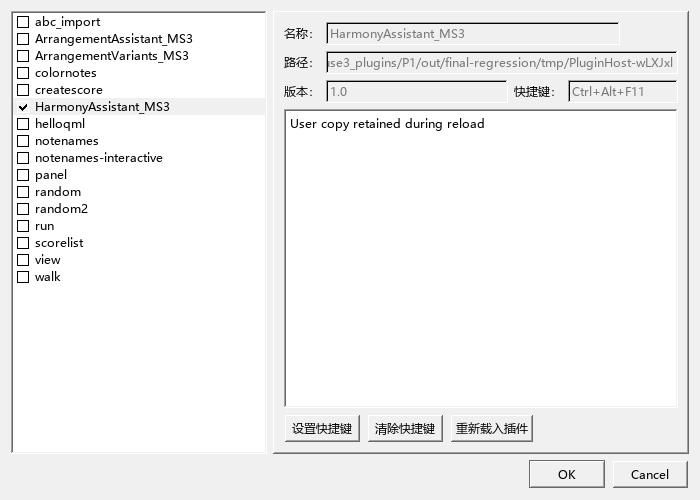

# 开关个人工具、重载插件和准备分享

适用于0.145.0 · Kumo branch / Freddd13。

## 暂时关闭个人工具

1. 先保存乐谱，退出MuseScore。
2. 打开`MuseScore3Evo.exe`旁边的`kumo.ini`。
3. 把下面这一项改为`false`，保存并重新启动。

```ini
[features]
enable_exp_feature=false
```

编辑器、和弦、原曲、表达、频谱、编配、写法、VST和AI等个人工具会收起。普通记谱、播放、打印和导出继续使用。想恢复时，改回`true`，保存并重启。

“帮助 → 关于”显示开关状态及配置位置。升级会保留这份配置；新装的个人版本默认开启。

## 关掉后，之前的资料放在哪里

音符、踏板和逐音演奏设置仍随乐谱保存。原曲路径与关联、人工和弦、取音标注、A/B写法和音源设置也保留在MSCZ里；重新开启工具后，可以接着编辑。

VST关闭时使用SF2播放，保存的VST选择和参数继续留在文件中。音频本体仍是外部文件，移动谱子时可一起带上，之后从原曲参考重新定位文件。

已经保存的普通乐谱可直接继续使用。分享带A/B写法的成果时，也可从“分段试写方案 → 更多 → 导出普通版副本”选择当前组合或主方案，生成一份单独的普通谱。

## 重载插件

打开“插件 → 插件管理器”，点“重载插件”。已经勾选的插件和自定快捷键会保留，正在打开的本项目工具会重新打开。

本程序自带的旧和弦、表达、原曲和API连接入口由内置功能接替，管理器会将这些旧入口收起。用户插件文件夹中的文件保留；文件名碰巧相同的插件仍可在管理器中使用。



## 制作单独的分享程序

开发仓库中的`P2/make_share_package.py`可以将当前安装复制到一个新文件夹，并关闭副本的个人工具。例如在插件仓库执行：

```powershell
python P2/make_share_package.py "E:\MuseScore分享版"
```

目标文件夹采用新名称。命令完成后，打开其中的`bin/MuseScore3Evo.exe`。原安装继续使用原有开关，副本中的其它配置保留。

分享包包含程序所需文件，使用者直接运行程序。AI连接的随包MCP也读取这份副本的开关；关闭时只显示连接与配置状态。首次连接的方法见[AI连接](WORKSPACE_063_GUIDE.md)。
