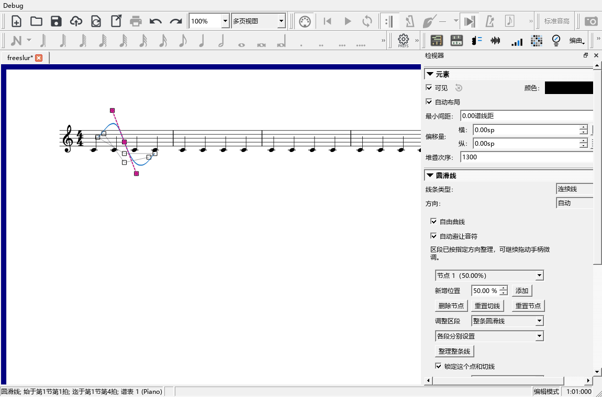
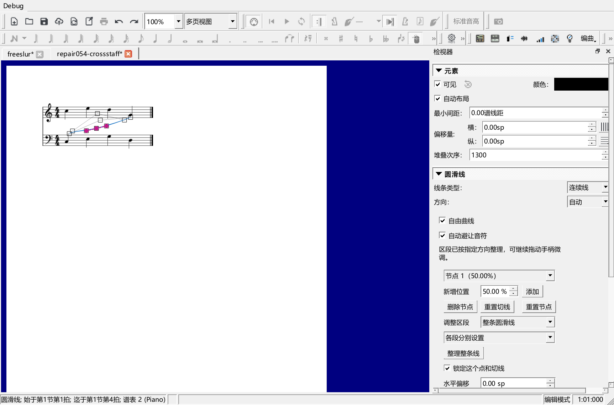

# 自由圆滑线：锁点、连续绕行和端点调整

对应0.85.0。检查使用项目自己的钢琴测试谱，官谱和用户原谱保持只读。

## 复现与修改

两端分别设为音符上方、下方，中间点开启自动避让后，锁定或整理中间点会使它移动约2.603210个谱间。复现日志为`P2/out/engraving-085-before-performanceeditor-run.txt`。

绘图已经根据两端位置调整参考曲线，保存可见点位时仍按原生参考曲线换算。现在绘图、取点和整理共用`freeBaseControls()`。关闭自动避让、仍使用区段上下走向时，也从当前画出的点开始拖动。

另一例中，三个点非常接近，整理中间点的手柄会越过邻点。日志`P2/out/engraving-085-reference-performanceeditor-run.txt`记录：点位保持检查通过，手柄范围检查失败。整理方法改为分别按相邻点的横、纵距离计算共同切线。

切线计算使用相邻割线的加权调和平均；相反方向或水平、垂直转折处采用零分量。方法见[SciPy的PCHIP公式与参考文献](https://docs.scipy.org/doc/scipy/reference/generated/scipy.interpolate.PchipInterpolator.html#notes)。运行时由C++直接计算。

## 完整操作

1. 建立前上后下及前下后上的区段，在同谱表、跨谱表下分别检查。
2. 锁定、整理后核对节点位置，打开或关闭自动避让后重复操作。
3. 从检视器选节点、锁定和整理，再实际拖动谱面上的点；核对鼠标位移、一次撤销和快捷键撤销。
4. 保存MSCZ、重新读取，核对节点、端点方向和实际MIDI事件。
5. 回查原有节点、切线、跨行、分谱、符杠避让和PDF／SVG；检查四种分手记号及速度面板。

点位、手柄、鼠标位移、快捷键撤销、保存重开及原有记谱共19项操作，加准备、结束共21项通过，日志P2/out/engraving-085-release-performanceeditor-run.txt。实际截图仍见普通谱例陡弯及跨谱表大波浪，保留在P2/out/slur-085-before-routing。区段绕行继续修改，0.85尚未安装发布。

## 连续绕行与端点

实际谱面暴露了跨谱表大波浪和普通谱例中间陡弯。新增连续绕行计算，按所连音线确定区段走向，其它谱面内容仍参加碰撞检查。固定节点、上下边界、曲线弯曲变化与高度一起参与计算；补充布局点用于绘图，文件保留用户的节点。

端点改用原生圆滑线的符干、符杠与发音符号位置。端点位移和切线调整分别保存为`freeSlurEndpoints`，与既有中间节点数据分开；旧的手动端点继续读取。拖点、锁点和整理保留共同的节点参考坐标。

鼠标检查扩展为起点、终点、两端切线，核对实际位移、固定中间点、撤销、重做、Esc取消、Home恢复、方向键微调及保存重开后的可见位置。最新21项操作加准备、结束共23项通过，日志`P2/out/engraving-085-release-final-performanceeditor-run.txt`。

官方3.6.2读取并重新保存两份端点谱例，音符、时值和MIDI一致；普通谱例32个起止事件、跨谱表谱例16个起止事件，记录在`P2/out/slur-085-stock/report.json`。原文件校验值保持。

首次截图取在停靠布局稳定之前。补充选线与进入编辑后的实际宽度检查，普通与150%显示缩放均保持340逻辑像素，控件可见。保留检视器原有布局；最新界面检查见`P2/out/engraving-085-inspector-reproduce-performanceeditor-run.txt`，150%检查见`P2/out/engraving-085-dpi150-performanceeditor-run.txt`。

原曲选段与频谱缩放在最终程序中另行回查，2项操作加准备、结束共4项通过，日志`P2/out/spectrum-085-final-pluginhost.txt`。覆盖整条录音、按谱对齐、卷帘、参数区、全曲入口、取音位置及缓存复用。

这组谱例中，32个节点的20次排版共6.050ms；2048个障碍的首次计算6.340ms，200次相同绕行的缓存读取0.240ms。这些数值对应上述测试谱与当前设备。

发布定位：`personal-v0.85.0`。
