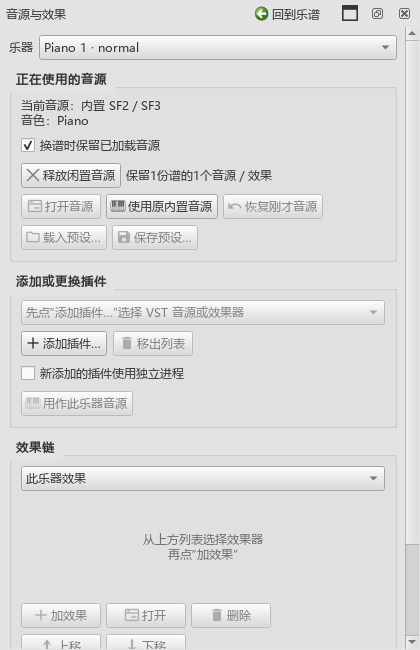

# 0.107音源保留检查

## 已发现并修复的问题

换谱保留整条效果链时，效果器的旧延迟缓冲也会保留。独立测试谱从A切B再回A，原本已经松键，输出仍出现0.125的旧声音。现已在换谱时清理声音处理状态和短延迟，音源实例与预设继续保留。

独立进程还要清理尚未送完的半块音频、旧输出和排队事件。控制操作与声音线程使用同一个互斥锁，重新检查已经取消的块；起音、踏板与参数不会从旧材料进入新材料。

## 操作与结果

首轮连续检查11项通过：

- 用计数音源核对创建、销毁和处理次数。A→B→A复用A；A闲置时处理次数保持不变。关闭所属谱和释放闲置音源均释放对应对象。
- 延迟效果分别放在乐器和主输出，检查程序内／独立进程两种方式。切回后保留原效果对象及参数，旧声音清零。
- SF2、Pianoteq9、CFX各自实际发声，A→B→A复用原对象，旧按键和踏板释放，返回后仍能弹新音。
- 原生谱页使用SF2、CFX检查勾选、换谱、保存、关谱、释放、取消勾选及重读文件。临时会话编号未写进乐谱。
- CFX厂商窗口继续核对定时刷新、参数修改和保存，窗口及音源对象保持稳定。

首轮首次载入与返回耗时：SF2为3301／0ms，Pianoteq为5064／0ms，CFX为3802／0ms。返回计时为毫秒整数；这些数字对应本机测试材料。

最终检查增加独立进程Pianoteq／CFX和保存设置变化后的缓存替换，共13项通过，0失败，耗时72.443秒；另回查原音源操作8项通过，0失败，耗时96.261秒。两组数量分别包含Qt初始化和收尾。

| 本机音源 | 首次载入 | 返回原谱 |
|---|---:|---:|
| SF2 | 3307ms | 0ms |
| Pianoteq9 | 1902ms | 0ms |
| CFX | 3460ms | 0ms |
| Pianoteq9独立进程 | 3644ms | 0ms |
| CFX独立进程 | 3838ms | 0ms |

返回值为毫秒整数计时，实例身份另行核对。CFX与SF2返回后输出为零；Pianoteq保留很小的释放声，RMS约0.00045，换谱前约0.0697，新起音仍正常。

旧操作实际检查了首次空列表扫描、内置SF2切回与恢复、两件乐器的选择、独立效果预设、参数输入及撤销、主输出与乐器效果列表，以及增删乐器后的更新。CFX厂商窗口的定时刷新和参数保存也通过。

原始结果位于插件工作区`P2/out/sources-107-final-pluginhost.txt`和`sources-107-old-controls-pluginhost.txt`。主程序、独立音源进程及测试程序已重新编译，0.107已安装。程序与随包音源进程的SHA256和编译材料一致，kumo.ini保持原值；关于页与启动画面的个人版本、作者和说明链接已通过原生窗口检查。源码c369489ca，发布定位personal-v0.107.0。

## 后续顺序

本批为B5-S1：每份谱保留自己的已载入音源。B5-S2接着实现所有谱子的钢琴自动共用、每谱切回自己的声音，以及保存、导出和多架钢琴的按键／踏板隔离。之后继续实体录入和声卡，再进入C、D、E、F。
