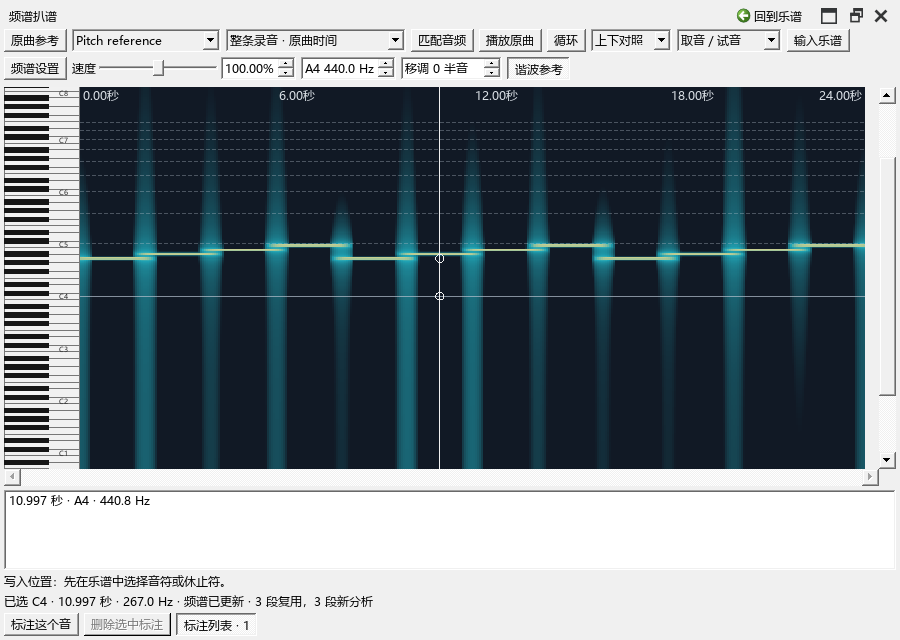
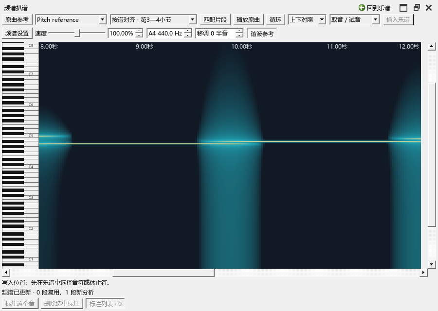
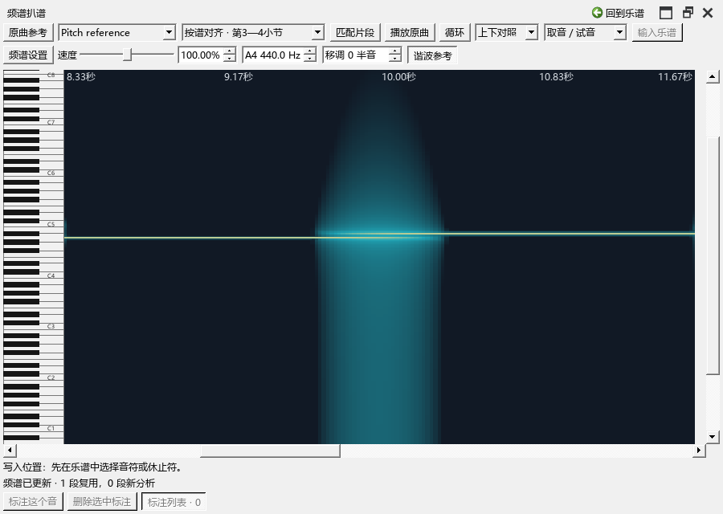

# 频谱：查看整条录音，或对齐谱中的一段

对应0.78.0起提供的操作，已在0.82.0复查。打开“视图 → 演奏编辑器”，选择“扒谱”。先在“原曲参考”添加音频，再在扒谱工具栏选择这条音轨。

## 查看录音的其它部分

时间下拉框选“整条录音 · 原曲时间”。这是新音轨首次打开时的显示方式。底部滚动条可以前后浏览，Ctrl+滚轮放大或缩小鼠标附近的时间，普通滚轮左右移动。

点“匹配音频”扩大可见范围。较长录音可以继续用底部滚动条查看后面的部分。选择“手形平移”后可拖动画面，中键也能平移。录音时间独立于谱中的拍位，适合先听和找音。

## 让频谱与谱段一起缩放

例如，把录音8—12秒关联到第3—4小节：

1. 在“原曲参考”建立这条关联。
2. 在扒谱时间下拉框选择“按谱对齐 · 第3—4小节”。卷帘和频谱会显示这段。
3. 按住Ctrl，在频谱或卷帘上滚动。两边一起缩放，鼠标附近的位置保持，底部滚动条也随之调整。
4. 拖动任一时间滚动条，查看同一段中的其它拍位。
5. 要重新显示整段，点“匹配片段”。要浏览录音的其它部分，切回“整条录音 · 原曲时间”。

每条音轨会记住你选择的时间方式。切换音轨后，再切回来可以继续原来的显示。

## 原曲参考选段后，怎样查看其它位置

例如，原曲参考里选了8—12秒，扒谱画面也正好只显示这几秒：先查看扒谱工具栏的时间下拉框。选“整条录音 · 原曲时间”即可继续浏览这份录音的其它位置；选“按谱对齐 · 第3—4小节”则围绕这段关联工作。

播放器的选段用于播放和循环；扒谱的时间下拉框决定你正在查看的范围。新音轨首次进入扒谱时使用“整条录音”。选择过“按谱对齐”后，会记住你在这条音轨上的选择。两处分别显示各自当前的范围。

上下对照中的整条录音按自己的秒数浏览；按谱对齐时，两边共用拍位和缩放。叠加时，Ctrl+滚轮会同时调整频谱和音符的显示。

## 在卷帘后叠加

“叠加对照”把频谱放在音符后。选择关联片段后，两边按谱中拍位对齐。Ctrl+滚轮从同一位置放大；显示设置里可调透明度，也可隐藏音符块以听辨频谱。

使用“整条录音”叠加时，Ctrl+滚轮会同时缩放画面和音符；时间对应仍由当前录音位置决定。需要精确对齐谱段时，选相应的“按谱对齐”片段。

## 画面空着时

先看音轨与时间下拉框。选了某个关联片段后，频谱只画这段对应的声音；平移到其它小节时，画面会提示当前位置在片段之外。点“匹配片段”返回，或切到整条录音继续听。

显示设置、配色、音高标注和保存方式沿用原设置。取音、试听、标注、删除和输入步骤见[扒谱操作](WORKSPACE_066_GUIDE.md)；区域高度与标注列表见[调整画面空间](REFERENCE_SPECTRUM_074_GUIDE.md)。
