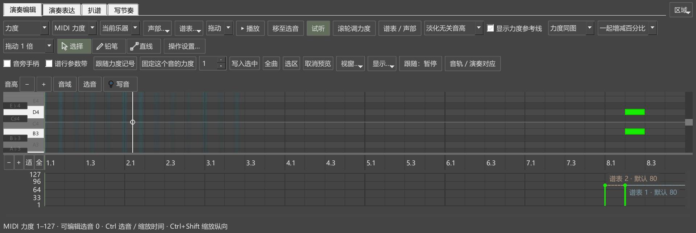
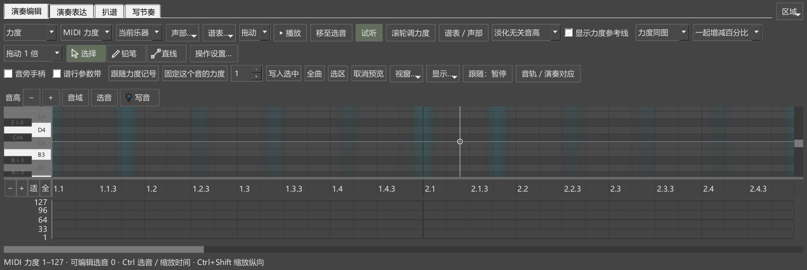
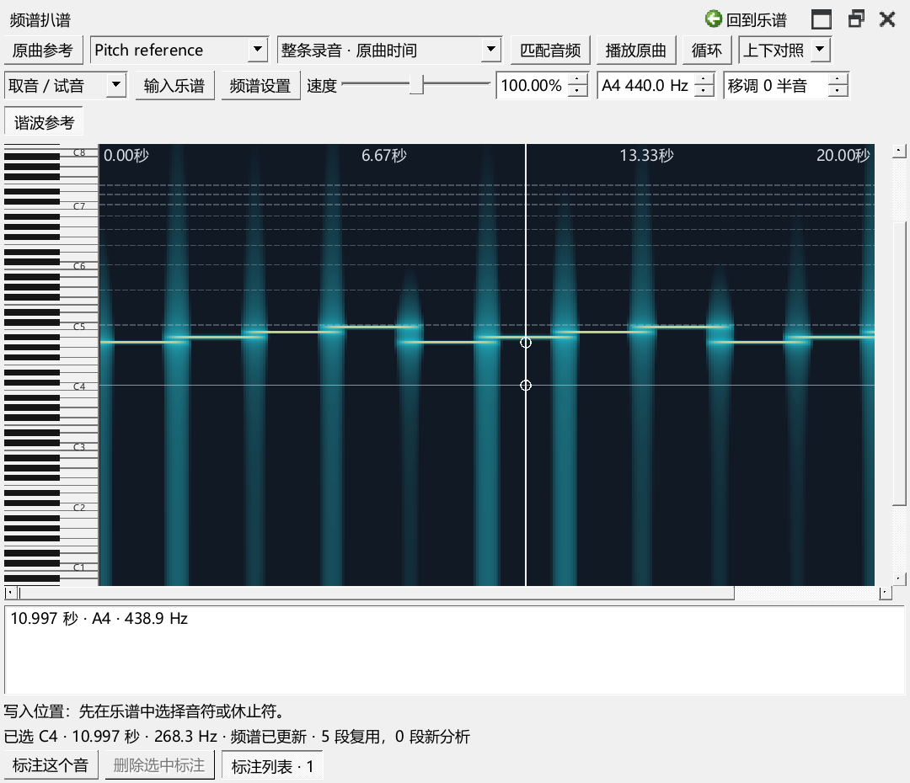

# 频谱选段与编辑器缩放检查

对应0.84.0。使用独立八小节钢琴测试谱和24秒测试音频，原曲参考中选8—12秒，关联到第3—4小节。用户乐谱、原曲和个人设置保留。

## 本次发现和修改

“整条录音 · 原曲时间”可以浏览选段之外的声音；“按谱对齐”按关联片段显示，并使用编辑器的拍位和缩放。两种方式沿用每条音轨已有的选择。

补查发现：整条录音叠加在卷帘后时，卷帘上的Ctrl+滚轮已更新频谱，但编辑器“全曲”只更新音符范围。复现日志为`P2/out/spectrum-084-before-pluginhost.txt`，新增范围检查失败。

现在叠加视图从编辑器共同的缩放入口更新录音显示，覆盖卷帘、参数区以及“全曲／选区”。频谱“匹配音频”也带动编辑器缩放。上下对照中的整条录音继续按自己的时间浏览。

## 操作与结果

- 从原曲参考的实际界面打开录音、选8—12秒并建立关联；首次打开扒谱仍可浏览整条录音。
- 读取缺少编号的旧关联，保留音频范围；切换音轨后恢复各自选定的显示方式。
- 选择“按谱对齐”后，从频谱及卷帘缩放；核对可见录音时间、鼠标附近的缩放中心和两边滚动条。
- 在内部对齐点取音，缩放前后写入同一录音时刻，撤销恢复原标注。
- 整条录音叠加时，点击编辑器“全曲”，再用“匹配音频”和参数区Ctrl+滚轮缩放；核对原来的24秒范围缩为20秒。
- 返回上下对照后，编辑器“全曲”保留录音自己的浏览范围。
- 缩放读取已有频谱块，新增计算块数为0；缩放操作保留乐谱撤销位置。

普通显示缩放8项操作及准备、结束共10项通过，日志`P2/out/spectrum-084-mouse-final-pluginhost.txt`。150%显示缩放3项操作及准备、结束共5项通过，日志`P2/out/spectrum-084-dpi150-pluginhost.txt`。已查看叠加、参数区缩放和窄窗截图。

新增鼠标检查最初按QToolButton查找“全曲”，实际控件为QPushButton；修正查找后重新运行完整组。原失败日志`P2/out/spectrum-084-final-pluginhost.txt`保留，其中后两项受前一项失败后尚未归位的悬浮窗口影响。

150%检查中，测试主动请求的大主窗口尺寸由Windows调整；频谱浮窗的720宽工具栏、正文和底部操作已按截图核对。日志中的既有QML Connections写法提示继续保留。

发布定位：`personal-v0.84.0`。
