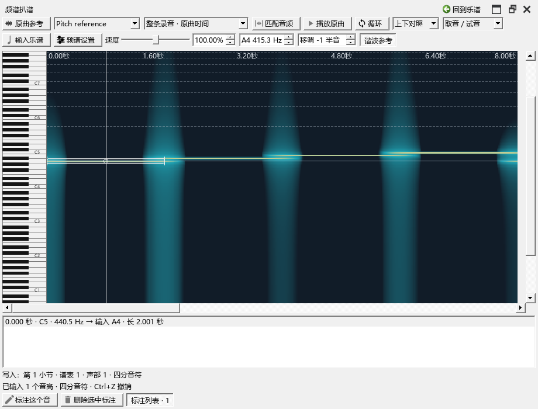
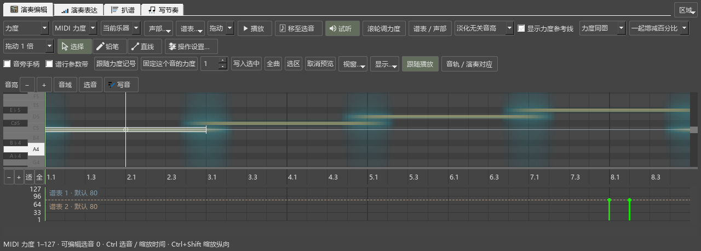

# 循环听辨、调律与对照检查

对应0.102.0，接续B3手动扒谱。

## 发现和修复

循环听到片段中间，调整均衡后会回到开头。复现中，原曲位置从约1.60秒跳回1.00秒，见`spectrum-102-before-pluginhost.txt`。

现在保留完整循环范围，按当前位置继续。实际点击均衡、选频、速度，再暂停继续，核对播放头；下一遍也播放完整循环。

过短循环的提示直接说明“至少0.2秒”和拖长结束位置的方法。

继续检查发现：8—12秒的片段播放结束后，点击约10秒再播放，仍从8秒开始。记录为`spectrum-102-probe-pluginhost.txt`。频谱现从原曲播放器读取当前位置，停止后也使用这份位置；复查从约9.997秒开始。

## 调律、移调和写谱

使用已知440Hz的测试音。将A4设为415.3Hz、移调设为+2，点选并标注，核对原始频率、确认音名C5与保存的调律。随后将移调改为−1，列表显示“输入A4”，写入乐谱后实际音高为69。

保存MSCZ并重新读取，核对音符和原始频率；再撤销、重做输入与标注。上下对照和叠加对照分别检查键盘、光标及音符块开关。调整配色灵敏度时复用已有分析。

切换显示方式后等待画面绘出再截图。复选框实际点击方框，并读取勾选结果。早期检查点击了横向拉伸后控件中间的留白，已修正；产品中的方框和文字可以正常点击。

## 缓存容量

内存缓存设为8MiB。分析高分辨率的0—120秒，再看60—180秒，旧范围15块复用、15块新分析；缓存用量为8000KiB。返回最早一块时重新分析，核对旧块已经淘汰。

磁盘容量设为1MiB，在独立测试目录准备超出容量的旧分析块，再生成新结果。清理后约717238字节，普通命名文件的内容保留。三格式、音高、基音显示、听辨过滤、节拍估计、取消及容量检查共21项通过，日志`spectrum-102-algorithms.txt`。

## 完整回查

本批10项界面流程，加准备、结束共12项通过，日志`spectrum-102-release-ui-pluginhost.txt`。包含长录音取音、连续写谱、标注时值、整首／片段、缩放、首次打开，以及停播后符号面板和原曲参考点击、工作视图两侧宽度。

原曲共同播放入口、重复播放、精确选段及普通乐谱播放4项，加准备、结束共6项通过，日志`spectrum-102-editor-performanceeditor-run.txt`。窗口回查仍保留既有的绘制警告；实际控件与最新截图已查看。

媒体模块的短循环提示更新后，再运行循环听辨和调律对照两项，加准备、结束共4项通过，日志`spectrum-102-final-module-pluginhost.txt`。

B3软件操作收尾，下一项B4写谱。真实音乐在声卡上的听辨与连续编曲使用随B5／F核对。操作见[扒谱完整步骤](WORKSPACE_066_GUIDE.md)，全部任务与顺序见[当前进度](REWORK_PROGRESS.md)。

发布定位：`personal-v0.102.0`。
