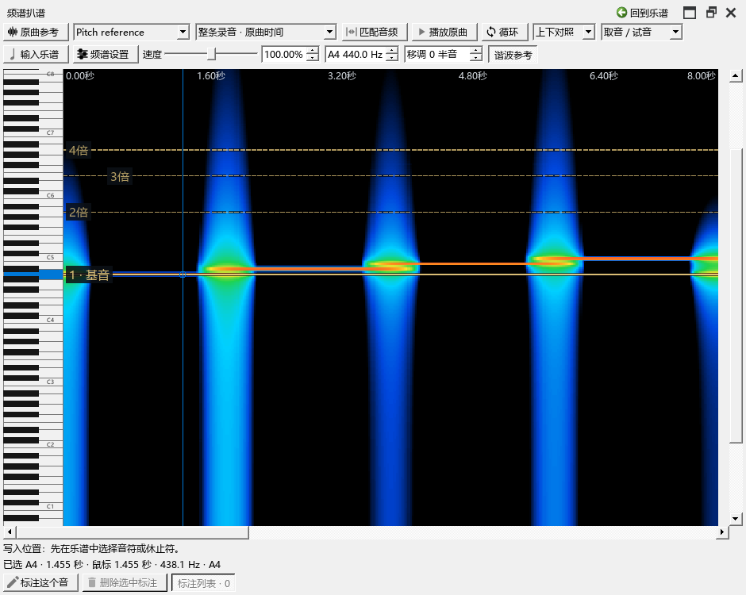

# 频谱：先准备录音，再听辨和对照MIDI

从“视图 → 演奏编辑器 → 扒谱”打开。先在“原曲参考”添加音频，再从扒谱页的音轨框选择它。频谱先准备当前看到的部分，随后在后台准备整条录音。下方状态写出进度；“频谱设置 → 分析”可以停止、重建，或关闭整轨预读。

## 一个完整例子

1. 打开钢琴谱，向原曲参考添加 WAV、MP3 或 FLAC。切到“扒谱”，选这条录音。
2. 范围选择“整条录音 · 原曲时间”。点“匹配音频”看全曲，或用底部滚动条浏览；Ctrl+滚轮以鼠标处缩放。已经准备的部分会继续显示，细节随后补上。
3. 鼠标移过亮线，左侧对应琴键会强调。单击选择这个音，“谐波参考”显示基音及2倍、3倍等频率的位置。右键单击可试听当前音高。
4. 在“频谱设置 → 显示 → 参考线…”调编号数量、颜色和强度。设置区与频谱之间有分隔条，可拖动高度；点“频谱设置”收起设置，给图像留空间。
5. 按空格播放／暂停原曲；在扒谱页的卷帘时间尺单击，可以先定位置再按空格。Shift+空格用于敲击节拍网格。
6. 点“标注这个音”，或使用“画／调整标注”拖出音高与时长。先在谱面设置输入位置、声部和时值，再点“输入乐谱”。每次写入可用Ctrl+Z撤销，保存乐谱后标注继续保留。

## 选择怎样对照

“上下对照”保留独立频谱和键盘；“叠加对照”放在钢琴卷帘背景，使用卷帘的时间尺、缩放与滚动。选一个关联片段时，录音按内部对齐点对应谱位；选择整条录音时，叠加时间从乐谱的零点按原有速度换算。要调整录音与谱面的关系，可先在原曲参考建立片段关联。

叠加时，按住Alt可以选取和调整谱中音符。普通演奏编辑页继续使用原来的选音、画音和播放操作。把卷帘浮出后，其时间尺也可以在扒谱页定位和用空格控制原曲。

## 看清基音、倍频和音符

“WaveTone 强弱色”从黑、蓝、青、绿、黄、橙到红显示由弱到强的能量；“灵敏度”和“对比度”用于分辨亮线。“突出基音”可以逐渐淡化倍频，归零即可看原始结果。现有个人配色继续保留。

“谐波参考”由当前所选音产生。编号1是基音；2、3等为它的整数倍频率。用它比较一组亮线是否可能来自同一个音，按需要减少编号，或调高线条强度。

“叠加时显示谱中音符块”及“显示MIDI轨道”分别控制两类音符。选音、轨道显隐与静音继续在原位置操作。

## 外部MIDI与临时写作

打开卷帘上方“轨道”，导入MIDI或新建临时轨。导入轨先静音显示，检查好对齐后取消M列静音即可试听。点“对齐…”选择对应的原曲音轨、偏移和内部对齐点；频谱使用这份时间关系显示音符。与谱面关联片段叠加时，在轨道时间框选择“按谱对齐”。完整操作见[MIDI轨道](MIDI_TRACKS_160_GUIDE.md)。

临时轨可以画音、改音长、调力度、录制，也可以删除和恢复。需要写进谱子时，点“写谱草稿…”选择谱表、声部及量化，再查看并采用。

## 保存、关闭与准备速度

标注、录音关联和MIDI轨道随乐谱保存；音频文件保留在原位置。频谱分析结果存入E盘缓存，可在“缓存设置”修改位置与容量。默认内存128MiB、磁盘1GiB，沿用已经保存的个人设置。

关闭扒谱区域后，后台分析停止；再打开可继续读取已有缓存。缩放、音域和调律通过已有分析换算，配色直接重绘；切换FFT预设会准备该预设的分析。长录音首次准备时可先听当前部分，进度完成后浏览全曲。

发布定位：`personal-v0.162.0`。交互参考：[WaveTone操作说明](https://ackiesound.ifdef.jp/doc/wthelp/htuse1.html)、[Sonic Visualiser手册](https://www.sonicvisualiser.org/doc/reference/5.2.1/en/)。
