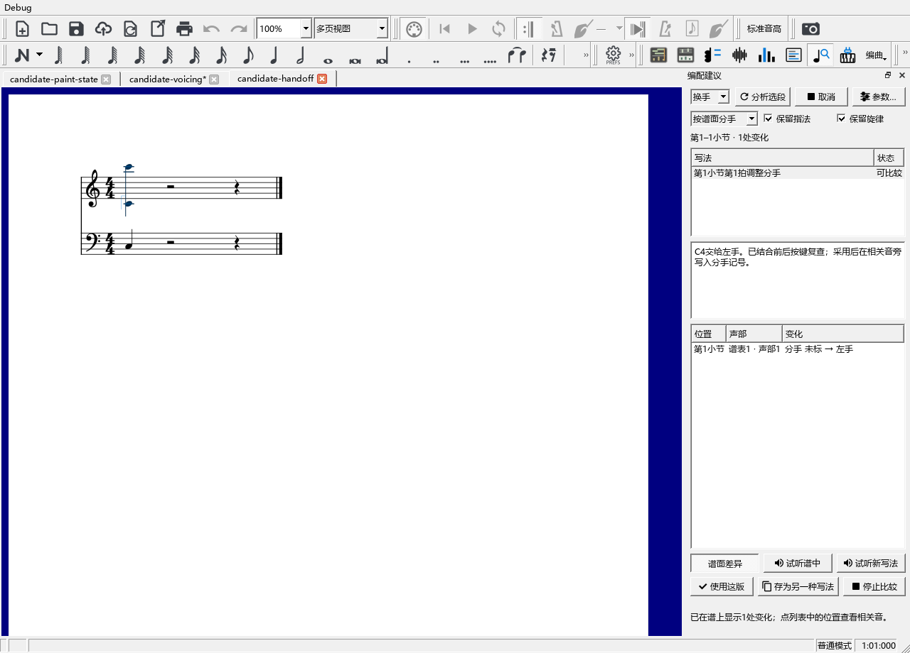
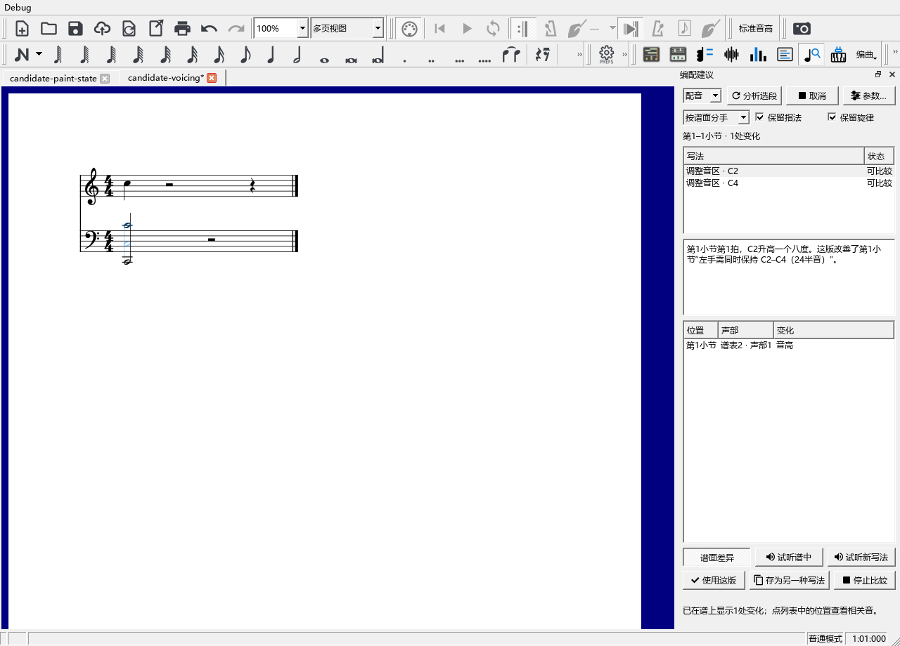
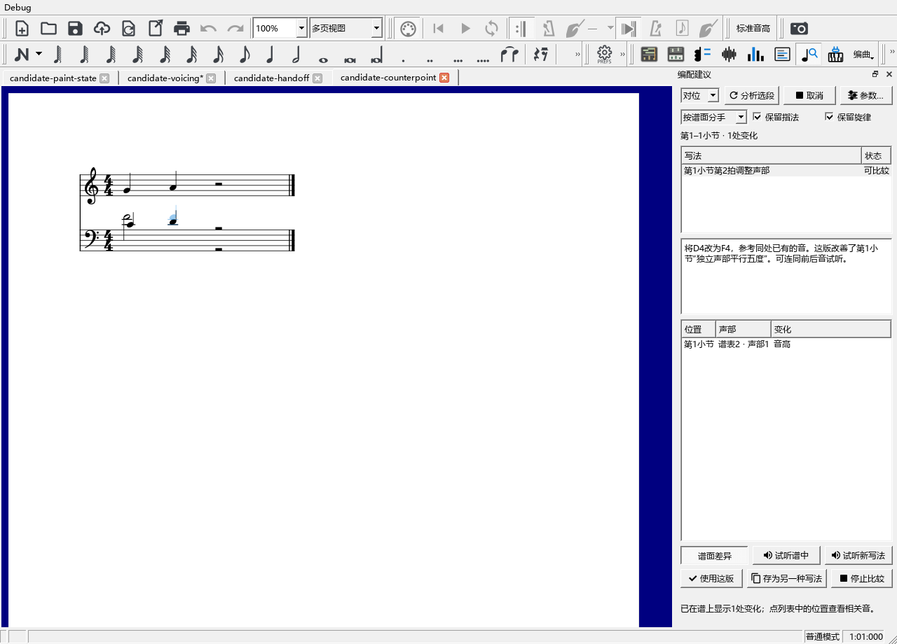

# 比较换手、音区和声部写法

本批源码已检查，尚未安装。当前使用0.128.0，更新安排见[当前进度](REWORK_PROGRESS.md)。

## 从哪里开始

在乐谱中选中要调整的几小节，打开“视图 → 编配建议”。左上可选择“指法”“换手”“配音”“对位”，然后点“分析选段”。底部显示读取与比较进度，旁边的“取消”可结束本次分析。

分析后点击一条写法，谱上出现相应变化，下方列出位置和具体内容。“谱面差异”控制这层显示；“停止比较”收起差异并结束试听。

## 换手：把哪些音交给另一只手

例如右手同时弹C4和C6，左手弹C3。自动分手可比较让左手接C4的安排，说明会写“C4交给左手”，变化列表显示“分手 未标 → 左手”。

1. 选择“换手”，下面使用“按谱面分手”。
2. 点“分析选段”，查看写法中的音名和分手。
3. 点击下方位置查看相关音，点“使用这版”写入分手记号。
4. Ctrl+Z撤销，Ctrl+S保存。再次打开乐谱，分手记号继续保留。

同一时刻的换手一起比较，上下谱表和不同声部都参加前后衔接检查。已经明确写出的分手继续采用。纯换手的声音相同，主要变化能从谱面与列表看到。

## 配音：尝试八度调整

“配音”会尝试把伴奏中的一个音升高或降低八度，再检查同时按键和前后声部。说明写出改变的音、拍位和改善的位置。

例如左手C2与C4同时按住，超过个人跨度时，可以比较把其中一音移近的写法。勾选“保留旋律”会保留默认旋律声部，以及你在编配检查中指定为旋律的声部。需要尝试修改这些音时，可取消勾选后重新分析。

1. 左上选择“配音”，点“分析选段”。
2. 点击一条写法，比较谱面上的原音和淡色新音。
3. 用“试听谱中”“试听新写法”听选段，选好后点“使用这版”。
4. 想留下两种写法，点“存为另一种写法”，再到“分段试写”切换。

比较同时检查和声、对位及按键困难。低音排列会按同一对音的音区和共同持续时间比较，帮助避免解决跨度后又加重浑浊。

## 对位：比较前后两组音

在编配检查中先指定独立声部，再到编配建议选择“对位”。建议会从同处已经存在的音和已知和弦中寻找小范围改法，持续到这里的长音也可作为参照。

例如两条独立声部从C4/G4一起上行到D4/A4，形成连续五度；同处内声部持续着F4时，可比较把D4改成F4。说明会写出原音、新音和改善的声部进行。

点击写法后查看前后音，再用两种试听比较。喜欢这版就点“使用这版”，或用“存为另一种写法”留待比较。

## 设置、保存和恢复

“参数…”沿用个人跨度和风格设置。“按谱面分手”使用现有记号与声部安排；“选段用右手／左手”用于指定一只手的短句。改变分手、保留条件或参数后，点“分析选段”重新比较，面板会在原位置提示。

一次“使用这版”对应一次撤销。采用后可以继续正常编辑，Ctrl+S保存；“存为另一种写法”的内容随分段方案保存。读取、查看差异和试听期间，原谱继续保持原来的音符与演奏设置。

指法的完整例子见[按实际按键安排指法](SUGGESTIONS_PHYSICAL_GUIDE.md)。本批具体结果见[检查记录](SUGGESTIONS_CANDIDATES_CHECKS.md)。
