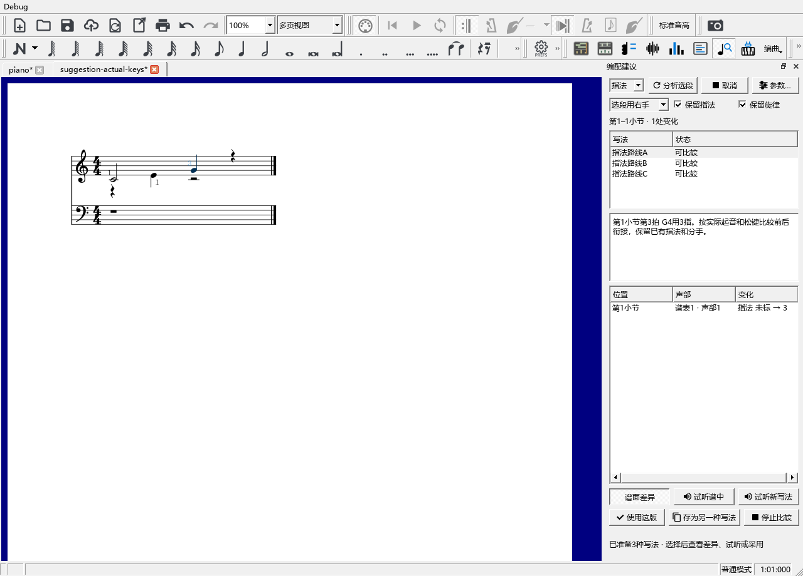

# 编配建议：按实际按键安排指法

这项修复已包含在 **0.129.0**，使用步骤如下；发布与后续检查见[当前进度](REWORK_PROGRESS.md)。

## 可以怎样使用

在一小段音乐里比较几条指法，查看谱上的变化，试听后选择喜欢的一条。分析会读取演奏编辑器中实际设置的起音、松键和踏板，已经松开的琴键会腾出手指。

例如C4在谱上写了半音符，演奏编辑器让它提前松键；接着E4仍可使用同一根手指。若把C4的播放音长延长到E4之后，建议会重新检查两个音的指法是否相容。

## 从选段到采用

1. 在谱上选中要比较的几小节，打开“视图 → 编配建议”。选一个音时，目标就是这个音的范围；想比较前后衔接，请选完整的乐句。
2. 左上选择“指法”。下面的“按谱面分手”使用谱内记号和已有设置；“选段用右手／左手”适合检查指定手的短句。
3. 保持“保留指法”勾选，点“分析选段”。底部会显示实际演奏的读取和计算进度，旁边“取消”随时结束这次分析。
4. 点击指法路线A、B或C。说明写出小节、拍位、音名及建议手指，谱面显示相应指法；下方列表写出“指法 未标 → 3”这样的具体变化。
5. 用“试听谱中”“试听新写法”听同一范围。需要结束比较时点“停止比较”。
6. 点“使用这版”写入指法。Ctrl+Z撤销这次采用，Ctrl+S保存。重新打开后，指法和原有的演奏音长继续保留。

“保留旋律”帮助保留旋律音高，旋律仍可添加指法。“保留指法”勾选时，已有单指、备选指法和换指都参与计算。想重新安排已有指法，可以取消勾选再比较。

## 怎样看前后衔接

持续按住的琴键会保留它正在使用的手指。踏板留住、手指已经松开的声音继续参加音响检查。明确的同音换指按[换指说明](ARRANGEMENT_SUBSTITUTION_GUIDE.md)中的时机使用相应手指。

反复播放仍对应同一个谱面音，因此新增指法要适合它的各次出现。建议写入同一条记号。需要核对的分手和指法会列在路线说明里，方便回到相关位置调整。

每条路线比较同时按键的伸展和前后移动。参数中的“和弦伸展”“移动手位”“穿指／跨指”等用于调整比较时的侧重；默认值继续沿用个人设置。方法参考[钢琴指法研究的连续音组模型](https://arxiv.org/abs/1904.10237)，具体计算与操作结果见[本批检查](SUGGESTIONS_PHYSICAL_CHECKS.md)。

## 后续继续检查

本批先统一实际按键资料、指法路线与显示。换手、配音和对位候选的连续片段比较继续按C3-B3-B处理，随后是MIDI松手导出和净谱检查。
