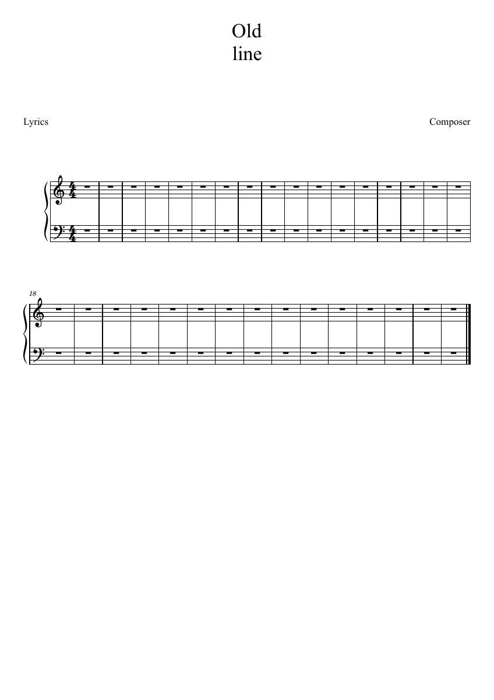

# E4：八项上游修复与个人适配

日期：2026-10-30。个人版本0.155.0，随包MCP继续使用2.7.2。用户已明确选择合入全部八项。使用现有E盘编译和测试运行目录，用户原谱与官谱保持只读。

## 来源

每项保留上游作者、日期和来源，并分别形成提交。停止后重播的0514c6695b84已由0.148处理，本批保留现有停止逻辑。

| 上游提交 | 本地合入提交 | 作者 |
|---|---|---|
| 97b26c87481f | 063e6ab06a3d | marc.adler |
| f9481b33ff1c | 2bd3311bc355 | marc.adler |
| eb9fbbcbfbc0 | 8b9b001c5d7f | marc.adler |
| dd0ca13f8d7e | 054e77d29789 | J.G. |
| 29f7827edc40 | e2c1d927df8c | marc.adler |
| 424d537f8220 | 983f639a72f6 | jeetee |
| 18ac05e6ebc5 | 194883d29c96 | Joachim Schmitz |
| 2c37d143bc8c | 372bebb9fb3f | marc.adler |

个人适配补充三处：播放中的预览定位复用已经准备的事件；GPIF按真实MasterBar元素逐个读取，兼容开头或中间有注释的文件；旧HTML的行分隔转换为本软件文字排版采用的换行。

## 实际检查

| 操作 | 结果 |
|---|---|
| 普通播放和工具试听，循环起点60tick、终点960tick | 起点没有新音；暂停处理界面消息100毫秒时保持一个返回请求，连续至少8次循环、12次播放中定位、停止与再播通过 |
| 反复第二遍调整为1.5、0.75、1倍速度 | 普通时间及原曲输出时间两组通过，改速后仍处于当前遍次，音频输出有限且有声 |
| 最近65份文件、先打开25份，再打开历史中的全部60份 | 列表最多20份，关闭后返回前列，全部打开时实际中文提示可见 |
| 新版多行文字和旧1.14真实格式 | 读取、重新保存和PDF分别核对；最终图像见下方 |
| 关闭展开反复，在首节与谱尾分别停顿1.25和0.75秒 | 重新保存读取保持；MIDI总长由8秒变为10.001秒，约2秒停顿全部保留 |
| 原有fermata、repeats、multivoices GPX | 分别为4、3、3小节 |
| GPIF前一时刻没有当前声部，含注释／不含注释 | 均读出4小节，当前音上的延长记号保留 |
| 停播后符号与原曲面板，连续试听，实际可见范围跟随 | 本批7项已有操作回查通过 |
| A/B踏板新增、修改、删除、切换及保存重开 | 本批回查通过，链接分谱的共用标记保持 |

新增7个实际情景与已有7个操作分别运行。循环两组输出最长声音块分别为0.610和1.028毫秒，回查实际播放最长0.572毫秒，超时块为0。测量来自测试驱动的真实合成输出；声卡听感及CFX实际按钮仍按原计划另行检查。

## 检查中发现并处理的差异

- 首轮分节重开失败来自测试直接设置停顿后仍保留默认样式标志。测试改为与检视器相同的独立数值保存方式，重新保存读取通过。
- GPIF测试初次丢首小节，确认读取器无条件跳过第一节点。改为按MasterBar元素读取，同时检查有注释和无注释。
- 延长记号测试的GPIF编号从0开始，测试拍位由3/1改为2/1，对应第三个四分位置；更正后检查真实附着音。
- PDF检查发现旧HTML的行分隔仍排在同一行，已修正旧格式转换并增加真实1.14文件读取。PDF文字抽取中的制表符、字体子节点及Unicode行分隔分别处理后再核对内容。
- MIDI保留谱尾0.75秒停顿，总时差应为两处合计2秒；检查同时读取中间拍位的1.25秒和完整文件时间。

早期失败记录保留在P2/out/upstream155-first-pluginhost.txt、upstream155-adapted-pluginhost.txt；最终结果在upstream155-final-pluginhost.txt及upstream155-regression-pluginhost.txt。导出文件和独立时间检查在P2/out/upstream155/exports.json。

- 反复改速的第一次检查在等待界面消息后才取位置，包含了正常前进的时间。最终检查直接记录声音线程收到新速度时的拍位，并同时保留稍后界面看到的位置。
- 独立测试运行目录会由检查脚本恢复安装程序；文件导出前逐次核对exe校验值。正式Windows导出与离屏模式的字体行距有差异，最终图片和安装检查均使用正式Windows方式。两行旧标题样例相应增加标题框空间，并移除原单行样例的副标题。

## 安装与剩余操作

0.155已安装到原目录。正式程序再次导出新版文字PDF15965字节、旧HTML文字PDF22388字节、分节MIDI321字节；MIDI与预检查文件逐字节一致。kumo.ini、Qt组件、MCP2.7.2及旧连接程序校验值保持。发布定位personal-v0.155.0。

CFX桌面检查按用户安排延后，E2-W2等待当前Codex重连；实体MIDI、声卡听感及Synthesia继续留在[完整进度](REWORK_PROGRESS.md)。

正式程序SHA-256：`b96a2ac566dc514e3c7c10d4ebed87c48ecdd1d344745373ced6fc7413342213`。原0.154程序与中文翻译备份保存在E盘P2/out/upstream155/before-install。
