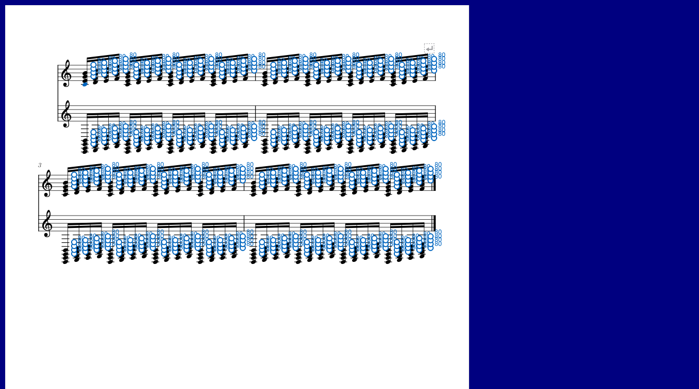
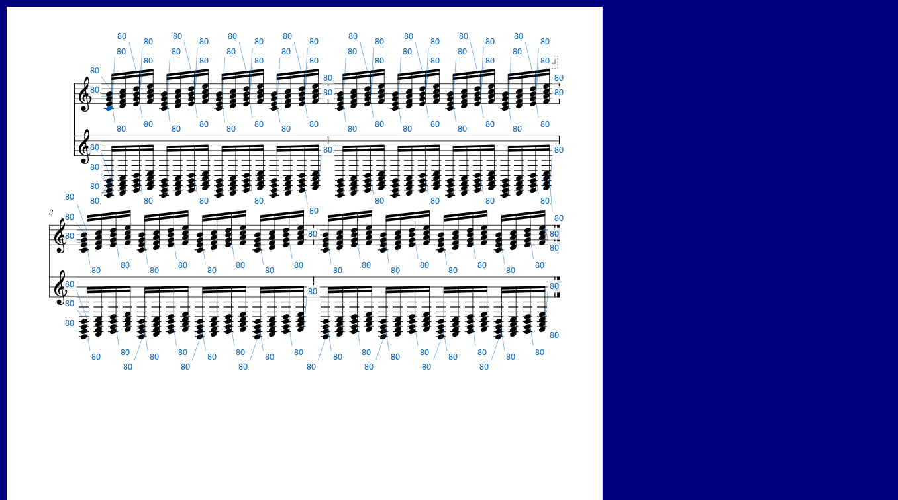

# A4：密集力度数字与谱行带检查

对应0.94.0。正常窗口1360×920，使用独立设置与测试谱；真实谱由已保存的只读副本再复制到测试目录。

## 查到的问题与修改

- 原先每个音在固定偏移处直接画数字，密集和弦的圆圈和文字挤在一起，卷帘短音符的文字也会盖到附近音符。
- 数字改为按选音、指向音和待调整音的顺序寻找附近空隙；谱面同时避开音头、符干、符杠和变音记号。手柄位置保持。
- 可见谱行的符号轮廓在布局更新后按需读取；数字位置在文字宽度、优先顺序、视口、手柄或布局变化后更新，静止重绘继续使用已有位置。
- 真实谱中复现：编辑器刚打开便关闭，随后开启常显，画面没有数字。修改前画面变化断言失败；开启时补齐数据读取后出现实际数值。

## 实际操作

- 四小节密集钢琴谱：两谱表、连续十六分音符与和弦；查看卷帘及谱面数字，逐张检查文字、音符及指向线。
- 谱行带：选第一、第二行，Ctrl滚轮缩放；检查紧凑菜单及高度边缘的上下箭头，拖高度48→80，再拖力度柱、采用及撤销，实际力度恢复，鼠标占用归还。
- 真实谱副本：六谱表、155小节，在已有修改和布局下打开、关闭编辑器、开启常显和谱行带；核对画面确实改变、撤销记录保持及文件校验值。
- 位置布局：边缘数字完整、数字之间互不相交、音头空位保留；改变优先顺序、布局和障碍时重新计算，重复重绘复用结果。

## 检查结果与耗时

- 本批5项通过：位置布局、密集谱面和卷帘、真实谱副本、谱行带跟随缩放、最近音滚轮。日志：`values-094-cached-pluginhost.txt`。
- 修改前的真实谱常显失败记录：`values-094-real-before-pluginhost.txt`；修改后：`values-094-real-open-pluginhost.txt`。通过画面实际变化与截图核对数字出现。
- 四小节密集谱的重绘中位数：卷帘关闭数字0.725 ms，开启2.310 ms；谱面关闭6.535 ms，开启7.854 ms。真实谱六谱表、155小节开启后为7.639 ms，P95为10.999 ms。
- 1000个数字请求的独立位置检查用时1.468 ms，在有限空间内显示147项，已逐项检查边界及相互重叠。该数值包含测试断言；完整界面耗时以上方原生窗口测量为准。
- 初版每次重排时，密集谱面开启数字为10.655 ms；缓存后为7.854 ms。可见谱行轮廓和位置复用已纳入后续检查。
- 原有9项编辑操作通过，包含直接拖动、重叠选音、谱面联动、实际演奏器生命周期、临时及常显数字、参考线、分谱表一起调整和悬浮卷帘。日志：`values-094-editor-confirmed-performanceeditor-run.txt`。
- 上轮3项窗口与输入回查通过：工作视图两侧尺寸、播放打断拖动后归还鼠标并实际点击原曲参考／符号、编辑器区域比例。日志：`values-094-workspace-pluginhost.txt`。
- 最后补查高度边缘光标、连续拖高与改力度、谱行位置及0.94版本标识，3项通过；实际谱窗直接接收移动事件，日志：`values-094-edge-confirmed-pluginhost.txt`。正式程序编译通过。
- Windows实际输入的检查本轮在确认前台窗口时停止（前台进程为0），尚未发出滚轮输入，记录保留于`values-094-editor-regression-performanceeditor-run.txt`。本轮Qt滚轮操作已核对目标与数值，系统按键已有0.90记录，完整工作过程继续在F检查。
- 真实谱副本校验值保持`4a62cc33723b1c19a207102f27425c983e9fd40d570a2ff65d7a818b82ac91ad`，用户原谱保持只读。

操作见[看清力度数字和谱行带](VALUES_094_GUIDE.md)，后续顺序见[进度与完整计划](REWORK_PROGRESS.md)。
