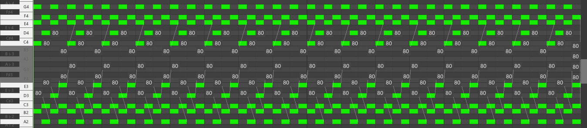
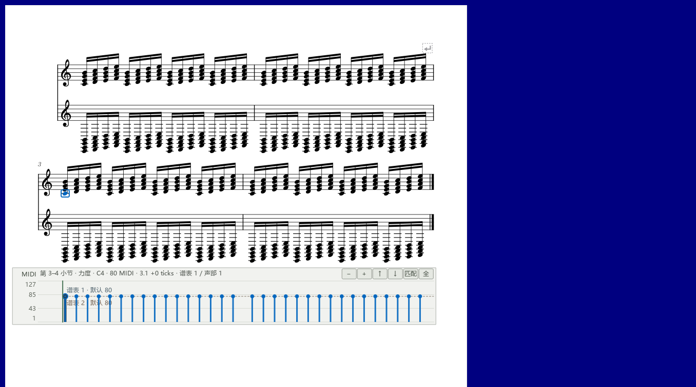

# 看清力度数字和谱行带

适用版本：0.94.0 · Kumo branch / Freddd13。

## 临时查看，或一直显示

1. 打开“视图 → 演奏编辑器”，选择“力度”。
2. 按住Ctrl+Alt+V查看选中音和鼠标附近的力度；再按Shift查看当前视口。
3. 希望一直查看时，在“显示…”勾选“一直显示力度（谱面与卷帘）”。
4. 松开快捷键或取消勾选，回到原来的画面。

谱面数字采用对应声部的颜色，在音符附近寻找空隙；离开原位置的数字用细线指向相关音。可拖的音旁手柄仍在原来的位置。

卷帘中，放得下的数字写在音符条内；短音符的数字放在附近空隙。密集处先显示选中、指向和正在调整的音，放大后可以查看更多。

## 把谱行带放在正在编辑的一行旁边

1. 勾选“谱行参数带”。
2. 在“显示… → 谱行带位置”选择“跟随选中／播放谱行下方”。
3. 在谱面选音，谱行带随所选谱行移动。播放时跟随当前播放行。
4. 鼠标移到可拖边缘会显示上下箭头。在谱行下方时拖底边；在谱行上方或固定底部时拖顶边。右键标题也可选“谱行带高度”。
5. 用刻度旁的“−／＋”缩放数值范围，“匹配”查看本行数据；窄谱行的更多操作放在“⋯”中。
6. 拖力度柱或端点调整选音，Ctrl+Z撤销这次修改。

当前谱行旁边空间较小时，谱行带会放在附近可见的边缘。也可以选择“固定在视口底部”。高度和位置按个人设置记住。

显示数字、改变高度和缩放只调整画面；拖力度会保存到乐谱，一次拖动可以一次撤销。高低谱表一起调整的方法见[力度操作](DYNAMICS_090_GUIDE.md)，具体检查见[本批记录](VALUES_094_CHECKS.md)。
