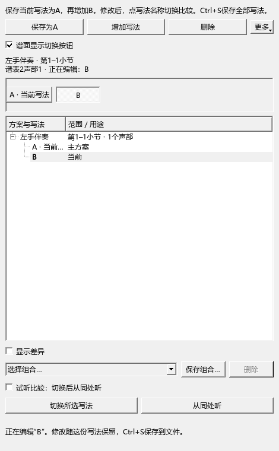

# 保留、切换和删除分段写法

适用版本：0.70.0。打开“工具 → 分段试写方案”。

## 第一次尝试 A、B 两种伴奏

1. 在谱面选几小节，点“保存为A”，核对小节、谱表和声部。
2. 点“增加写法”，起名为“B · 分解和弦”。面板“正在编辑”随即显示 B。
3. 回到谱面修改 B 的音符、节奏或力度。
4. 单击面板列表中的 A，或者上方的 A 按钮，谱面切换到 A；这时可以继续修改 A。
5. 单击 B，会看到刚才修改的 B。每次切换都会保留离开前的修改。
6. 按 Ctrl+S 保存 MSCZ。重新打开这份文件，继续切换 A、B，各份写法及上次正在编辑的选择都会恢复。

列表中加粗并标有“当前”的一行，就是正在谱面里编辑的写法。“正在编辑”还会列出具体小节、谱表和声部。用键盘选择列表项目时，按回车切换。

0.69.0 的列表单击只选中名称，双击才切换，与当时说明写的步骤不一致。0.70.0 已统一为单击切换。

## 删除写法、方案组和组合

- **删除一份写法：**在列表中点这份写法，再点上方“删除”。窗口列出名称及接下来显示的写法，点“删除”完成，点“取消”继续编辑。
- **删除整组：**在列表中点方案组那一行，再点“删除”。当前谱面内容保留，这组的 A、B 等记录一并移除。
- **删除最后一份写法：**同样保留当前谱面内容，并结束这一组方案。
- **删除一个组合：**在组合列表中选名称，点旁边的“删除”。各组 A、B 写法继续保留。

删除都支持 Ctrl+Z 恢复，Ctrl+Shift+Z 重做。删除当前写法后显示相邻写法；删除了主方案时，当前写法接替主方案。引用被删写法的组合会改用接替的写法，删除窗口会说明名称。

## 把谱面小按钮移开

直接拖动小节上方的切换按钮，把它放到附近空白处。单击按钮仍会打开写法菜单；在按钮上按 Ctrl+滚轮仍可切换写法。

- 菜单里的“隐藏这组按钮”只收起这一组。
- 面板里的“谱面显示切换按钮”统一显示或收起所有组。
- 想找回某一组，先在面板选中该组，再点“更多 → 恢复这组谱面按钮与位置”。
- 按钮菜单的“恢复自动位置”也可以重新摆回。

手动位置与单组隐藏状态随谱保存，支持撤销和重做；缩放时跟随谱面位置。统一显隐开关保存在个人设置中。谱面小按钮用于屏幕操作，打印和 PDF 使用正常乐谱。

保存方式、主方案和普通版副本的完整说明见[用户说明第13章](../USER_GUIDE.md#13-分段试写同一段保留ab几种写法)。提交定位：`personal-v0.70.0`。
