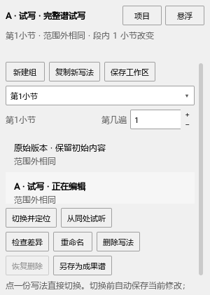
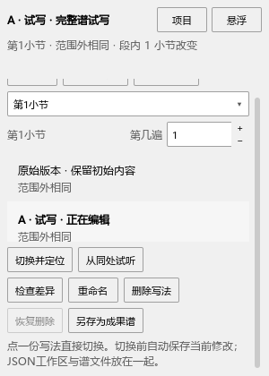

# 完整谱试写与说明整理检查

日期：2026-10-20；个人版本0.76.0。

程序SHA256：`379aa9d4403b4cd46f95551fc42c3d3b535751ac8b3b44b0a3eaef6b035704cc`。已更新原安装目录，kumo.ini保持原设置。

## 从修改到保存

在独立钢琴测试谱建立完整谱工作区，修改A后切换到原始版本，直接读取A的MSCZ。修复前仍是MIDI59；修复后读到60。再回到A改为61，切换后读回61；A保持同一标签页和音符对象。

复制B后把对应音改为65，离开B后读回65。随后普通Ctrl+S把A保存为67，从原始乐谱重新打开工作区，A显示67。JSON另存到带中文名称的新位置，材料路径仍指向正确文件。

检查还包括：

- 删除A并恢复，A的修改保留；期间给另一组改名，恢复时仍保留该名称。
- 选中文件有问题的条目后删除，移除正确条目，当前正在编辑的A保留。
- 另一组暂时打不开时修改A，保存仍写入实际正在编辑的A。
- 删除全部组，重开空工作区，再建立新组；原A、B文件继续存在。
- 原始乐谱的内容状态和撤销位置保持。

最后的完整过程与元信息检查共4项通过（含初始化与结束），日志：`P2/out/usability-076m-final-pluginhost.txt`。此前连同插件连续重载、启用状态／快捷键、原生选择色、P键盘及选区边框共7项通过，日志：`P2/out/usability-076l-final-pluginhost.txt`。

## 面板与插件扫描

实际点击列表切换，点击删除和恢复。分别查看400×740和300×420窗口；窄窗口滚动到底部，检查按钮、文字与滚动条各有空间，底部说明可完整看到。

公共QML控件曾在插件元信息扫描中执行初始化。现在跳过本项目这些控件，真实插件及带模块别名的MuseScore根对象仍可读取。原有其它插件继续按原方式扫描。

原生副本保存、资源与个人演奏属性、速度显示、只读版本和查询兼容共6项通过（含初始化与结束）。日志：`P2/out/usability-076-copy-regression-p1native-run.txt`。

## 说明与发布资料

主说明按日常操作阅读，历史设计和字体研究保存到独立历史文件。本机已有的27行字体研究追加原文保留在工作文件；发布说明使用本批准备的版本。主说明与已准备提交的内容逐字节一致，安装后的本地链接也已逐项检查。说明SHA256：`64284d86cdd18362f4688676c94be6dd9f7e78244c7aac5fd34d025b5a0817e1`。

启动画面、帮助关于的个人版本与作者标识，以及工作流数据保存、撤销与字体排版共4项通过（含初始化与结束），日志：`P2/out/usability-076-delivery-brand-pluginhost.txt`。

完整操作见[保存、切换与恢复](VARIANTS_076_GUIDE.md)。其它功能继续按[完整使用检查](USABILITY_REWORK_20261019.md)推进。
