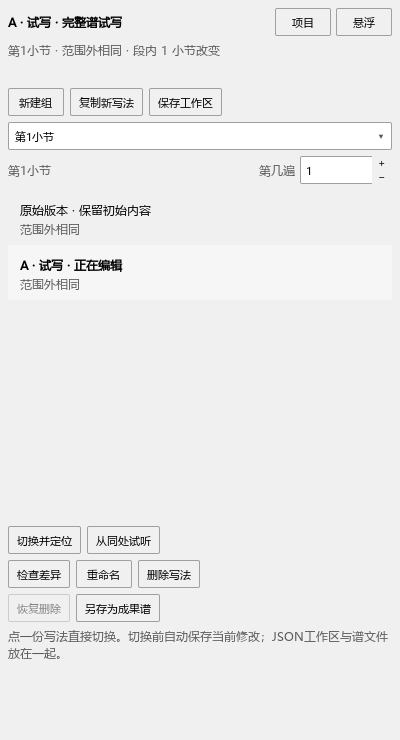

# 完整谱试写：保存、切换与恢复

这个插件用几份完整乐谱比较写法。内置“分段试写方案”把局部A/B随一份MSCZ保存；这里继续打开已有JSON工作区，也适合需要改整首曲子的方案。

## 先试A，再试B

1. 在插件管理器勾选ArrangementVariants_MS3.qml，从“插件 → Arrangement Variants”打开。
2. 在谱面选中要比较的段落，点“新建组”，选择JSON工作区的保存位置。
3. 程序保留一份“原始版本”，打开“A · 试写”。在A里自由修改音高、节奏、力度和标记。
4. 点“复制新写法”建立B；点列表中的A、B直接切换。离开当前写法前，程序先保存刚才的修改。
5. 点“从同处试听”比较这段；空格或乐谱停止按钮结束播放。需要改比较的反复出现次数，调整“第几遍”。
6. 点“保存工作区”。以后从“项目 → 打开工作区”选择JSON继续。普通Ctrl+S保存过的写法也可以继续打开。

列表标明正在编辑或查看哪一份。“原始版本”保留开始时的谱；想在它上面改，用“复制新写法”建立可编辑版本。

## 删除和恢复

点“删除写法”移除列表里的当前条目。“恢复删除”放回刚才移除的写法。移除整组使用“项目 → 移除这组”。其它组中的修改会继续保留。

谱文件仍在项目文件夹，恢复时可以继续使用。JSON和这些MSCZ一起保存，移动材料时保留它们之间的相对位置。删空所有组后，工作区仍可打开，再点“新建组”继续。

## 查看差异和保存成果

“检查差异”比较拍号、段外内容及跨段连线。你可以在当前谱里自由编辑；改了段外内容后，列表会指出差别，方便判断试听条件。

“另存为成果谱”保存当前完整写法。选择新的文件名即可继续保留试写工作区。

## 更换JSON位置

“项目 → 选择工作区保存位置”另存项目索引。已有谱文件继续使用原位置，关联路径会更新。取消保存窗口后，可以继续当前操作。

## 撤销

文件暂时打不开时，可以选中并移除那个条目；当前编辑的谱会保留。

谱面编辑使用Ctrl+Z；移除工作区条目使用“恢复删除”。切换前保存的是你当时正在编辑的内容。

