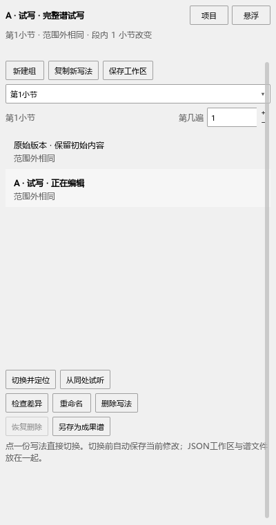
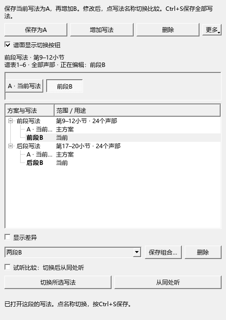
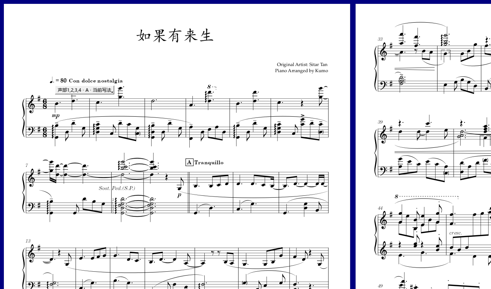

# 写法修改、切换和保存检查

日期：2026-10-23。版本：0.91.0；发布定位personal-v0.91.0。

## 完整谱工作区的另存问题

已复现：修改A后用“文件 → 另存为”保存，再继续改A，切到另一写法。新文件只保留另存当时的音，后续修改漏存。

原因是插件按原文件名寻找当前写法。现在每个已打开的乐谱拥有持续的会话标识，另存成功时通知工作区更新文件位置。这个标识只用于当前打开过程，保存的乐谱内容和撤销记录保持原有方式。

实际检查：A从MIDI59改成60，另存后继续改成62，再切走，读回新文件得到62。另存成功后立即读取JSON，已指向新文件；保存副本保持当前文件位置。重新打开原来的旧文件，它作为另一份乐谱显示；再点A，回到新文件及62。原有完整谱A/B、删除恢复、空工作区、另存JSON和保存检查一起通过。

日志：`P2/out/variants-091-save-as-before-pluginhost.txt`记录修复前漏存；`P2/out/variants-091-save-as-final2-pluginhost.txt`记录修复后的2项连续操作及准备、结束，共4项通过。

## 内置分段写法

只读复制《如果有来生 release5》到E盘检查，源文件SHA256为`4a62cc33723b1c19a207102f27425c983e9fd40d570a2ff65d7a818b82ac91ad`。读取后的谱有6个谱表、155小节。

第9–12、17–20小节分别建立A/B：修改音高、相对力度、固定力度和指法，切换单段及两段组合；再回A继续修改，保存MSCZ并重开。逐项读取音高、拼写、声部、时值、休止、延音、指法和力度保存值，各份写法保留自己的修改；段外内容保持。撤销、重做也恢复正确写法。两次整组切换为24.39、20.24毫秒，这个数字对应本机本谱，未包含完整屏幕重绘。

检查普通版主方案副本，读取到主方案A及原来的后段A；当前完整文件重开仍显示保存时的两段B。现有链接、跨界连线、独立声部、扩大范围、导入和导出检查继续通过。

实际点击删除并撤销、删除最后一份与整组、隐藏和拖动谱面按钮、换谱再回来，原有操作保持。第1小节和末小节各设按钮，滚到两端检查，只显示当前可见谱行对应的按钮；本轮未改动其位置算法。

范围说明原来逐项列出24个声部，占据多行。现在相同声部范围按谱表合并，正常460×650面板为两行，给写法列表留出空间。

本组9项操作及准备、结束，共11项通过。日志：`P2/out/variants-091-native-final-p1native-run.txt`。原谱最终校验及普通MSCZ内容读取记录：`P2/out/variants-091/archive-check.json`。

## 当前操作说明

内置写法按[保留、切换和删除](VARIANTS_070_GUIDE.md)操作，完整谱JSON工作区按[完整谱保存与恢复](VARIANTS_076_GUIDE.md)操作。后续按总进度进入A4，继续组件图标和音源面板。
