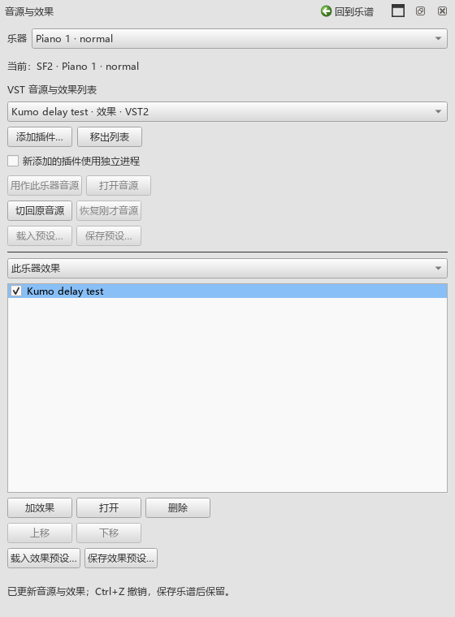
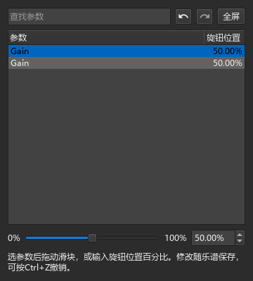

# 0.88.0 音源、效果和预设检查

本批从实际面板开始操作，使用E盘的独立测试谱和临时设置。Pianoteq与CFX使用本机已经安装的版本，SF2使用随程序提供的音色库。

## 操作与结果

| 操作 | 实际结果 |
|---|---|
| 清空扫描列表，用文件选择框添加插件，再为钢琴选择音源 | 列表从空提示变为已扫描插件；Pianoteq经面板载入并产生声音 |
| 两件钢琴分别加效果、切回原音源、再分别恢复 | 每件乐器的按钮与恢复记录对应；两件乐器同时恢复后使用各自实例 |
| 加主输出效果，再查看普通SF2乐器的效果 | 两种范围各显示自己的链；修复前普通乐器会误列主输出的效果 |
| 保存效果预设，输入25%，载入原来的50%，撤销、重做 | 实际插件参数依次对应；载入和手势各用一次乐谱撤销 |
| 在参数窗口拖滑块，再用Ctrl+Z撤销拖动与载入 | 数值、实际声音参数与撤销位置一致；窗口继续对应原效果 |
| 同一插件加两次，换顺序、旁通、删除其中一个 | 参数窗口跟随原效果身份；删除其它实例后继续可调 |
| 删除SF2乐器最后一个效果，再撤销、重做 | 恢复原SF2音色；撤销重新载入效果并产生声音，再重做返回SF2 |
| 保存MSCZ、重新读取效果与声音设置 | 音源、效果顺序、旁通及参数数据读回一致 |
| 在乐谱中改乐器名称、删除乐器，再撤销与换谱 | 乐器下拉及时更新；旧条目退出，当前操作对象保持有效 |
| 查找参数、查无结果、清空查找、全屏与返回 | 调节控件对应可见项目；空结果保持禁用；返回时恢复窗口大小 |

## 真实音源与声音

Pianoteq通过实际文件扫描、采用、打开厂商窗口、保存与载入预设。载入前后保持同一个音源实例，厂商窗口继续打开。切回SF2后核对原音色库、bank和program，实际导出的MIDI文件逐字节一致。

CFX载入本机Compact预设后的导出峰值为0.401428；SF2单独加测试效果后峰值为0.99。另一个两件乐器谱例，SF2切换前后峰值为0.990011和0.99，音色编号及MIDI文件保持一致。以上均检查有限的实际音频采样与非零输出。

CFX厂商窗口保持打开2.6秒，再保存修改：实例与引擎版本保持，产生一次撤销；再次保存同样参数保持原撤销数量。重新激活后又等待2.6秒，实际系统焦点保持在厂商窗口。窗口移出屏幕后重新显示会回到可见区域。

CFX在受限测试进程中载入超时；用正常本机权限检查后约6秒完成。相关等待日志继续保留，记录中区分测试环境与程序结果。桌面检查使用computer-use技能查看当前窗口列表；本批操作和截图主要来自实际Qt控件，声音由实际音源渲染检查。

## 界面与检查文件

说明中的截图使用MuseScore正式浅色、深色主题。检查280宽面板、360宽参数窗口和全屏返回，按钮按实际内容排列，窄窗口由整页滚动。

| 检查组 | 通过／失败 | 日志 |
|---|---|---|
| 效果范围、预设、拖动撤销、逐乐器恢复、搜索、全屏、乐器增删 | 7／0 | vst-088-final-ui-pluginhost.txt |
| 150%显示缩放、窄窗与同一套鼠标键盘操作 | 4／0 | vst-088-dpi150-pluginhost.txt |
| CFX、Pianoteq、SF2声音、MIDI与关闭扩展 | 5／0 | vst-088-release-sound-pluginhost.txt |
| CFX厂商窗口、实际焦点与保存时的实例保持 | 3／0 | vst-088-cfx-focus-final-pluginhost.txt |

各原生组包含准备和结束。日志放在`P2/out`；保存、读取及MIDI比较使用独立测试文件。本批完成离线声音检查，实体键盘延迟和声卡听感沿用此前结果，后续实际演奏检查继续记录。

最初的撤销检查未载入正常快捷键表，补齐与启动相同的配置后，浮窗中的按键、按钮和实际参数一起核对。当前仍会记录原有SF3采样边界和测试环境中的`no seq`提示。

发布定位：personal-v0.88.0。用户操作见[VST使用说明](VST_088_GUIDE.md)。完整返工继续按`Planning/USABILITY_REWORK_20261019.md`逐项进行。
