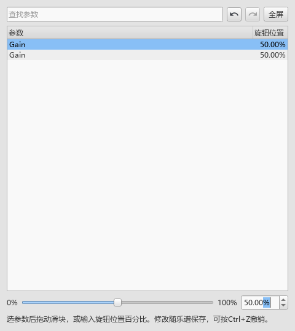

# 使用钢琴音源与效果

适用版本：0.88.0。打开“视图 → 音源与效果（VST）”，也可以从混音器的“音源与效果…”进入。最上面的“乐器”决定本次调整哪件乐器，“当前”显示它正在使用的音源。

## 第一次使用 Pianoteq 或 CFX

1. 打开乐谱，在面板的“乐器”里选钢琴。
2. 点“添加插件…”，选已安装的 `.vst3` 或 x64 `.dll`。扫描结束后，列表会写出名称、音源／效果和格式。
3. 选中 Pianoteq 或 CFX，点“用作此乐器音源”。“当前”显示新音源后，点“打开音源”。
4. 在厂商窗口里选择钢琴和预设。CFX 第一次可能需要先载入钢琴，可在厂商窗口选择，也可用本面板的“载入预设…”读取 `.ariax`。
5. 回到谱面点音符试音，用空格播放。厂商窗口可以留在旁边继续调整。
6. 保存 MSCZ，保留当前音源、预设和效果设置。

这台电脑的常用位置：

- Pianoteq：`C:\Program Files\Common Files\VST3\Pianoteq 9\Pianoteq 9.vst3`
- CFX：`E:\music_fonts\CFX Concert Grand\VST\CFX Concert Grand VST_x64.dll`
- CFX Compact 预设：`Presets\com.Plogue.Aria\02- Compact\Player\00_Default.ariax`

“移出列表”移除当前扫描条目。以后点“添加插件…”可重新加入；乐谱中已经选用的实例继续使用。

## 给一件乐器加效果

1. 用“添加插件…”加入效果器，在插件列表选中它。
2. 在“乐器”中选要处理的乐器，效果范围选“此乐器效果”，点“加效果”。SF2 乐器也可以这样使用。
3. 新效果会直接选中。点“打开”进入厂商界面；提供参数列表的插件会打开下面的参数窗口。
4. 列表按从上到下的顺序处理声音，用“上移／下移”调整顺序。行前的勾选控制启用，取消勾选可暂时旁通。
5. 点“删除”移除选中的效果。SF2 乐器删掉最后一个效果后，继续使用原来的 SF2 音色。

“主输出效果”处理乐谱各乐器汇合后的声音。切换这个范围可查看和编辑主输出自己的效果链；“此乐器效果”显示上方所选乐器的效果。

## 在参数窗口调整

打开后已经选中一个参数。用搜索框找名称，选中后拖下方滑块，或输入旋钮位置的百分比。插件提供的数值文字和单位可在参数行的悬浮说明中查看。

松开滑块或确认输入后，这次调整进入乐谱撤销。窗口上方可点撤销、重做，也可用 `Ctrl+Z`／`Ctrl+Y`。窗口可以调整大小，“全屏”展开查看，再点“返回窗口”继续编辑。

效果换了顺序，参数窗口继续对应原来的效果。删除该效果、切换乐谱或切回原音源后，对应参数窗口会关闭。

## 保存与载入预设

面板上方的“保存预设…／载入预设…”对应当前音源。效果链下方的“保存效果预设…／载入效果预设…”对应选中的效果。

例如保存一种混响：选中混响行，点“保存效果预设…”，选择 JSON 文件位置。下次选中同款混响，点“载入效果预设…”读回。载入后可用 `Ctrl+Z` 恢复之前的参数。

程序保存的 JSON 带有插件名称和身份，载入时会核对。选错文件时，面板会写出它适用的插件。原有 JSON、VST2 的 `.fxp／.fxb` 和 CFX 的 `.ariax` 继续可读。

## 回到 SF2、恢复、保存和导出

“切回原音源”恢复这件乐器选用 VST 前的音源与音色。当前打开的谱里，“恢复刚才音源”可以重新载入这件乐器刚才的 VST 和效果；换到另一件乐器，按钮对应另一件乐器自己的记录。这些切换各用一次乐谱撤销。

切到另一份乐谱后，可以通过原谱的撤销记录恢复先前的音源切换。

保存 MSCZ 后，音源身份、声音设置、效果顺序和旁通状态一起保存。插件与大型音色库使用本机安装位置。移动了插件，可重新添加新位置，再为乐器选择它。

音频导出采用当前声音设置。MIDI 导出保留原乐器的通用音色编号，便于继续放到播放器或 DAW 使用。普通 MuseScore 可以打开完整乐谱；在本分支关闭个人扩展时，VST 声部使用 SF2，谱里保留 VST 设置。

“新添加的插件使用独立进程”作用于下一次选择音源或添加效果。默认直接运行，适合低延迟弹奏；独立运行由随包的 `MuseScoreVstHost.exe` 处理，增加约两个 256 样本块的缓冲。关闭面板后，当前音源继续用于乐谱播放。

发布定位：personal-v0.88.0。具体检查见 [操作与声音记录](VST_088_CHECKS.md)。
