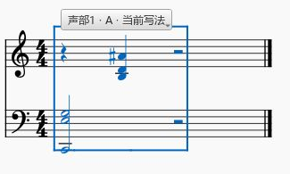
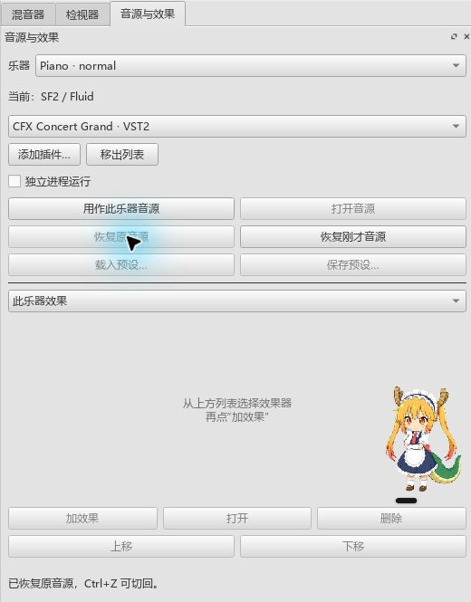
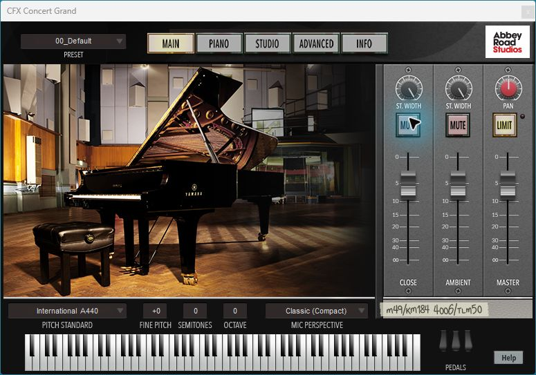
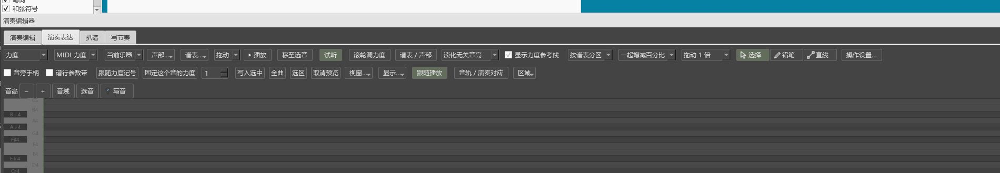

# 窗口与首次使用检查记录

日期：2026-10-19 至 2026-10-20。窗口与音源修复已安装为 0.72.0，演奏表达结果页已编译为 0.73.0，近期功能按下列记录继续逐项检查。

## 当前程序与源码

- 安装目录：`msvc.install_repair_current_x64/bin/MuseScore3Evo.exe`。已更新为 0.72.0，并配套更新 `MuseScoreVstHost.exe`。
- 本批主程序、VST 辅助程序和检查程序编译成功。安装后实际完成 CFX 多级预设选择与保存。
- 0.73.0 包含工具栏背景和录制结果页修复。生成截图中颜色已一致，结果区能直接查看音名和力度；安装更新等待当前测试程序正常关闭。
- 窗口与音源修复已提交：本体 `641dac751`，插件 `eba54b6`。两仓库均已推送；0.73.0 的表达改动另行提交。

## 解锁后实际做过的操作

### 分段写法

从项目自己的 `mtest/mscore/scoreobserver/piano.mscx` 打开测试谱，另存为插件工作区内的 `P2/out/manual-variants-3a04a746.mscz`。

1. 选择范围，建立第一小节、两谱表声部 1 的 A。
2. 在谱面选中高音，按上箭头改音。
3. 点“增加写法”复制为 B，再在谱面把同一音升高。
4. 点击面板 A、B 按钮来回切换，分别看见两种音高。
5. 按 Ctrl+S，关闭测试谱，再从文件重新打开。
6. 重开后显示 B；点击 A，仍显示 A 的改动。

读取保存文件核对：A 的该音为 MIDI 70，B 为 MIDI 71；其余五个音一致。文件包含两份片段，主方案为 A，重开恢复的当前写法为 B。

这个谱例的修改保留正常。用户报告的内容丢失继续列为待修问题，接着检查已有方案、新增与删除音、其它声部、跨界对象及撤销后的切换。

### CFX 与 SF2

在同一独立测试谱，从混音器点“音源与效果”。

1. 首次打开显示“当前：SF2／Fluid”，插件下拉为空。
2. 点“添加插件…”，选择本机已经安装的 `CFX Concert Grand VST_x64.dll`。
3. 扫描后出现 CFX，点“用作此乐器音源”；当前音源随之改变。
4. 点“打开音源”，CFX 界面出现在可见区域。
5. 点击 Piano 页，页面切换成功。分别点击预设文字和右侧下拉箭头，菜单均未保持展开。
6. 关闭 CFX 界面，点“恢复原音源”，面板回到“当前：SF2／Fluid”。

这次确认了添加入口、CFX 窗口和切回 SF2 的界面行为。实际声音、音色、厂商菜单持续操作和保存重开继续检查。

普通权限下另一次 CFX 测试在读取测试谱后提前退出，未得到完整的 CFX 交互结果，日志保留为 `P2/out/usability-072m-unlocked-attempt.txt`。

### 旧工作区中的菜单

桌面“视图”菜单缺少 AI 连接，并出现 `menu-kumo-workspace` 等内部名称。

代码核对发现：读取工作区会替换菜单并延迟释放旧菜单；AI 动作以旧菜单为父对象。已改为主窗口持有、重建菜单时复用动作。工作视图和谱行锁定菜单恢复时，将保存标识创建的入口接回现有工具菜单，并保留用户加在菜单中的动作。

连续读取两次工作区并等待旧菜单释放后，AI 动作仍存在、每项菜单只有一个入口，连接窗口可打开；程序内检查通过。

## 更新到 0.72.0 后的 CFX 操作

1. 从混音器打开“音源与效果”，列表显示“CFX Concert Grand · 音源 · VST2”。
2. 点“用作此乐器音源”“打开音源”。厂商窗口完整出现在可见区域。
3. 依次展开预设菜单的 `02-Compact → Classic → 00_Default`。各级菜单可以连续选择，随后完成样本载入。
4. 关闭厂商窗口，按 Ctrl+S 保存独立测试谱。
5. 读取保存文件，CFX 状态中保留 `02-Compact/Classic (Compact)`，音源路由仍为 KumoVST。

程序内另行检查了 CFX 预设渲染、切回 SF2、恢复 VST、保存重开和撤销。CFX 渲染峰值为 0.401428，全部样本为有限数；这一结果确认有音频输出。实际声卡听感继续单独核对。

关闭 CFX 时仍有 QMutex 警告，记录保留。桌面后来锁定，已停止桌面输入；这份测试谱的 CFX 预设保存已核对，锁定后的检查继续采用程序内测试和保存文件读取。

## 首次打开的面板尺寸

旧安装版首次打开演奏表达时，下方内容超出可见区域，最大化后才露出更多内容。以下图片保留该次现象。

本批将分段写法表单放进可滚动区域；编辑器、音源及分段面板同时停靠时，表单内容可以滚动查看。Windows 程序内检查已覆盖从悬浮恢复后向上扩展编辑器、全屏返回和小窗口参数区。

离屏检查使用的字体环境不同，曾将窗口最小高度撑大，相关失败日志保留。最终尺寸判断使用 Windows 下的检查与生成截图。组合检查也发现悬浮状态和首次恢复尚未结束就请求调整尺寸会影响结果，检查步骤已按实际操作先完成恢复，再拖动。

## 最近成功运行的检查

| 检查 | 实际结果 | 记录 |
| --- | --- | --- |
| 0.73 Windows 菜单、首次音源、控件换行、频谱和多面板全屏 | 五项通过，连同初始化及结束共 7 项 | `usability-073-final-window-pluginhost.txt` |
| 表达范围、结果行点选、MIDI 导入采用撤销与工具浮动主题 | 三项通过，连同初始化及结束共 5 项 | `usability-073b-expression-pluginhost.txt` |
| 音源资源释放、表达范围与采用、CFX/Pianoteq 渲染、SF2 恢复、参数保存 | 七项通过，连同初始化及结束共 9 项；QMutex 警告消失 | `usability-073-release-pluginhost.txt` |
| 录制、停止、对应、使用力度及撤销 | 一项完整过程通过，连同初始化及结束共 3 项 | `usability-073-recording-p1native-run.txt` |
| 录制采用、写法编辑保留、单击切换、谱面切换按钮与撤销 | 五项通过，连同初始化及结束共 7 项 | `usability-073-recording-variants-p1native-run.txt` |
| 删除写法、撤销与保存重开 | 一项完整过程通过，连同初始化及结束共 3 项 | `usability-073-variant-delete-p1native-run.txt` |
| 0.72m 控件换行、频谱首次打开、四工具独立开关与全屏、CFX 状态保存 | 四项通过，连同初始化及结束共 6 项 | `usability-072m-window-data.txt` |
| 同一组检查，显示缩放 150% | 四项通过，连同初始化及结束共 6 项 | `usability-072m-dpi150-data.txt` |
| 演奏编辑器力度、分谱与撤销数据 | 七项通过，连同初始化及结束共 9 项 | `usability-072m-editor-data-performanceeditor-run.txt` |
| P1 录制、表达、谱副本与导出数据 | 十六项通过，连同初始化及结束共 18 项 | `usability-072i-data-p1native-run.txt` |
| VST 独立检查 | 九项通过 | `usability-072-vst-counter.txt` |

这些日志位于插件仓库 `P2/out`。此前锁屏期间无法完成的键盘和焦点操作继续保留；完整 P1 离屏运行中出现的鼠标、窗口操作失败也保留原记录。

CFX 关闭时的 QMutex 警告继续保留。修复版厂商界面的多级菜单与预设载入已实际操作；反复重开和实际声卡听感继续核对。

## 已进入本批修复与继续检查的内容

- 空音源列表直接显示添加步骤；列表区写清用途，每项区分音源与效果。音源操作和预设按钮按文字宽度排列，窄窗口换行。
- AI 连接动作跟随主窗口存活，旧工作区重新载入后保留入口。
- 卷帘和频谱先画琴键，再画音名。低高度下仍给文字保留完整高度，避免相邻琴键盖掉音名。
- 频谱空标注列表仍占较多空间，列入下一步区域调整。
- 各工具的完整播放、录制、采用和保存流程按[本轮返工记录](USABILITY_REWORK_20261019.md)继续逐项检查。

后续优先使用程序内操作、保存文件读取和生成截图检查。鼠标焦点、系统按键、拖动和实际播放需要桌面核对时，再安排对应的实际操作。更新安装时同步程序、VST 辅助程序和说明。

## 录制后界面的检查结果

采用计时输入生成独立测试录音，依次点击录制、停止和“使用力度”，随后撤销，程序内操作通过。六个已对应音的力度能采用，采用形成一项撤销。

查看录制结果截图发现：主操作可见，下面仍有大片空白，对应的音名、拍位和原／新力度没有直接呈现。这个界面继续返工，下一批将把具体对应放到结果区，选中后联动编辑器；本项当前只确认录制到采用的数据路径。

原来的 0.72q 与 0.72r 部分记录复制了旧日志文件，引用已撤下。检查脚本现按每次运行保存实际输出，上表列出重新运行后的文件。旧文件继续留存，便于核对。

## 0.73.0：录制后直接看见对应结果

录制停止后，页面列出音名、小节拍位、演奏秒数和 `原力度 → 拟采用力度`。结果分为待使用、需核对、漏弹、多弹、已使用；点结果可联动选中谱面音。界面截图检查发现滚动条遮住最右侧数值，已给数值留出独立空间。

操作说明见[录一遍，再把力度用到谱子](EXPRESSION_073_GUIDE.md)。

### 音源关闭警告的原因与修复

继续排查发现，QMutex 警告来自内置 Fluid 音源的析构：等待取得互斥锁后释放声音资源，结束时遗漏解锁。已改用作用域内持锁，在资源释放结束后解锁。三次创建与释放检查通过；同批重新检查 CFX、Pianoteq 渲染、恢复 SF2、恢复 VST、参数记录和撤销，也未再出现这条警告。
