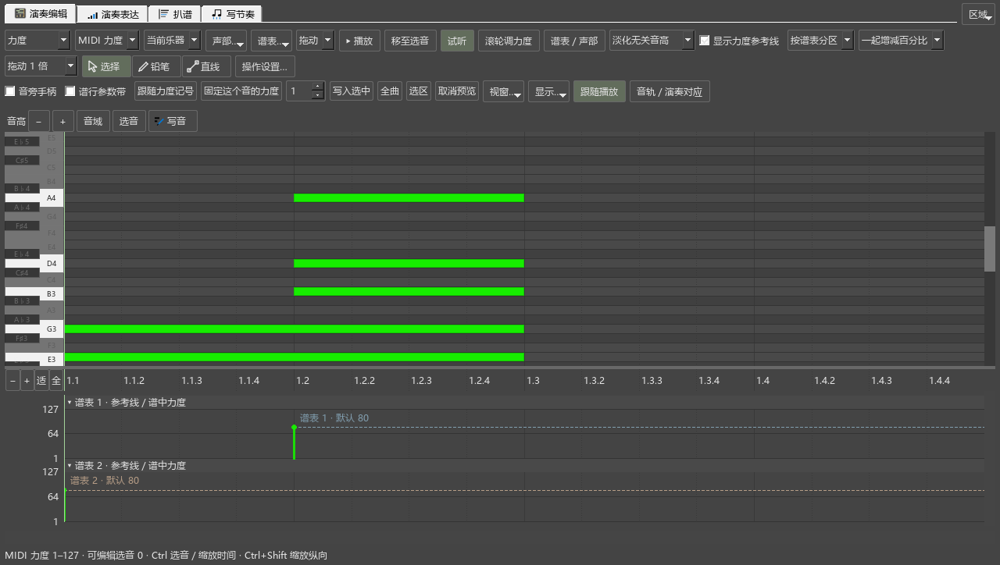
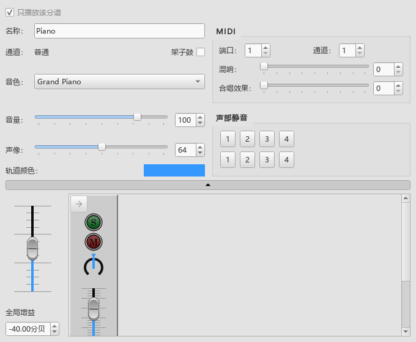

# A1窗口组合与工具入口检查

对应0.89.0。使用独立设置、项目钢琴谱和随包SF3，在正常显示大小操作真实Qt界面。

## 已复现和修复

- 同时打开混音器、和弦、参考播放器及编辑器时，混音器最小尺寸为522×443，编辑器只有378像素高。移除新增整行按钮，并让内容按需滚动后，混音器可缩小，编辑器展开到523像素；1360×920的主窗口保持原尺寸。
- 编辑器与原曲参考并列时，离开编曲再回来，编辑器由523缩到378像素。按当前可见标签组保存尺寸，恢复时计入标签栏占位后，两次经过DAW、雕版、后处理再返回，均保持523像素和0.400的内部比例。
- 主题图标刷新会把和弦、原曲、表达改回相同播放三角。现在动作创建和刷新读取各自图标；四个工具页、卷帘写音与音源入口采用对应图形。
- 新工具页图标接线中曾将动态菜单动作当作快捷键动作，检查时发生空动作访问；已改用现有编辑器图形，后续窗口操作通过。

## 正常显示下的操作记录

- `layout-089-release-normal-pluginhost.txt`：组合窗口、工作视图、全屏与可见区域、独立关闭、首次雕版、移出放回、表达页高度和快速切页共8组操作，另查个人版本；加准备和结束共11项通过。组合操作同时核对和弦、原曲、表达图标在主题刷新后保持一致。
- `layout-089-release-profile-pluginhost.txt`：只读复制现有设置中的60项编辑器／工作视图设置，首次打开、菜单恢复、音源入口共3组操作；加准备和结束共5项通过。
- 现有布局中的编辑器为748像素高，内部区域都处于可见范围。原设置文件的读取前后摘要相同。
- 按用户最新要求，后续检查采用正常显示大小。早期显示缩放记录保留在原日志中。

这批处理共同窗口与入口图标。各组件内部操作图标、日常调力度和复杂写法保存继续列在[总进度](REWORK_PROGRESS.md)的A2—A4中。

发布前的最终程序、检查日志和文件摘要随本批交付记录保存。
