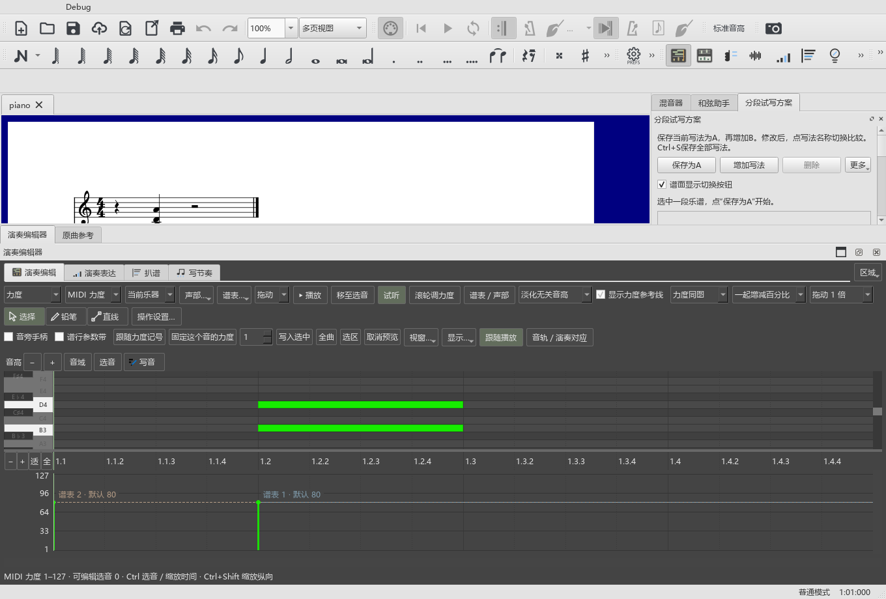
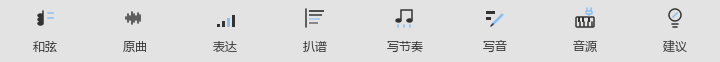

# 组合面板、保存布局与工具图标

适用版本：0.89.0 · Kumo branch / Freddd13。

## 给编辑器留出空间

1. 从“视图”打开演奏编辑器，再打开原曲参考、和弦助手或混音器。
2. 原曲参考和演奏编辑器可放在同一组标签中，点击标签切换。
3. 向上拖编辑器组的上边缘，给卷帘与力度区留出更多高度；内部拖分隔条分配两块区域。
4. 混音器空间较小时，用其滚动条查看下面的控制项。空间增大后，原来的控件会完整展开。

“音源与效果”从“视图 → 音源与效果（VST）”或编曲工具栏的琴键加插头图标打开。混音器详情区回到原来的控制内容。

## 切换工作视图再回来

在上方工作视图入口选择“编曲／DAW／雕版／后处理”。返回编曲时，编辑器组恢复离开前的高度，卷帘和力度区保留各自比例。编辑器与原曲参考并列为标签时也一样。

窗口本身改变大小后，恢复会结合当前空间调整。继续拖动即可重新安排；下次离开该视图会保存新尺寸。

## 把两个工具分别放在旁边

点击编辑器右侧“区域”，在“演奏表达”或“频谱扒谱”下面选择“悬浮显示”。这两个工具可以同时留在编辑器旁边。

- 拖浮窗边缘调整大小。
- 标题栏的“面板全屏”展开当前工具，再点一次或按Esc返回。
- 关闭某个工具后，其它工具继续保留。可从原入口重新打开。
- 在“区域”里选“放回编辑器”，回到相应工具页。

## 认工具图标

| 图形 | 用途 |
|---|---|
| 音符叠成和弦 | 和弦助手 |
| 波形 | 原曲参考 |
| 力度柱 | 演奏表达 |
| 横向频谱线 | 扒谱 |
| 连着的音符和拍点 | 写节奏 |
| 音符条和笔 | 卷帘写音 |
| 琴键与插头 | 音源与效果 |
| 提示灯 | 编配建议 |

编曲工具栏、对应菜单和编辑器工具页采用相同图形。鼠标停在按钮上可看名称与作用。切换主题或刷新工具栏后，和弦、原曲和表达继续显示各自的图标。

具体音源操作见[钢琴音源与效果](VST_088_GUIDE.md)。后续音源共用、后台保留及踏板方式见[已确认的安排](SOUND_PEDAL_PLAN.md)。

发布定位：personal-v0.89.0。实际操作记录见[窗口检查](WINDOWS_089_CHECKS.md)。
