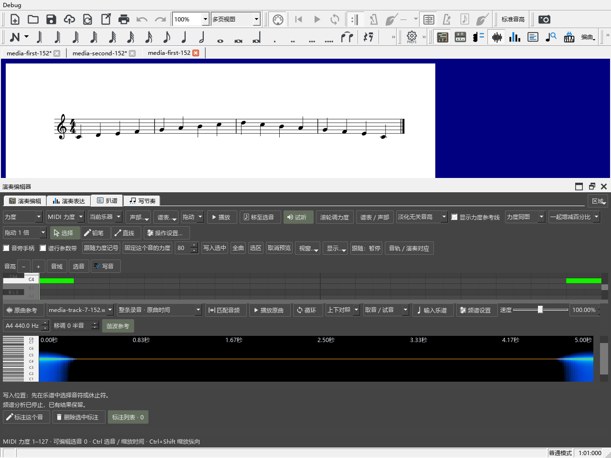

# 换谱后继续录制与查看原曲

适用于0.152.0及之后版本。

## 回到一份谱，继续使用演奏表达

1. 从“视图 → 演奏表达”打开，在一份谱中导入MIDI或录制演奏。
2. 处理对应和力度，再切到另一份谱。
3. 切回原谱，表达页会立即恢复刚才的阅读位置。
4. 想重新录制时，滚到上方，确认“目标谱段”，点“录制”。页面保持你正在使用的位置。

重新录制或改选段时，页面保持你正在操作的位置，原有的对应、采用比例、选音和人工连接继续保留。

录制结束后看对应、试听，再点“使用力度”或“使用速度”。完整操作见[录制后继续处理](EXPRESSION_RECORDING_150_GUIDE.md)，撤销与重做见[自动更新比较](EXPRESSION_REFRESH_151_GUIDE.md)。

## 每份谱使用自己的原曲资料

在“原曲参考”添加音轨并建立关联，再按Ctrl+S保存乐谱。切到另一份谱时，面板和频谱会显示那份谱自己的音轨；重新打开保存的乐谱，也能继续使用这些资料。

每条音轨右侧有“删除”，删掉后可点音轨列表上方的“恢复删除”。删除音轨会一同移除它的片段关联，原始音频文件继续留在原位置。恢复后，片段和内部对齐点一起回来。

扒谱页上方的音轨选择框，与原曲参考共用当前音轨。先选音轨，再选择整条录音或某条关联片段。

图中是独立测试谱和5秒长的测试音频。原曲的添加、关联与播放，见[原曲参考说明](REFERENCE_081_GUIDE.md)。
