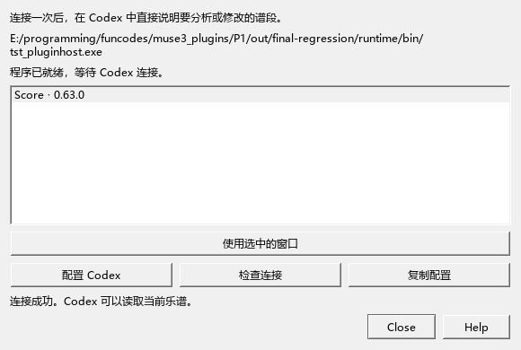

# AI 连接与个人扩展开关

当前操作适用于0.145及之后版本。AI连接、工具开关和分享设置都可从本页找到；开关和进程的完整操作见[连接管理](AI_CONNECTION_133_GUIDE.md)。

## 第一次连接 Codex

1. 打开这份程序，再打开要编辑的乐谱。
2. 从“视图 → AI 连接”打开连接窗口。列表显示正在运行的程序和谱名；打开了多个窗口时，选一行并点“使用选中的窗口”。
3. 点“配置 Codex”。程序会先备份原配置，再更新 MuseScore 这一项，其它设置继续保留。
4. 重新连接 Codex，或重新打开 Codex 后新建对话。输入：“检查 MuseScore 连接，告诉我当前谱名和选区，再读取选区中的音符。”
5. 回到乐谱选中几小节，可以接着说：“保留右手旋律，把左手写得疏一些，给我两版比较。”收到的写法显示在“视图 → 编配建议”。



程序包已附带MCP及运行文件。点“配置Codex”会使用`bin/tools/mcp`下当前版本目录里的`MuseScoreMCP.exe`；`current.json`记录当前目录。用户电脑可直接运行随包程序。移动程序目录后，再点一次“配置Codex”更新路径。

## Codex现在怎样看乐谱

选段读取使用MuseScore当前内存中的音符，能包含尚未保存的修改、声部、延音、力度、踏板和反复位置。可以直接说：“读取当前选段的完整数据，再告诉我具体小节和声部。”

可以接着说：“读取当前谱的身份和任务范围，取这几小节的原生谱图，与音符数据一起分析。”`get_score_identity`返回谱面标题、作品信息、文件名和分谱名；`get_score_image`裁取MuseScore已经排好的谱面，图中保留当前字体、连线和跨谱表写法。读图的完整例子见[原生谱图](AI_IMAGES_141_GUIDE.md)。

旧工具`show_score`提供按音符数据画出的示意图，`get_score`保留音符文本入口。编配任务使用`read_arrangement_context`读取完整声部，继续讨论时沿用任务范围；新工具没有出现在Codex中时，重新连接MuseScore这一项。具体步骤见[AI编配完整操作](AI_WORKFLOW_144_GUIDE.md)。

## 连接窗口的按钮

| 按钮 | 用途 |
|---|---|
| 使用选中的窗口 | 选择后续读取和修改的 MuseScore 窗口 |
| 配置 Codex | 保存连接命令；原配置备份在原文件旁 |
| 检查连接 | 检查程序包、扩展开关及实际读谱连接 |
| 复制配置 | 复制手动配置内容，适合自行管理 Codex 配置 |
| 帮助 | 打开本页 |

移动程序文件夹后，重新点“配置 Codex”，更新启动路径。Codex 的 MCP 状态可以用 `codex mcp list` 查看。

## 怎样查看和采用建议

在“编配建议”中选一项，谱面显示变化位置。用“试听谱中”和“试听新写法”比较，点“使用这版”采用；一次Ctrl+Z可撤销，Ctrl+S保存乐谱和采用记录。修改过相关乐谱后，面板会提示“谱子已修改”，请让Codex更新读取并重新给出写法。完整例子见[比较两种左手写法](AI_WORKFLOW_144_GUIDE.md)。

## 连接未完成时

- 列表没有窗口：检查是否打开了同一份程序，以及程序旁的扩展开关。
- 找不到 MCP 程序：安装完整程序包，保留 tools/mcp 下的运行文件。
- Codex 仍使用旧路径：点“配置 Codex”更新，再重新连接。
- 打开了多个窗口：选择要处理的谱名。换谱后检查窗口中显示的谱名。
- 软件正常、Codex 没看到工具：重新启动 Codex 并新建对话，再请它检查连接。

## 分享前关闭个人扩展

在 MuseScore3Evo.exe 同目录找到 `kumo.ini`：

```ini
[features]
enable_exp_feature=true
```

设为 `false`，保存后重启。演奏编辑器、和弦、原曲、表达、频谱、编配、试写、MIDI 人性化和 AI 等个人工具统一由此控制。帮助 → 关于会显示当前状态和配置文件位置。

新装默认 true；升级保留你已有的值。配置文件缺失或内容无法读取时关闭扩展。谱中已经写入的音符和资料继续保存。

关闭后，普通乐谱仍能打开、播放和保存。原曲路径与关联、人工和弦、分段A/B写法及音源设置保留在文件中，重新开启后可继续使用。分享文件夹的制作和保存往返检查见[开关、插件与分享](SHARING_145_GUIDE.md)。

插件管理器会收起本程序自带、已由内置功能接替的旧入口。用户自己添加的插件保留；重载后继续使用原来的勾选和快捷键。

## 使用0.62的旧程序时

旧版需要将 MCP 仓库中的 `musescore-mcp-websocket.qml` 复制到程序 plugins/MuseScoreMCP 文件夹，重开软件，在插件管理器勾选它，再运行“插件 → MuseScore API Server”。本机完整路径和旧 Python 命令见[MCP 仓库配置说明](https://github.com/Freddd13/mcp-musescore/blob/codex/musescore-evolution/docs/CODEX_SETUP.md)。新版按本页开头操作即可。
