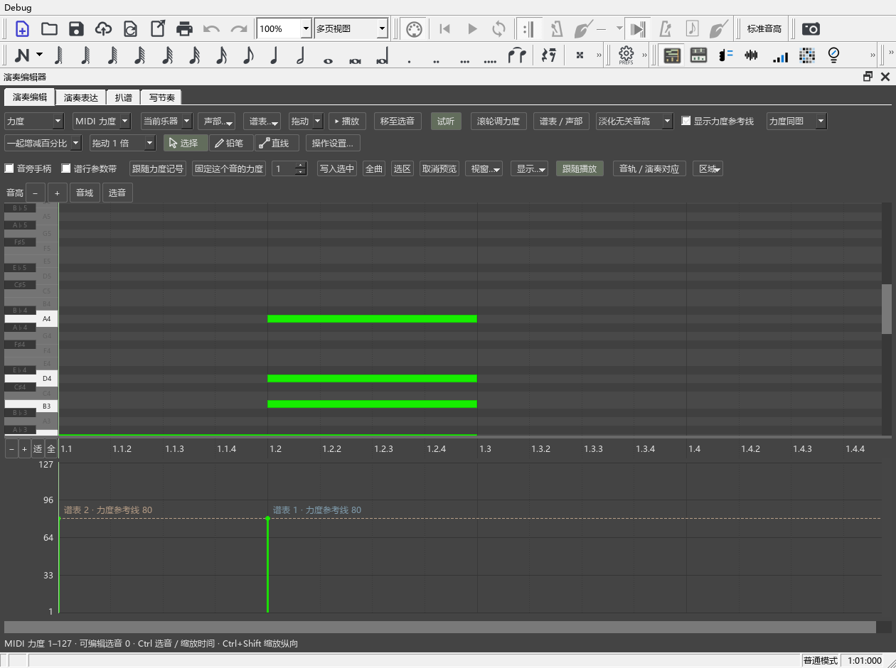

# 按工作内容整理窗口

适用版本：0.64.0 · Kumo branch / Freddd13。

## 从工具栏打开常用工具

顶端“编曲工具栏”依次提供演奏编辑器、谱行参数带、和弦助手、原曲参考、演奏表达、频谱和编配建议。把鼠标停在图标上可以看名称与快捷键。图标和“视图”菜单操作相同。

最右边的“编曲”按钮用于切换工作视图。也可以打开“视图 → 工作视图”。

## 想集中调演奏，切到 DAW

1. 打开一份谱，点工具栏“编曲”，选择“DAW”。演奏编辑器会占满主要区域。
2. 想同时看谱，打开“视图 → 工作视图 → 显示乐谱对照”。拖谱面与编辑器之间的分隔线，调到合适高度。
3. 在“区域”里收起暂时不用的钢琴卷帘或演奏对应区，把空间留给力度、速度。
4. 回去改音时，从工具栏切回“编曲”。原来的谱面与面板位置会恢复。

“编曲”“DAW”“雕版”“后处理”分别记住面板位置、展开的工具页和区域高度。雕版和后处理当前用于摆放已有工具；后续增加的专用操作会放在对应视图里。

## 把演奏表达放到右侧，给力度区留空间

1. 打开演奏编辑器，点“区域 → 演奏表达 → 放到右侧”。
2. 演奏表达会成为独立面板；编辑器中的力度区继续显示。
3. 想单独放在另一块屏幕，选择“悬浮显示”。双击“演奏表达”“扒谱”或“写节奏”标签也能移出。
4. 放回时，在“区域”里的对应项目选择“放回编辑器”。

钢琴卷帘、力度／速度／踏板、音轨／演奏对应、演奏表达、频谱扒谱和写节奏都能这样摆放。独立卷帘带有时间尺，可以直接点选播放位置；选音、时间缩放和播放位置继续与谱面共用。

浮窗标题栏右侧有“回到乐谱”。点它会收起当前浮窗，并将焦点带回谱面；下次从原入口打开仍可使用。浮窗标题栏菜单中的“保持悬浮”可以关闭拖动时的停靠吸附。

拖区域之间的分隔线调整高度。若以前保存的布局让参数区缩到看不见，重新打开会给它恢复可用高度；也可以点“区域 → 恢复区域高度”。

## 打开和弦助手后直接查看

打开和弦助手会先识别当前位置，再整理整段和弦。准备过程中会显示“正在读取”或“正在分析前后和弦”；播放时先显示当前位置结果。

当前和弦区的“面板显示结果”同时控制顶部摘要与右侧详情：

- “实时结果”显示当前音响的识别。
- “所属和弦”显示当前位置所属区间的解释。

名称、转位与级数从同一份结果生成。“修改和弦与范围”移到当前和弦下方；功能色、音旁文字和记号外观分别展开，方便把常用操作留在前面。

## 管理多条原曲音轨

1. 打开“原曲参考”，点“添加”或拖入音频。列表中每行是一条音轨。
2. 点音轨名称选中它。“原曲 → 播放”只播放这条轨。
3. 拖“速度”滑块慢放，拖“音量”滑块调音量。旁边的数值框可直接输入百分比。
4. 点这一行的“删除”移除音轨与它的片段关联。点列表上方“恢复删除”，恢复最近删除的一条。音频文件仍保存在原来的位置。
5. 要听多轨，先点亮“联合”列的“联”，再选择“一起播放”。“S”用于联合播放时独听这条轨；“M”用于静音。播放前设置这些选项，停止后可以继续调整。

面板窄时，按钮按操作组换行；右侧滚动条可查看下面的片段和关联。完整例子见[原曲与乐谱一起播放](REFERENCE_SPECTRUM_074_GUIDE.md#原曲与乐谱一起播放)。

音轨与片段关联随乐谱保存。删除和恢复会立即记入乐谱的撤销记录，也能使用 Ctrl+Z。速度和音量继续保存到对应音轨。

## 保存与恢复

窗口位置、视图和区域高度属于这台电脑的个人设置。音轨与关联随 MSCZ 保存。乐谱中的音符和演奏数值继续使用原来的保存与撤销方式。

## 速度记号的音符大小

使用默认 Leland Text 的速度记号会采用与官方 3.6.2 相同的节拍音符外观，附点也一起恢复。速度文字继续使用谱中设置的字体与字号，已经选用的其它音乐字体照常显示。

《如果有来生 release5》已分别用官方 3.6.2 与当前程序导出比较。标题在本机都使用 KaiTi，拉丁文字都使用 Palatino Linotype；节拍音符的差异来自附带的 Leland Text 字形尺寸。兼容字形随程序提供，打开原谱即可显示。

若工具栏被收起，打开“视图”菜单，勾选“编曲工具栏”。若独立面板关掉，从原来的工具图标或“区域”菜单重新打开即可。

Codex 连接步骤见[第一次连接](WORKSPACE_063_GUIDE.md)。本版同时修复了主窗口创建期间的工具栏顺序和 AI 服务自动启动，打开乐谱后可在“AI 连接”检查状态。
