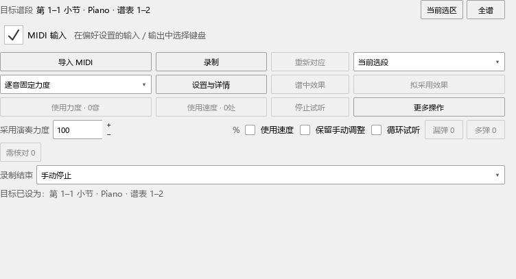

# 0.65.0：把一段演奏的力度用到谱子

## 从哪里打开

打开乐谱，先在谱面框选要处理的段落，再点“视图 → 演奏表达”或编曲工具栏的表达图标。工具在演奏编辑器内打开。“区域”菜单可以把它移到右侧、悬浮，或放回编辑器。

面板最上方一直显示目标小节和谱表。“当前选区”采用你刚选的范围，“全谱”采用当前钢琴声部组的整首内容。选好后可以继续点音、编辑和定位；目标范围会保留，直到再次点这两个按钮。

## 第一次导入并使用力度

1. 选中要处理的谱段，点“当前选区”，核对顶部范围。
2. 点“导入 MIDI”，选择演奏文件。文件可以包含全曲，工具会寻找这个谱段的位置。
3. 对应完成后，演奏编辑器自动显示谱中力度和拟采用力度。默认采用演奏力度的 100%，保存方式为“逐音固定力度”。
4. 点“谱中效果”听当前谱子，点“拟采用效果”听新的力度。切换时接着当前拍位播放。“停止试听”暂停；修改设置、重新对应或应用时会结束比较并进入所选操作。
5. 在范围框选“选中音”“当前选段”或“全部已对应范围”，点“使用力度 · N音”。按钮上的数量是这次会更新的音。
6. 已应用的音退出待处理显示，其余对应可以继续使用。按 Ctrl+Z 撤销一次应用，Ctrl+S 保存乐谱。

“当前选段”采用谱面上现有的蓝色选区；收起选区后，继续采用顶部保留的目标范围。“选中音”用于只修改几个点选的音。

## 用 MIDI 键盘录一遍

1. 在“编辑 → 偏好设置 → 输入／输出”中选择键盘。面板的“MIDI 输入”可以直接开关软件输入；旁边显示设备状态。
2. 选好目标谱段，保持“录制结束：手动停止”，点“录制”。
3. 弹第一个音后开始计时。谱面和卷帘上的位置线跟随正在对应的音；有多个可能位置时，面板显示“可能在”。漏弹、多弹后会继续寻找后面的对应。
4. 弹完点“停止录制”。原始演奏保存后自动对应，并显示力度对比。
5. 按上面的步骤试听，再点“使用力度”或“使用速度”。

“到时停止”从第一个音起计算旁边的秒数。“弹完选段停止”结合末尾起音、松键和短暂停顿结束。重复音型可用手动停止来控制结束位置。

录制时可以收起面板，再打开查看结果。“设置与详情”中的“录制时听到键盘声音”控制键盘试听；“任意音高敲击音序”适合只表达节奏和力度。

## 读懂比较和设置

- **采用演奏力度 100%**：使用演奏文件的力度；50% 取谱中力度与演奏力度的中间值。
- **逐音固定力度**：这些音保存明确的 MIDI 力度值。谱上的 p、mf 等文字继续显示。
- **继续跟随力度记号**：把目标力度换算为相对增减，以后改 p、mf 或渐强渐弱时一起变化。
- **漏弹／多弹／需核对**：点相应数量查看具体位置，再点一项定位。对应轨中可以重新连接或固定某一处对应。
- **使用速度**：采用演奏的快慢变化。谱内速度影响同一位置的全部声部；在设置中选择时长及已有速度记号的处理方式。

普通编辑器的“力度参考线”表示 p、mf、渐强渐弱给出的力度。对比模式默认收起，显示开关可以随时打开。原值与拟采用值共用时间尺；同音对比适合看每个音的变化，真实播放时间对比适合观察快慢。

## 保存和恢复

- **Ctrl+S** 保存已应用的力度、速度和应用前力度记录。
- **更多操作 → 恢复应用前力度** 按当前应用范围恢复，重开乐谱后也能使用。
- **更多操作 → 以当前力度为比较起点** 把现在的力度作为下一轮恢复位置。
- **更多操作 → 保存表达项目** 保存原始 MIDI、对应、人工调整和设置，方便以后接着比较。

录制文件默认放在 E 盘的项目录制目录，保存表达项目时会保留一份原始 MIDI。

## 编配检查和建议

“编配检查”的问题类别可多选：例如一起看和声与可弹性，暂时收起对位。菜单提供“全选”和“清空”，严重程度可以另外筛选；已算出的结果仍保留。

“编配建议”选中一种写法后，谱面直接显示变化。“谱面差异”可以随时收起或恢复。点下方变化列表定位，使用“试听谱中／试听新写法”比较，再点“使用这版”。

“保留指法”会同时约束手部分配和指法路线。关闭后按这次设置重新安排；明确的左右手仍由谱面标记和手部设置决定。

## 遇到问题时继续操作

- 目标范围不合适：在谱面重新选段，点“当前选区”；要回到整首就点“全谱”。
- 使用力度显示 0 音：查看应用范围、漏弹和需核对列表，或在更多操作中显示已经使用的对应。
- 输入未就绪：连接键盘并在偏好设置中选设备，再检查面板“MIDI 输入”。
- 录制中途停止：面板会显示设备断开、关闭输入或到时等原因，收到的演奏会保留下来。
- 修改了音符或节奏：点“重新对应”后继续；换谱后重新选择那份谱子的目标范围。

本版：0.65.0，提交定位 personal-v0.65.0。具体检查记录见 [交付记录](WORKSPACE_065_DELIVERY.md)。
