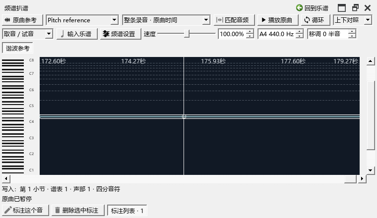
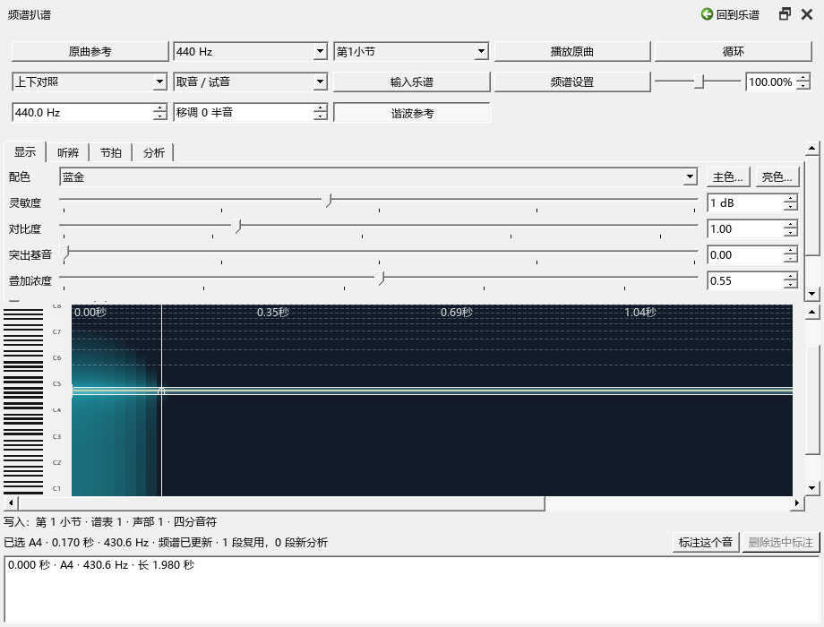
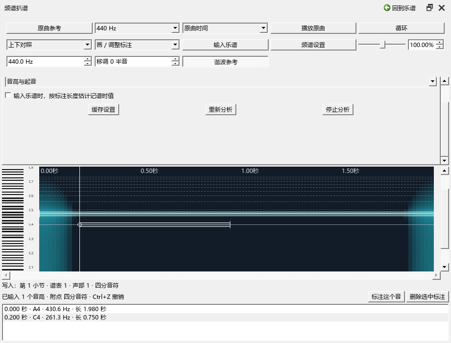

# 频谱扒谱：听清一个音，再写进乐谱

本章按0.101.0的界面核对。打开“视图 → 频谱扒谱”，或在演奏编辑器中点“扒谱”。

## 第一次使用：听一小段钢琴

1. 打开乐谱，再打开“原曲参考”，拖入 WAV、MP3 或 FLAC 文件。在音轨列表选中要听的那一轨。
2. 进入“扒谱”。上面的音轨框与原曲参考使用同一份材料；片段框可选择已有谱段关联，也可查看整条录音。
3. 保持“上下对照”：上面看谱中的音，下面看录音频谱。左侧键盘可以点按试音。亮线的位置表示频率，横向表示原曲时间。
4. 点“播放原曲”，或把焦点放在频谱内按空格。再次按下暂停。拖速度滑块可以保调慢放，数值框也可直接输入 50%–150%。
5. 选择“选择循环”，在频谱中从开始拖到结束，再打开“循环”。用“手形平移”、中键或底部滚动条移动时间；滚轮平移，Ctrl+滚轮在鼠标附近缩放，Shift+滚轮调整音高范围。
6. 切回“取音／试音”，点亮线。下方显示所选音名、原曲时间和频率；“谐波参考”画出这个频率的倍频，便于区分基音与泛音。
7. 点“标注这个音”。程序会参考这条亮线的连续范围估计起止。也可以切换“画／调整标注”直接拖出长度；拖两端改起止，拖中间改时间和音高。选中标注后按 Delete，或点“删除选中标注”。
8. 在乐谱中选择输入位置、谱表、声部和时值，再点“输入乐谱”。下方“写入”一行显示目的位置；写完一个音，跟随乐谱的输入光标继续更新。列表里同时选多个音高，可以输入为和弦。

标注的横条表示你准备采用的按键范围。钢琴在踏板下的余音会延续，估计长度后可以按听感拖短。画出的范围和输入到谱上的时值分别保存。

“标注列表”可展开、收起，拖它与频谱之间的分隔条可调整高度。没有标注时，空间留给频谱。配图和操作见[调整频谱与标注列表的空间](REFERENCE_SPECTRUM_074_GUIDE.md)。

## 找到长录音后面的一个音

例如，想听三分钟录音在2分55秒附近的音：

1. 时间框选“整条录音 · 原曲时间”，把底部时间条拖向右侧。条块到最右时，可以看到录音结尾。
2. 在要听的位置按Ctrl滚轮放大，点亮线；空格播放，再按空格暂停。
3. 点“标注这个音”。在乐谱点一个休止符，选声部和时值，再点“输入乐谱”。
4. 接着点另一个音高，继续“输入乐谱”，会写到当前输入光标的位置。要跳到别处，就在乐谱重新选位置。
5. 按Ctrl+S保存。每次写入都可以单独撤销；标注保留在这份乐谱里，下次打开可以继续查看。

## 频谱设置

点“频谱设置”展开四页；再点一次收起。主要播放、选轨和输入按钮留在上方。

| 页面 | 怎样使用 |
|---|---|
| 显示 | 选择蓝金、绿紫、灰阶，或自选主色和亮色；“灵敏度”让弱音更明显，“对比度”拉开强弱；“叠加浓度”控制背景透明度 |
| 听辨 | 开启“试听均衡”，调低音、中音、高音；开启“按选频听”后，围绕所选频率听辨，宽度决定保留多大的音域 |
| 节拍 | 显示节拍网格，设置 BPM、拍号和第一拍；可估计速度、选候选、半速／倍速或敲击校正 |
| 分析 | 选“音高与起音”“低音更清楚”或“起音更清楚”；重新分析、停止分析和缓存设置集中在这里 |

显示设置只改变图像。听辨设置作用于频谱面板发起的试听。关闭均衡和“按选频听”即可听原来的声音。

“突出基音”会降低较明显的倍频线，帮助找低音和根音。推到 0 随时查看原始能量；重叠乐器时可以来回比较。

## 让网格跟上录音

1. 在“节拍”页打开网格。
2. 框出节奏清楚的 4–120 秒，再点“估计这段速度”；没有循环选段时使用当前可见范围。程序给出少量候选，选择后立即预览。
3. 用半速／倍速校正拍感；在第一拍位置单击频谱，再点“这里为第一拍”。
4. 也可按 Shift+空格敲节奏。播放中按录音实际时间计算，慢放时仍能还原原曲速度；暂停时按你敲击的间隔计算。
5. 点“保存节拍”，再 Ctrl+S 保存乐谱。有关联时，可以选择使用谱中的节拍网格。

BPM 使用四分音符速度。拍号分母决定网格每格的长度，例如 6/8 的每格为八分音符。敲击单位可选八分、四分、附点四分和二分。

## 按标注长度输入时值

在“分析”页勾选“输入乐谱时，按标注长度估计记谱时值”。输入时优先使用所选标注的长度；有关联时按谱位换算，查看整条录音时按节拍页 BPM 换算，取接近的普通或附点时值。多个音高组成和弦时采用其中最长的长度。

例如四分速度 120、标注长 0.75 秒，会采用附点四分音符。输入完成后恢复你之前选择的输入时值，便于继续写谱。休止、延音和跨拍写法沿用乐谱的输入整理设置。

## 上下对照、叠加和独立窗口

- “上下对照”保留单独频谱和键盘；“叠加对照”把频谱铺在卷帘后面，显示页可隐藏钢琴块、调透明度。
- 叠加时按 Alt 操作谱中的音，其余鼠标操作按当前频谱工具执行。
- 编辑器区域菜单可将扒谱悬浮、放到右侧或放回。浮窗里的“回到乐谱”方便在两个窗口间切换。
- 有谱段关联时，频谱、卷帘使用同一时间尺和滚动位置；整条录音有自己的时间范围。原曲参考与频谱共用播放，当前参与的音轨会显示播放位置。

## 保存、撤销与分析速度

标注、节拍和调律对应随 MSCZ 保存。标注的一次拖动、删除、保存节拍和输入乐谱都可以 Ctrl+Z 撤销。配色、显示和面板设置保存在个人配置。

频谱按 4 秒一块计算并缓存。平移、缩放、换色会复用已经算好的块，状态栏显示复用和新分析数量；换分析方式或调律后使用对应的新结果。点击“停止分析”可保留当前图像继续查看，“重新分析”重算当前区域。

“缓存设置”可更改 E 盘位置、磁盘和内存容量。音频文件仍由原曲参考管理；文件移动后在该面板重新定位，原有标注继续保留。

若看不到频谱，先检查上面的音轨、片段和分析状态。弱音可提高灵敏度；低音难分辨时选择“低音更清楚”并纵向放大；找不到写入位置时先在乐谱点选一个音或休止符。
