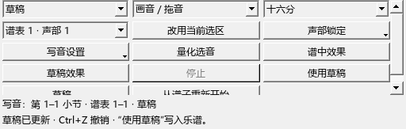

# 0.67.0：卷帘写音与草稿

本版完成完整方案的第五批。[按步骤使用卷帘写音](WORKSPACE_067_GUIDE.md)。

## 实际操作

1. 选中要改的小节，从“视图 → 卷帘写音”打开，或点演奏编辑器卷帘上方的“写音”。
2. “直接写谱”中拖空白画音、拖主体移动、拖右端改长度；Ctrl+拖动或 Ctrl+D 复制，Delete 删除。
3. “草稿”中先修改，用“谱中效果／草稿效果”比较，再点“使用草稿”。一次采用可整体撤销。
4. “声部锁定”保留指定写法；交叠新音可自动寻找同谱表中空闲的声部。编辑器的筛选同时有效。
5. “写音设置”可选择新音跟随力度记号或固定力度，并决定是否保留拖动的细微演奏时间差。
6. Ctrl+S 保存。草稿随 MSCZ 保存，“草稿…”可恢复其它范围；Esc 取消手势或退出写音。

窄窗口自动分行，工具栏可滚动；卷帘独立悬浮时保留同一套操作。

## 记谱和演奏设置

输入结束后使用原生编辑整理休止、各音的延音及连音组。复制保留指法、颜色、小音符属性、力度保存方式与已有演奏事件。

精确演奏位置与记谱起止分别保存；开启细微时间差后，MIDI 起音和松手采用这些偏移。原有多次发声的演奏事件继续沿用。

修改范围、声部安排和时值在工作线程计算，直接写谱只更新涉及的小节及声部。拖动和绘制通过区间索引读取可见音符。测试中的一万个音确定范围约需 55–90 毫秒，后台计算期间界面计时事件继续响应。

## 检查记录

内置窗口 41 项通过，3 项使用各自的独立启动方式检查；原有工作流 53 项、演奏编辑 64 项通过。关闭扩展启动 3 项通过。实际 0.67.0 程序自动启动内置服务，随包 MCP 在移除系统 Python PATH 后读取 6 个测试音。记录：P2/out/067-final-ui.txt、067-final-existing.txt、067-final-off.txt、067-final-startup.txt。

鼠标检查覆盖画音、草稿、采用、撤销、复制、删除、保存重开及窄窗口。另检查三连音、同声部各音独立延音、已有连音组、自动分声部、复制后的个人设置和细微时间差；渲染 MIDI 起止与目标相差不超过一个 tick。

试听复用已有播放会话和独立材料；原谱与编辑器保留在原窗口。钢琴声源和实际键盘的听感在设备操作时继续核对。

提交定位：宿主 personal-v0.67.0，插件与交付资料 workspace-v0.67.0。
