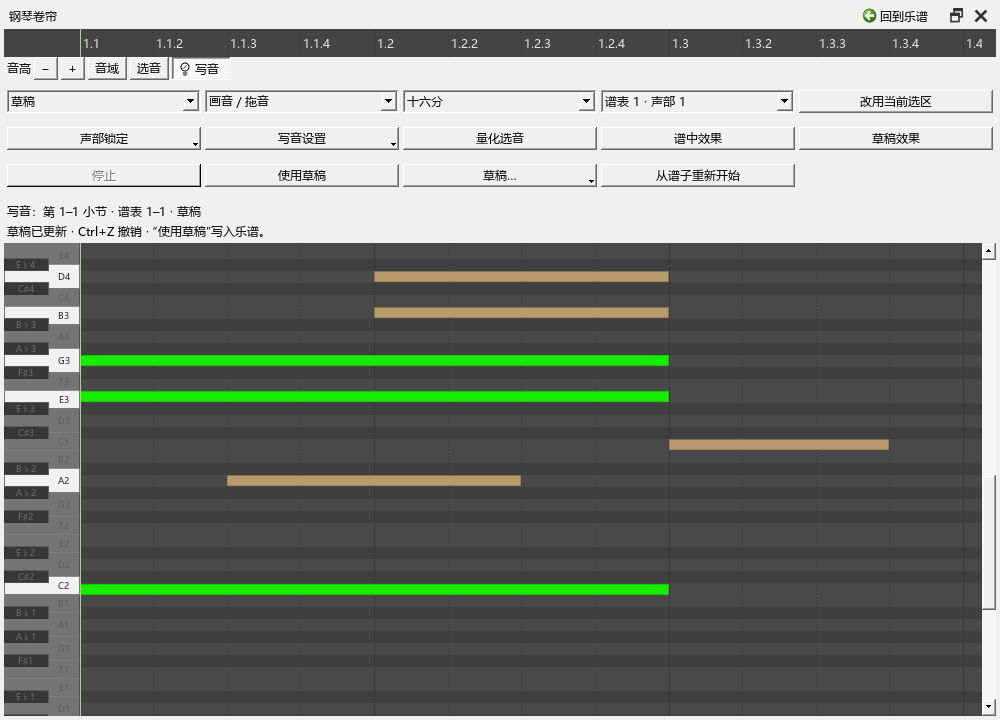

# 卷帘写音：直接改谱，或先试一个草稿

适用版本：0.67.0。从“视图 → 卷帘写音”直接打开，或在演奏编辑器钢琴卷帘左上的音域按钮旁点“写音”。再次点它可回到原来的演奏调整。

## 第一次使用：给一小节加几个音

1. 在乐谱中选中要写的小节。跨几个小节写作时，先框选这几小节。
2. 打开演奏编辑器，在卷帘上方点“写音”。“写音”一行显示当前小节、谱表和模式。
3. 保持“直接写谱”，选好新音的谱表和声部，再选“八分”或“十六分”网格。
4. 在卷帘空白处按下并向右拖动。松开后，这个音会写进谱子，休止、跨拍和延音由软件整理。
5. 拖音符中间可以移动时间和音高；拖右端改变长度。按住 Ctrl 拖动可复制，Ctrl+D 可向后复制一个网格。
6. 点击选音，按 Shift 加选；“框选”工具可以一次选中一组。按 Delete 删除选音，也可以用“删除”工具逐个点掉。
7. Ctrl+Z 撤销整个手势，“编辑 → 重做”恢复，Ctrl+S 保存乐谱。

已有音符保持原声部。声部框决定新音写到哪里。原谱上点选与卷帘中的已有音会同步强调；新草稿音在卷帘里单独显示选择。

## 先听草稿，再决定怎样写

1. 将模式切到“草稿”，用同样的方法画音、移动或删除。
2. 点“谱中效果”听原来的写法，点“草稿效果”听调整后的写法。当前按钮会保持选中，下面也会显示正在听哪一版。
3. 两个按钮可以从当前拍位切换。点“停止”后继续修改；开始新的鼠标操作会结束这次试听。
4. 满意后点“使用草稿”。整次采用可以 Ctrl+Z 撤销，乐谱和采用前草稿会一起恢复。

草稿音使用预览色，原谱音淡化作参考。草稿随 MSCZ 保存，重开后再次进入这段的“草稿”即可继续；“草稿…”菜单可找回其它范围的草稿。

“从谱子重新开始”把当前草稿恢复成谱中写法。Ctrl+Z 可以找回刚才的草稿。

## 声部、筛选与力度

“声部锁定”可以逐条锁住要保留的写法。编辑器上方的谱表／声部筛选也作用于写音，隐藏或锁住的音继续作为参考。

“交叠音自动选择声部”会为起止不同的重叠音寻找同一谱表里空闲的声部。关闭后，在当前声部用延音整理这些长度。四个声部都占用时，可先调整音长或解除相应锁定，再继续画音。

“写音设置”中的“新音跟随力度记号”默认开启。右手 mf、左手 p 时，新音分别按所在谱表的力度播放。关闭后，在“新音固定力度”指定 1–127 的数值。已有音和复制音继续保存原来的力度方式；也可以用原来的力度区逐音调整。

## 网格与演奏细节

- 提供四分、八分、十六分、三十二分，以及八分和十六分三连音。
- 网格按每个小节的位置对齐；已有连音组使用组内的细分。起止不同的同声部音通过各音自己的延音连接。
- “量化选音”把所选音的起止整理到当前网格。它保留音高、声部和原来的演奏属性。
- 在“写音设置”开启“保留拖动的细小时间差”，记谱仍对齐网格，播放采用拖动产生的细微提前或延后。原始位置与记谱位置分别保存。
- 已设置多次发声的装饰演奏继续保留原来的演奏方式。

直接写谱只更新本次涉及的小节、延音范围和声部；播放比较时才准备完整试听材料。拖动期间使用音符索引读取当前可见部分。

## 窗口、保存与常见操作

卷帘可以通过编辑器的区域菜单独立悬浮、移到右侧或放回；写音工具会一起移动。窄窗口的工具栏按空间分行，并可滚动。浮窗标题上的“回到乐谱”方便返回。

若点空白处没有加音，先看“写音”一行是否包含该位置，再检查谱表、声部和锁定。“改用当前选区”可主动换范围。播放准备完成后会继续读取；普通播放期间暂停后即可写入。

范围碰到延音或连音组边界时，把完整的一组包含进来。含歌词或连接两组音的震音时，可先选择其它声部写音；提示会指出相关内容。

普通保存会保留乐谱和草稿。其它 MuseScore 版本可读取正常音符、休止和演奏事件；继续维护草稿时使用本分支。
