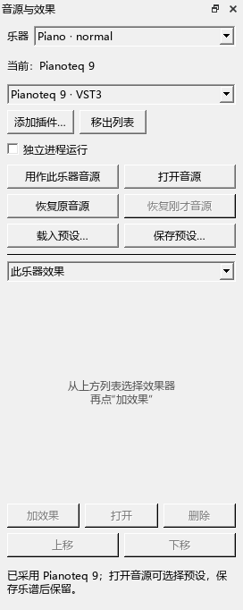
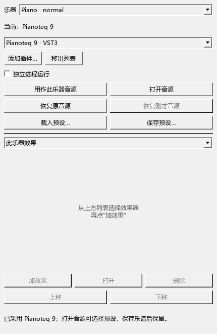

# 在乐谱里使用 VST 音源与效果

本文保留0.69.0的操作记录。当前按钮、效果预设和参数窗口见[最新版使用说明](VST_088_GUIDE.md)。入口在“视图 → 音源与效果（VST）”，也可以点编曲工具栏的推子图标，或混音器里的“音源与效果…”。这几个入口打开同一个面板。

## 第一次用 Pianoteq 播放一件乐器

1. 打开乐谱和“音源与效果”，在最上面的“乐器”中选择钢琴。
2. 点“添加插件…”，选中安装好的 `Pianoteq 9.vst3`。扫描完成后，列表中会出现 `Pianoteq 9 · VST3`。
3. 选中它，点“用作此乐器音源”。“当前”一行随即显示采用的音源。
4. 点“打开音源”，在 Pianoteq 自己的窗口里选钢琴和预设。这个窗口可以留在旁边，主窗口继续可操作。
5. 回到谱面点音符试音，再用空格播放乐谱。
6. 保存乐谱。重新打开后会恢复音源与预设；`Ctrl+Z` 可以撤销刚才的音源更换。

Pianoteq 的常见位置是 `C:\Program Files\Common Files\VST3\Pianoteq 9\Pianoteq 9.vst3`。VST2 选择 x64 的 `.dll` 文件。

## 使用 CFX

添加 `CFX Concert Grand VST_x64.dll`，再点“用作此乐器音源”。CFX 新实例可能打开空音色槽；接着需要选择一份钢琴预设。

- 点“打开音源”，从 CFX 界面中载入钢琴。
- 或点“载入预设…”，选择 CFX 安装目录中的 `.ariax`，例如 `Presets\com.Plogue.Aria\02- Compact\Player\00_Default.ariax`。

这台电脑的插件在 `E:\music_fonts\CFX Concert Grand\VST\CFX Concert Grand VST_x64.dll`。载入预设后，点谱面音符即可检查声音。

## 给乐器添加效果

1. 点“添加插件…”，选一个 VST 效果器。
2. 在“乐器”中选择要处理的乐器，效果范围选“此乐器效果”。
3. 在插件列表中选择效果器，点“加效果”。列表从上到下依次处理声音。
4. 选中一行，点“打开”调参数；用“上移／下移”换顺序。
5. 取消这一行的勾选可以旁通，再勾选恢复。点“删除”移走效果，`Ctrl+Z` 可以恢复。

SF2 乐器也能单独加效果。软件会为这件乐器建立独立发声实例，沿用原音色、音量与声像。要处理整首谱的合成器输出，把效果范围改为“主输出效果”。原曲参考音频仍由它自己的面板控制。

不同乐器分别选择音源。通过混音器选用另一件乐器已载入的 VST 时，会复制它的预设，音量、踏板和效果随后分别控制。

## 换回原音源与恢复

“恢复原音源”换回这件乐器添加 VST 前的音源与音色。面板会释放刚才的实例；“恢复刚才音源”可重新载入它的预设和效果。两种操作都支持 `Ctrl+Z`。

“移出列表”管理扫描列表。以后可以通过“添加插件…”再次加入这份插件。

## 预设、保存和导出

“保存预设…”导出当前音源的一份 JSON 预设。“载入预设…”可以读回这份文件；VST2 还可读带声音数据的 `.fxp／.fxb`，CFX 可读 `.ariax`。

保存 MSCZ 时会保存音源身份、预设、效果顺序和旁通设置。插件本体与大型音色库继续使用本机安装位置。移动了插件后，重新添加新位置并为乐器选择它即可。

音频导出使用当前预设和效果。MIDI 导出保留原乐器的通用音色编号，继续用于熟悉的播放器和 DAW。普通 MuseScore 可以打开完整乐谱；在本分支关闭个人扩展时，VST 声部用 SF2 播放，原 VST 设置随谱保留。

## 直接运行与独立进程

默认直接运行，适合低延迟键盘弹奏。“独立进程运行”在下次选择音源或加效果时生效，每个实例由辅助程序单独运行。

独立运行额外缓冲 512 个采样，44.1 kHz 下约 11.6 毫秒。软件会补齐各乐器之间的处理延迟；离线导出采用离线处理方式。辅助进程退出时，面板显示原因，重新选择这份音源可以载入。

随包的 `MuseScoreVstHost.exe` 与主程序放在同一个 `bin` 目录，负责扫描和独立运行。分享程序时一起保留它。

## 面板摆放与排查

拖标题栏可停靠到底部或侧边，也可以悬浮；再次打开会恢复工作区保存的位置。关闭面板后，已选音源继续播放。

| 遇到的情况 | 接着这样操作 |
|---|---|
| 找不到刚安装的音源 | 点“添加插件…”选实际的 `.vst3` 或 x64 `.dll` |
| CFX 显示已采用，点音符还没声音 | 打开音源选择钢琴，或载入 `.ariax` |
| 插件文件移动了 | 重新添加新文件，再点“用作此乐器音源” |
| 扫描未完成 | 面板会显示具体原因；检查该插件自己的程序能否打开 |
| 想暂时绕过某个效果 | 取消效果行前的勾选 |
| 找不到面板 | 从“视图 → 音源与效果（VST）”重新打开 |

提交定位：`personal-v0.69.0`。实际检查与开发记录见 [本版交付记录](WORKSPACE_069_DELIVERY.md)。
