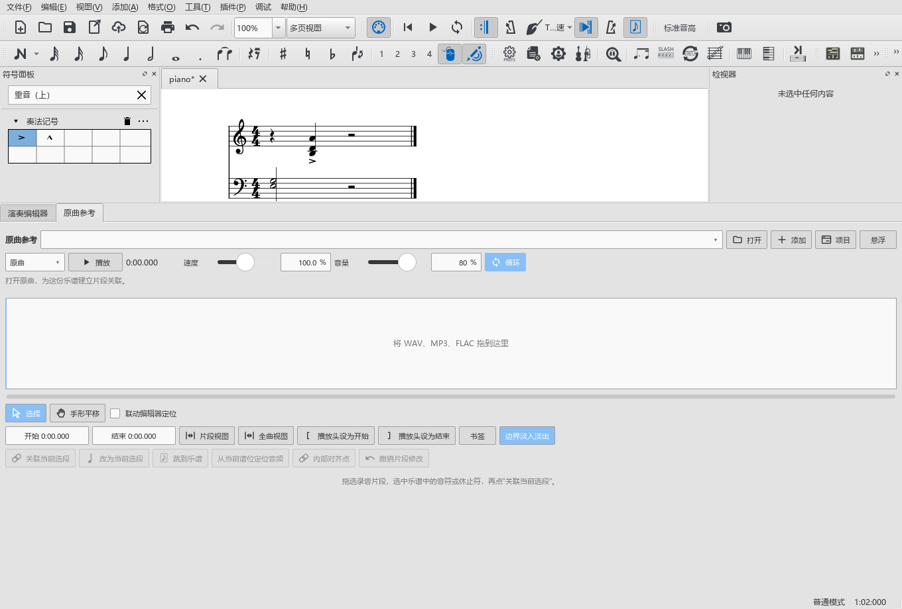

# 工作视图与面板鼠标响应检查

对应0.93.0。使用正常显示大小、独立设置和项目钢琴谱，用户谱与原设置保持只读。

## 原因与本次调整

- 编辑器的时间尺定位、框选和平移使用鼠标占用。此前开始播放只清理参数拖动，留下的定位／框选仍占着鼠标，原曲参考和符号面板都会收不到点击。按住时间尺后启动播放已复现：播放已经开始，鼠标仍被时间尺占用。本次将播放开始、结束及鼠标意外转交时的清理补齐；编辑器画布之间正常转交鼠标继续保留。

- 原先只额外保存编辑器高度，左右侧栏依赖Qt整体布局。现在保存实际可见标签组的宽度，恢复时先显示目标中央谱面，再恢复两侧与编辑器。
- 首次进入雕版、后处理原本继承当前DAW布局。在DAW里打开两侧后，出现左侧1150、右侧81、中央127像素的布局。本次改为从编曲摆放开始；已有视图继续读自己的设置。
- 停播原本依赖各谱窗接收当前声音系统的停止信号。用先建立的谱窗和后建立的声音系统操作，停止通知已发出，主窗口与谱窗仍为播放状态8192，符号面板保持禁用。本次由主窗口同步当前谱窗，停播后恢复为普通状态2。

用户反馈的偶发操作顺序仍需结合日常使用继续追踪；这里分别写出本轮确实查到的路径和实际检查。

## 尺寸与点击

- 1360×920窗口，编曲左240、右290、中央828像素。经过DAW、雕版、后处理再返回三次，三处宽度保持；快速连续切换后继续核对相同宽度。
- 在DAW中重新打开两侧，再进入雕版、后处理时恢复240、290、828。各模式已保存的摆放继续保留。
- 手动停止、工具结束播放、整段自然播完后，符号面板与QML内容均恢复可用；鼠标抓取和模态窗口为空。实际单击展开／收起符号组。
- 搜索真实的重音记号，选中谱中音符并单击应用；发音符号数从0变1，撤销为0、重做为1。搜索结果与实际谱面一起截图。
- 播放中打开编辑器、演奏表达、原曲参考，并在DAW中播到结束，返回编曲后继续应用符号。
- 在时间尺按下尚未松开时启动播放，鼠标占用解除；停止后实际悬浮并单击符号，单击原曲参考的循环按钮并读回改变后的状态。原录音材料保持原样。

## 操作检查结果

| 检查内容 | 结果与记录 |
|---|---|
| 本批尺寸、鼠标操作与版本 | 3项通过；`workspace-093-final-pluginhost.txt` |
| 标签组高度、区域比例、首次雕版、快速切页、浮动全屏及表达页高度 | 6项通过；`workspace-093-layout-regression-pluginhost.txt` |
| 原有用户布局副本首次打开 | 复制60项设置，卷帘328像素、参数区201像素，首次显示均可见；`workspace-093-user-layout-pluginhost.txt` |
| 正常拖动、独立区域定位、重叠选音、实际演奏器生命周期、表达拖动采用、原曲重复播放、独立摘要与空格 | 7项通过；`workspace-093-editor-regression-performanceeditor-run.txt` |

鼠标占用的修改前后记录分别为`palette-reference-093-grab-before-pluginhost.txt`与`workspace-093-final-pluginhost.txt`。前者在播放开始后仍由时间尺占用鼠标处失败；后者释放鼠标，并完成符号应用、撤销重做及原曲循环按钮的实际点击。

以上使用原生Qt窗口、鼠标事件和实际控件检查，未操作用户正在编辑的乐谱。截图已查看两侧宽度、实际符号和原曲面板；音频输出继续沿用原有路径。

## 检查过程中的调整

首次测试程序使用尚未初始化的符号工作区，已补齐初始化；随后增加真正的符号应用和撤销，避免只检查enabled值。初次创建符号素材时有QPainter警告，原日志保留；本轮查看实际QML图像、点击与保存对象，并继续检查正式程序。

一次旧代码对照构建把仅供测试的编译选项用于应用库，触发了不必要的重编译，已结束该任务并恢复源文件。该次构建结果未用于交付判断。

操作步骤见[工作视图与面板操作](WORKSPACE_093_GUIDE.md)，剩余顺序见[完整计划](REWORK_PROGRESS.md)。
