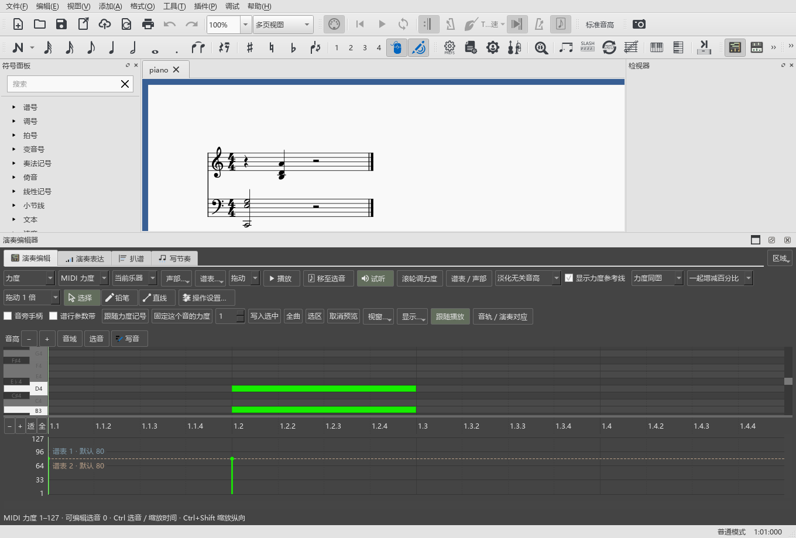
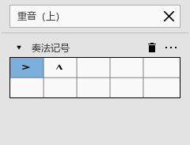

# 切换视图与继续使用各面板

对应个人版本0.93.0 · Kumo branch / Freddd13。

## 调好侧栏，再切换工作

1. 进入“编曲”，打开需要的符号面板、检视器或其它工具。
2. 拖侧栏边缘调整宽度，拖编辑器上边缘调整高度。
3. 使用“工作视图”切到DAW、雕版或后处理，再返回编曲。
4. 两侧和编辑器分别恢复这次调好的尺寸。若几个工具并列为标签页，它们共用的区域一起恢复。

每种视图保留自己的摆放。第一次进入雕版、后处理时，先沿用编曲的面板位置，再按该视图安排工具。已经保存过的视图继续恢复原设置。

窗口变窄时面板按可用空间调整；回到日常大小后，可以继续拖边缘确定喜欢的比例。切换视图会保存这次摆放。

## 在编辑器与原曲参考之间继续操作

在时间尺定位、框选或调节参数时按空格开始播放，编辑器会结束尚未完成的拖动并归还鼠标。播放停止后，可以直接点原曲参考的播放、循环、速度等控件，也可以回到符号面板添加记号。

## 停止播放后添加符号

1. 选中一个音，播放后停止；也可以让片段播放到结尾。
2. 返回符号面板，展开需要的组，或在搜索框中找记号。
3. 单击需要的记号，将它加到所选音上。
4. 用Ctrl+Z撤销，Ctrl+Shift+Z重做；Ctrl+S保存乐谱。

从演奏编辑器、演奏表达或原曲参考返回，也按这套操作继续编辑。停止播放时，主窗口与当前谱窗会一起恢复编辑状态。

其它窗口操作见[面板组合与高度](WINDOWS_089_GUIDE.md)；四种视图、区域拆分与放回见[工作视图和工具页](LAYOUT_079_GUIDE.md)。
