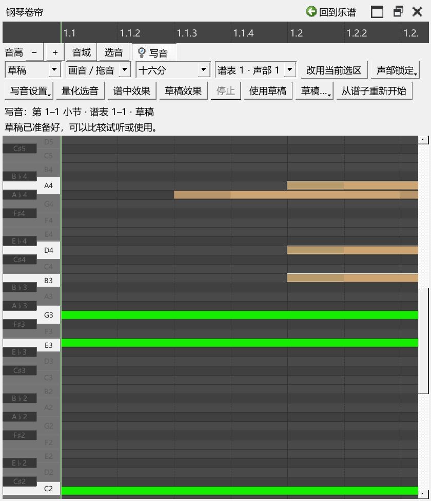
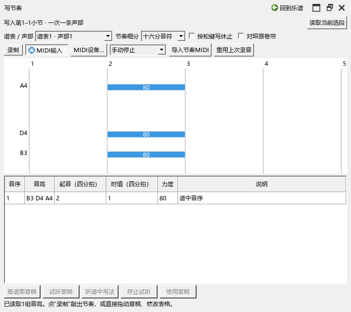

# 0.87.0 卷帘草稿与写节奏检查

独立测试谱、录音、导出事件和截图放在E盘。下面记录已执行的操作；用户乐谱和个人设置保留。

## 操作和结果

| 操作 | 结果 |
|---|---|
| 画草稿，保存，换谱，再打开草稿，继续复制并保存 | 重新读取的草稿音符与保存内容一致；继续编辑期间谱面原音符保留 |
| 使用草稿、撤销采用、删除当前草稿、Ctrl+Z恢复 | 每次采用与删除各进入一次乐谱撤销；恢复后音符和按钮一起更新 |
| 第3小节分别试听卷帘、节奏草稿并切换原写法 | 首次起点3840 tick；切换保持当前拍位，停止与自然结束更新按钮；原谱内容和撤销位置保留 |
| 改音长、撤销重做，再改力度、采用、再次修改与采用 | 休止保持正确；两个采用各为一次撤销，保存重开读回音长和力度一致 |
| 延音与和弦内不同力度，单独修改另一组音的力度 | 保留各音延音、相对／绝对保存方式及数值；实际MIDI起音、松手事件除目标力度外逐项一致 |
| 录四次任意音高的敲击、拖起音、采用、保存和重开 | 目标音高、100%录入力度、指法、移谱表、调律、连线及原力度恢复记录一起保存 |
| 320、720、1200宽度，移出工具、放回及退出程序 | 控件按实际宽度换行，内容可调高度，普通编辑器保留导航；组合关闭完成 |

## 本轮找到并修正的问题

原节奏草稿会填掉部分休止、截短最后的延音，并将原三连音吸到普通网格。现在从完整逐音时值建立草稿，按每个音的开始和结束位置整理休止与延音。

采用后原先继续使用旧音符资料；现在读取实际写入的结果再继续编辑。刚提交表格就点采用的操作也会接着执行。浮动卷帘中的撤销与删除恢复已经用实际按键检查。

多个独立工具轮换后退出时，录制对象的结束通知可能刷新已在销毁的节奏面板。关闭时先断开本页连接并结束任务；同一组开关及退出步骤重新检查通过。

## 检查文件

| 检查组 | 通过／失败 | 记录 |
|---|---|---|
| 草稿保存、试听、连续采用、实际MIDI值 | 7／0 | writing-087-release-checked-performanceeditor-run.txt |
| 150%窗口与同一套鼠标、按键操作 | 7／0 | writing-087-dpi150-performanceeditor-run.txt |
| 录制、三连音、窄面板、导航、独立工具与退出 | 8／0 | writing-087-close-pluginhost.txt |
| 频谱整条录音、片段与编辑器共同缩放 | 4／0 | writing-087-spectrum-pluginhost.txt |
| 原有节奏规则 | 14／0 | PerformanceExpression/tests/test-rhythm.cjs |
| 原休止、延音、短音、三连音及各音保持 | 7／0 | PerformanceExpression/tests/test-rhythm-preservation.cjs |

各原生组包含准备和结束。使用原生窗口及Qt鼠标、键盘事件；录制检查向实际输入入口发送带时间的MIDI事件，试听经过实际演奏顺序及合成器事件输出。检查保存文件和MIDI事件，本轮没有重新录制实体键盘或声卡听感。

原有QML Connections提示、准备副本时的UndoStack提示及模拟合成器空效果提示继续保存在日志中。已经核对相应源谱、撤销位置和输出事件。

发布定位：personal-v0.87.0。
