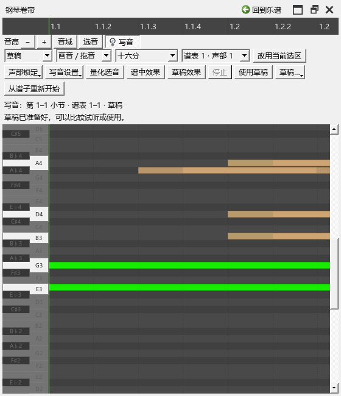
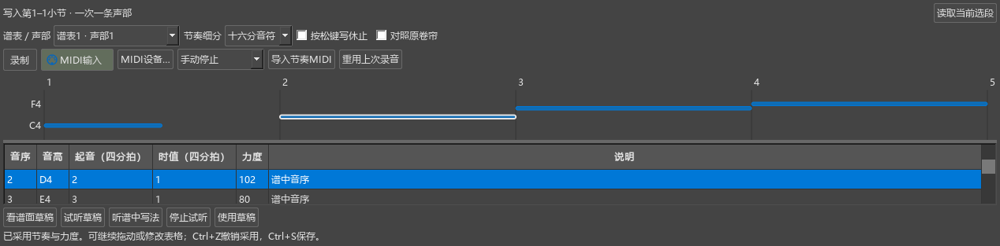

# 卷帘草稿与写节奏

版本：0.104.0 · Kumo branch / Freddd13。

## 在卷帘里试写，再继续修改

1. 选中要写的小节，打开“视图 → 演奏编辑器”，点卷帘左上的“写音”。
2. 选“草稿”，确定谱表、声部和网格。在空白处向右拖动加音；拖音条移动，拖右端改长度，选中后按Delete删音。
3. 点“谱中效果”或“草稿效果”比较。试听从这段的起点开始；播放中切换保留当前拍位。点“停止”，或开始编辑，继续调整。
4. 按Ctrl+S保存。重开乐谱后，在“草稿…”选择对应的小节，就能接着写。Ctrl+A选择允许编辑的音，Ctrl+D向后复制一个网格。
5. 点“使用草稿”写进乐谱。Ctrl+Z恢复采用前的谱子和草稿。
6. 想去掉这段草稿时，打开“草稿… → 删除当前草稿”。Ctrl+Z恢复删除；再次保存会记住当前保留的草稿。

“从谱子重新开始”将当前草稿改回谱中写法。工具按文字所需宽度排列，窄窗自动分行；卷帘、工具和时间尺可以一起悬浮。浮窗中的Ctrl+Z、Ctrl+Y也可撤销、重做。

直接写谱、声部锁定、复制、量化和演奏细节见[卷帘写音](WORKSPACE_067_GUIDE.md)。

## 给已有音高换节奏

假设谱上已有C4、D4、E4、F4，想保留音高，重新安排起音和轻重：

1. 在谱上选这些音所在的小节，打开演奏编辑器的“写节奏”。顶部显示将写入的小节，下面选择谱表和声部。
2. 草稿先显示谱中写法。原休止、延音和连音组继续保留；一个和弦中各音自己的音长、力度也保留。表格的“时值”直接显示实际拍数。
3. 可以直接拖音条、拖右端，或在表格修改起音、时值和力度。起音从选段第1拍计算；时值1代表四分音符，0.5代表八分音符。时值填0，让软件根据下一次起音计算长度。
4. 点击一行，草稿和谱面强调对应音。一个和弦各音长度不同时，“说明”会提示；将鼠标放到时值或力度格可查看各音的值。修改力度格会一起调整这一组。
5. 点“试听草稿”和“听谱中写法”比较。按钮会显示正在听哪一版；切换保留拍位。“停止试听”结束播放。
6. 点“使用草稿”，将这一条声部写入乐谱。刚改完表格时也可直接点，软件整理完这次修改后继续采用。
7. 采用后仍可继续拖动、修改和再次采用。Ctrl+S保存；重开后，谱面使用最后保存的写法。

## 用MIDI键盘敲节奏

1. 按上面的步骤选好小节和声部。
2. 在本页打开“MIDI输入”。“MIDI设备…”可选择输入设备。
3. 点“录制”，用任意琴键敲出起音和力度，再点“停止录制”。也可选择弹完音序后停止，或按秒数停止。
4. 录完后草稿和表格自动更新，显示音名、拍位、音长与力度。漏敲处显示估计位置；点“修改对应…”可按音名重新选择，多敲的音可点“忽略敲击”。
5. 继续拖动和修改，试听后点“使用草稿”。录入的力度按100%采用，写成逐音固定力度。

“按松键写休止”开启后，将松键后的空隙写成休止。关闭时延续至下一个起音，最后一音使用原音长。

“导入节奏MIDI”走同一套修改、试听和采用操作。采用后的录音资料随谱保存，“重用上次录音”可以取回继续试写。录音文件默认放在E:/MuseScoreCache/recordings。

## 改正漏敲、多敲和对应位置

以C4、D4、E4、F4四组音为例，录制时少敲了一次：

1. 录完后看表格“说明”列，漏敲处写着“漏敲，按前后估计”。点击这一行，谱面和草稿同时指出相关音。
2. 点“修改对应…”，或双击“音序”格。列表显示音名和原谱拍位，例如“3 · E4 · 原谱第3拍”。选择这一行应该使用的音或和弦组。
3. 如果估计的位置已经合适，直接选择当前这一项，便记住这次人工校正。还可以拖动音条或编辑起音、时值。
4. 录多的一次，选中后点“忽略敲击”。这行会变淡并显示“已忽略这次敲击”；原始录音继续保留。Ctrl+Z恢复这次忽略。
5. 点“试听草稿”检查，再点“使用草稿”，把当前节奏与力度写入目标声部。采用后可以接着修改，Ctrl+Z撤销采用，Ctrl+S保存。

一次选择、一次忽略各对应一次撤销。关闭选择列表可继续浏览；列表中的“跳过这次敲击”与忽略按钮作用相同。已经采用的录音和人工对应随谱保存，重开后用“重用上次录音”继续调整。

## 保存与撤销

草稿中的一次拖动或一次表格修改可用Ctrl+Z撤销，Ctrl+Y重做。按Esc可取消正在拖动的内容。

点“使用草稿”后，这次采用进入乐谱的撤销记录；Ctrl+Z恢复采用前的乐谱，Ctrl+Y重做。后续再调整草稿时，先撤销最近的草稿修改，再继续撤销采用。

试听保留谱中的音符和演奏设置。采用会更新目标声部，并保留随音高材料移动的指法、分手和连线。更换写入范围用“读取当前选段”，顶部会显示新的小节范围。
