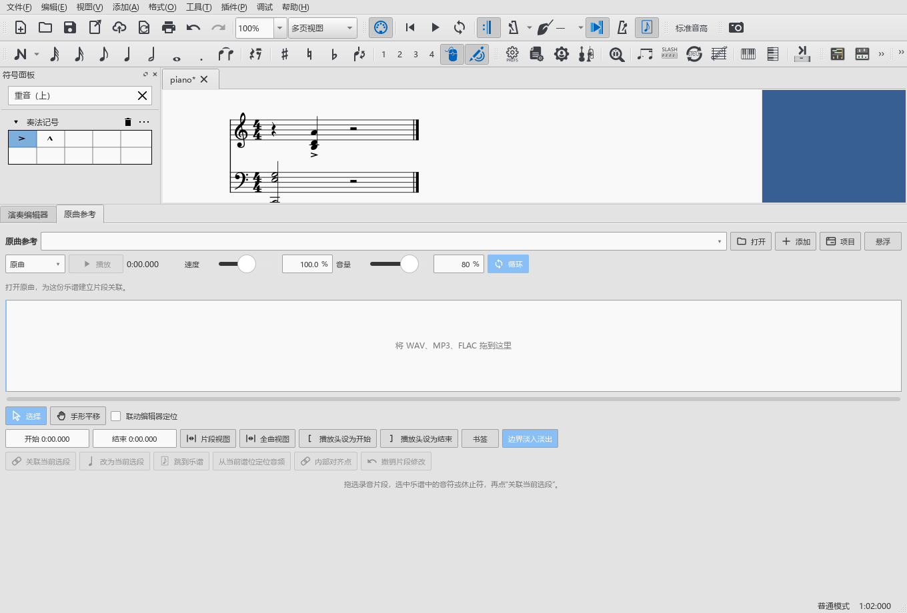
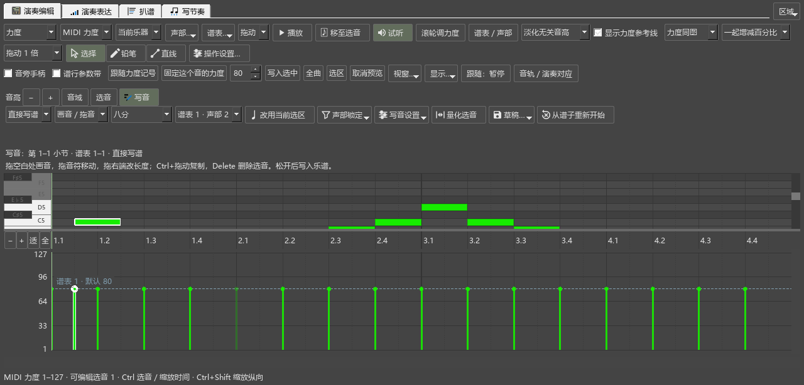

# 写音中断、面板点击与跨小节延音

对应0.103.0，接续B4写谱；本批优先补查用户反馈的符号面板、原曲参考共同点不动。

## 实际查到的原因

时间尺手势的中断已在0.93修过，本次增加卷帘写音检查，复现了另一条遗漏：按住音条开始播放，写音画布仍占着鼠标。记录`input-103-before-pluginhost.txt`在鼠标占用检查处失败。

现在播放开始、切换窗口或鼠标转交时取消未完成的写音。正常松开鼠标时，先结束手势再归还鼠标，继续完成这次写入。

## 面板与拖动

- 手动停止、工具停止、整段自然播完，以及按住时间尺／写音画布后启动播放，分别检查鼠标占用解除。
- 每次停播并往返工作视图后，实际点击展开／收起符号组，再点击原曲参考的循环按钮，读取改变后的循环状态。
- 搜索并添加实际重音记号，撤销、重做，核对谱中发音符号数量。两侧宽度连续往返另行检查。
- 写音中切换窗口、让其它窗口取得鼠标、应用程序失去活动状态，均恢复拖动前的音符；随后正常拖画仍可写入，保持一次手势一次撤销。

## 跨小节延音

原先范围里有延音连到外面时，整个写音工具会停止读取。先在第一小节末音连到第二小节的谱例复现，记录`writing-103-before-performanceeditor-run.txt`。

现在范围里显示该段涉及的音，原生写入继续保留范围外的连接。分别操作：

1. 第一小节有向后延音，在声部2实际拖画一个音。原声部的全部音、延音和播放事件一致；新增音为C5，起点240、长度480 tick。
2. 第二小节两端分别有进入与离开的延音，在同一声部把中间A4移为B♭4。两端延音保留，原固定力度91保留；范围外内容一致，实际MIDI只改变目标音高。
3. 两种操作各自保存MSCZ并重新读取，再撤销、重做，核对真实音符和播放事件。

测试使用独立项目谱与原生Qt窗口，鼠标点击和拖动经过实际控件。用户原谱及官谱保持原样。

## 记录与后续

| 检查内容 | 结果 | 文件 |
|---|---|---|
| 共同鼠标点击、两侧宽度、正常写音、复制、量化整理及后台取消 | 7项操作，加准备、结束共9项通过 | `input-103-release-pluginhost.txt` |
| 延音边界、窗口中断、草稿恢复、同处试听、连续采用、原属性及原曲重播 | 8项操作，加准备、结束共10项通过 | `writing-103-release-checked-performanceeditor-run.txt` |
| 原有鼠标编辑、选音、框选和时间尺定位 | 2项操作，加准备、结束共4项通过 | `input-103-original-performanceeditor-run.txt` |

旧的选音检查使用前一项建立的谱和窗口；本轮已按完整顺序重新运行。保留首次单独追加该项时的失败记录`writing-103-release-performanceeditor-run.txt`。编译警告、旧的QML连接提示和演奏准备日志保留在各原始记录中。

B4继续交叠声部、量化和草稿的连续使用；B5音源／踏板、C—F保持原顺序。

操作见[卷帘写音](WORKSPACE_067_GUIDE.md)、[停播后继续使用面板](WORKSPACE_093_GUIDE.md)。全部任务见[进度与完整计划](REWORK_PROGRESS.md)。

发布定位：`personal-v0.103.0`。
