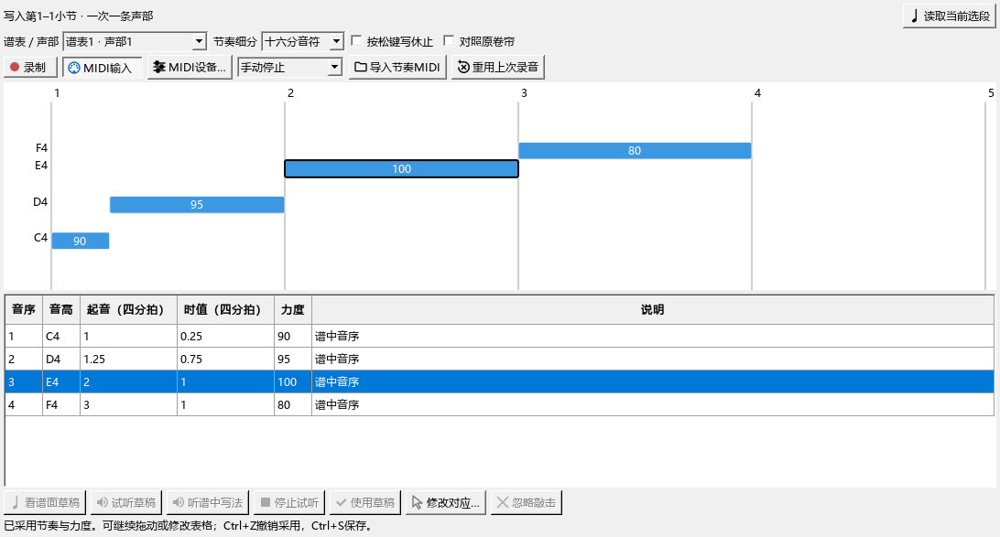
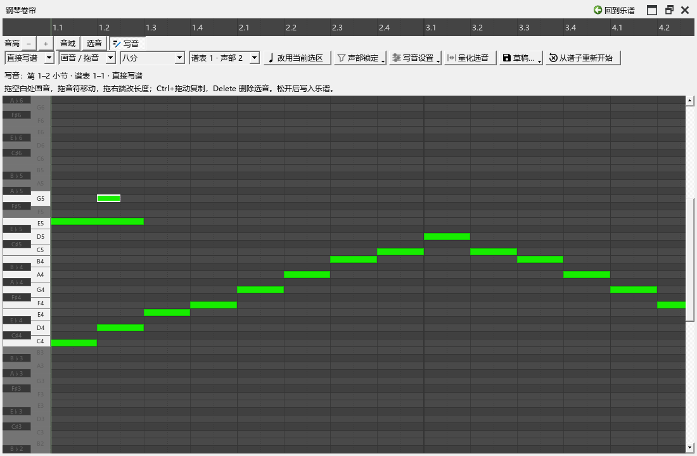

# 交叠写音、量化与录后校正检查

对应0.104.0，接续B4。使用独立钢琴谱和E盘录音目录，原有用户资料保持原样。

## 找到并修正的问题

第1声部已有音时，在半拍位置画一颗跨拍音，新音按设置分到声部2。原实现同时重写声部1，检查中原对象与内容摘要改变，记录为`writing-104-gestures-performanceeditor-run.txt`。

现在分配后再确认哪些声部确实有变化，并保留读取时的缺省属性。检查原声部对象、各音属性、实际MIDI和保存重开结果。

写节奏原来用数字输入修改音序。现在可以按音名和原谱拍位选择，支持明确选定当前估计、忽略一次敲击和撤销。忽略后键盘焦点留在表格，浮窗Ctrl+Z可恢复。

## 连续操作

| 操作 | 核对内容 |
|---|---|
| 自动分声部，锁定其余声部，再解锁重试 | 新音在声部2；无可用声部时保留原内容；解锁声部4后可继续画音。原声部的对象、属性和MIDI一致 |
| 同一声部写两颗不同长度的交叠音 | E5保持至960 tick，G5只在480—720发声，内部延音正确。一次撤销移除第二音，重做后恢复 |
| 连画三颗八分三连音，再画跨小节长音 | 三连音各160 tick；长音1680—2160，跨小节由延音连接 |
| 用四分网格量化跨小节音 | 改为1920—2400，MIDI起止一致；原三连音保留。撤销和重做恢复对应起止 |
| 三次计时输入对应四组音，选择估计位置、忽略再撤销 | 列表显示具体音名和原谱拍位；每次操作各一次撤销，采用后保留四组给定音高 |
| 保存MSCZ、重开及继续使用 | 核对真实音符、演奏事件与人工校正资料 |

输入检查通过原生MIDI入口发送带单调时间的音符，录音实际写成MIDI后再读取。实体键盘、驱动与声卡听感继续随B5／F检查。

## 图片和最终记录

| 检查组 | 结果 | 文件 |
|---|---|---|
| 本批四项流程、延音边界、原草稿、节奏试听／采用及原曲重播 | 12项操作，加准备、结束共14项通过 | `writing-104-release-checked-performanceeditor-run.txt` |
| 面板点击、两侧宽度、原生写音／复制、量化、后台取消、录制和窄面板 | 10项操作，加准备、结束共12项通过 | `writing-104-native-ui-pluginhost.txt` |
| 节奏对应规则 | 14项通过 | `writing-104-rhythm-rules.txt` |
| 原休止、延音和各音时长保留 | 7项通过 | `writing-104-rhythm-preservation.txt` |

采用后重新打开MSCZ，实际点“重用上次录音”，人工对应继续保留。恢复资料时，乐谱保存状态与撤销位置保持一致。

一万音的受影响范围整理约69.7ms；后台计算与取消检查继续通过。窗口、选择与指法等旧记录中的QML提示、演奏准备日志保留在输出中。

最初的测试用和弦对象建立选区，已按真实选音方式修正；菜单等展开后实际点击。组合检查时，测试恢复自己改变的声部设置，并按卷帘当前可见高度滚动到目标音。相关失败记录保留，未作为交付结果。

操作和图片按实际正常窗口检查。

B4软件操作在本批整理，实体录入仍与B5共同检查。之后按B5音源与踏板、C音乐判断、D记谱、E AI与分享、F完整编曲过程推进。

操作见[卷帘写音](WORKSPACE_067_GUIDE.md)和[录后校正](WRITING_087_GUIDE.md#改正漏敲多敲和对应位置)。发布定位：`personal-v0.104.0`。
